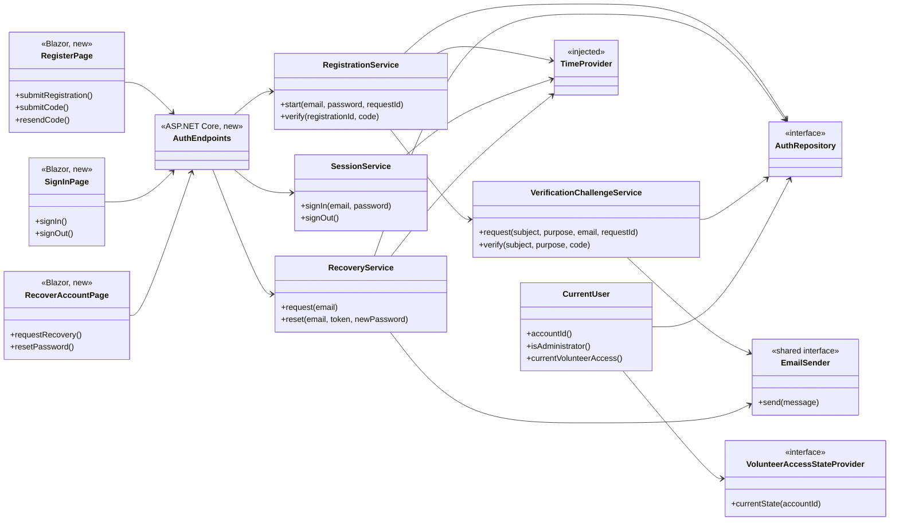
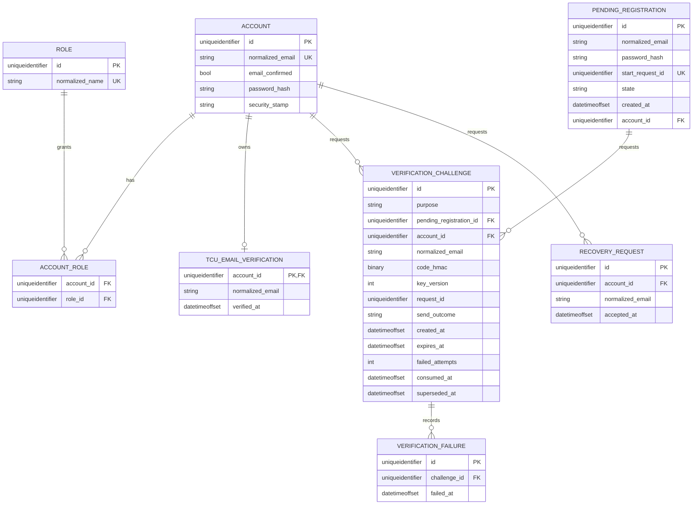

# Authentication Design

**Project:** ReFrog
**Team:** Team 3
**Area:** `AUTH`

> **Realizes:** `UC-AUTH-register-account`, `UC-AUTH-sign-in`, `UC-AUTH-recover-account`, `FR-AUTH-account-signup`, `FR-AUTH-password-policy`, `FR-AUTH-session-policy`, `FR-AUTH-password-recovery`, and the shared machinery required by `FR-AUTH-verification-code` and `FR-AUTH-verification-limits`
> **Depends on:** `BR-tcu-email-domain`, `FR-AUTH-enforce-permissions`, `FR-AUTH-verification-code`, `FR-AUTH-verification-limits`, `FR-AUTH-verification-ownership`, `FR-AUTH-volunteer-role`, `FR-AUTH-volunteer-lifecycle`, `FR-VAL-server-validation`, `FR-VAL-field-feedback`, `FR-VAL-preserve-input`, `FR-SAVE-confirmed-success`, `FR-SAVE-unknown-outcome`, `ROB-external-service-failure`, `SEC-audit-log`, `SEC-authentication-provider`, `SEC-session-expiration`, `SEC-transport-encryption`, `KD-own-accounts`, and `KD-tcu-it-stack`
> **See:** [Use cases](../requirements/use-cases.md#area-authentication-auth), [Specification](../requirements/software-requirements-specification.md), [Glossary](../requirements/project-glossary.md), and [Architecture of record](architectural-design.md) (§5.2, §8, §9.2)
> **Designed against:** `main` at `a00d249` plus the Authentication security decisions recorded in issue #79. No application code exists yet; every implementation element below is new.

---

## Overview

Authentication owns ReFrog account registration, sign-in, sign-out, password recovery, stable account identity, administrator recognition, trusted current-user state, shared email-verification challenges, and persisted TCU email verification. It is the `AUTH` area of the one ASP.NET Core Application and supplies pages to the hosted Blazor WebAssembly PWA (`KD-tcu-it-stack`, `KD-deployment-shape`). It uses ASP.NET Core Identity for password hashing, security stamps, roles, reset tokens, and cookie authentication; EF Core repositories isolate Microsoft SQL Server details behind application interfaces (`MNT-data-access-abstraction`). Authentication sends registration, affiliation-verification, and recovery messages only through the shared provider-neutral email adapter. IDV reads Authentication's persisted TCU verification and trusted access state, but continues to own shopping-eligibility decisions.

## Components and classes



- `src/Frontend/ReFrog.Client/Features/Authentication/RegisterPage.razor` (new): registration, code entry, resend timing, field feedback, and preserved valid input.
- `src/Frontend/ReFrog.Client/Features/Authentication/SignInPage.razor` (new): sign-in, safe credential failure, unavailable retry, and return-path handling. Sign-out is exposed from the authenticated account navigation.
- `src/Frontend/ReFrog.Client/Features/Authentication/RecoverAccountPage.razor` and `ResetPasswordPage.razor` (new): recovery acknowledgement and reset-token completion without account enumeration.
- `src/Backend/ReFrog.Server/Features/Authentication/AuthEndpoints.cs` (new): maps the API contract below to services. It never accepts an account ID, role, verification status, or administrator flag from the browser.
- `RegistrationService` (new): validates registration, hashes the pending password, coordinates registration challenges, creates the Identity account only after successful code verification, and creates TCU verification for an exact `tcu.edu` registration email in the same transaction.
- `SessionService` (new): validates credentials through ASP.NET Core Identity, applies lockout, issues the correct cookie lifetime, signs out, and records administrator sign-in attempts.
- `RecoveryService` (new): returns the same acknowledgement for all recovery requests, applies recovery request limits, issues a 30-minute Identity reset token for existing accounts, resets the password, and rotates the security stamp.
- `VerificationChallengeService` (new, owned by AUTH): the only implementation of six-digit email-code generation, HMAC verification, key versions, expiry, resend invalidation, attempt limits, request limits, idempotent send actions, and delivery outcomes. It supports `ACCOUNT_REGISTRATION` and `TCU_AFFILIATION` purposes.
- `ICurrentUser` / `CurrentUser` (new): derives the stable account ID and administrator role only from the validated server principal and current database state. It asks `IVolunteerAccessStateProvider` for `ROLE_ACTIVE`, `NONE`, `RESTRICTED`, or unavailable; it never trusts browser claims for current authorization.
- `IVolunteerAccessStateProvider` (new seam): the initial implementation returns `NONE` for an ordinary account. The future volunteer/administration implementation supplies current event-scoped state. Failures propagate as unavailable rather than `NONE`.
- `IAuthRepository` and EF Core implementation (new): own AUTH persistence and hide SQL Server/Identity storage details from services.
- `IEmailSender` (shared interface, new if no earlier area creates it): provider-neutral; Microsoft 365 Outlook delivery uses a Microsoft Graph adapter when configured. Verification codes and reset links are email-only and are never placed in the in-app inbox.
- .NET `TimeProvider` (injected): the only source of current time for codes, rolling limits, reset expiry, cookie/session boundaries, and tests.

**Registration build note (issue #79).** The repository layout is `src/Frontend` and `src/Backend`. In the first registration increment, `RegistrationCode` owns code generation and versioned HMAC checks, while `EfAuthRepository` enforces challenge limits and completion inside SQL Server transactions. The separate shared `VerificationChallengeService` shown above is not yet present; IDV must reuse one AUTH-owned implementation when its flow is built. The user selected a Microsoft 365 work or school Outlook mailbox on 2026-11-06; `MicrosoftGraphEmailSender` sends through Graph with application credentials from deployment configuration, while an unconfigured deployment reports delivery unavailable. Graph's `202` means accepted for processing, not delivered. Registration issues the administrator session when bootstrap assigns that role, as clarified for `UC-AUTH-register-account` step 8.

## Shared API envelope

AUTH establishes the architecture §8.2.3 envelope used by every area:

```text
ApiResponse<T> = {
  data: T | null,
  error: {
    category: VALIDATION | AUTHORIZATION | UNAVAILABLE | UNEXPECTED,
    code: stable machine-readable code,
    message: safe user-facing text,
    fields: { fieldName: message } | null,
    retryAt: ISO-8601 timestamp | null
  } | null
}
```

Exactly one of `data` or `error` is non-null. Timestamps are ISO-8601 instants; the Blazor client displays them in `America/Chicago`. Unexpected failures use a correlation identifier in server logs but return no stack trace, connection detail, credential, email, code, token, or personal data.

## API contract

| Operation | Caller/access | Request | Success | Errors |
|---|---|---|---|---|
| `POST /api/v1/auth/registrations` | Signed-out browser | `email`, `password`, client-generated `requestId` | `202`: opaque `registrationId`, `expiresAt`, `resendAvailableAt` after provider acceptance. Retrying the same request returns the stored outcome and never creates another pending registration or send | `422 VALIDATION_FAILED`; `409 EMAIL_ALREADY_REGISTERED`; reused request ID with changed input: `409 REQUEST_ID_REUSED`; `429 TOO_MANY_REQUESTS` with `retryAt`; `503 EMAIL_NOT_SENT`; `503 NOT_RECORDED` |
| `POST /api/v1/auth/registrations/{registrationId}/codes` | Signed-out browser continuing the same registration | client-generated `requestId` | `202`: original or new `expiresAt`, `resendAvailableAt` | `404 REGISTRATION_NOT_FOUND`; `409 REGISTRATION_COMPLETED`; `429 TOO_MANY_REQUESTS`; `503 EMAIL_NOT_SENT`; `503 NOT_RECORDED` |
| `POST /api/v1/auth/registrations/{registrationId}/verification` | Signed-out browser | six-digit `code` | `200`: account summary and authenticated cookie; `tcuEmailVerified` reflects the exact-domain registration rule | `422 VALIDATION_FAILED`, `CODE_INVALID`, or `CODE_EXPIRED`; `429 TOO_MANY_REQUESTS`; `409 REGISTRATION_COMPLETED`; `503 NOT_RECORDED` |
| `POST /api/v1/auth/session` | Signed-out browser | `email`, `password`, optional local `returnPath` | `200`: account summary and authenticated cookie | `401 INVALID_CREDENTIALS` for unknown email, wrong password, or lockout; `503 AUTHENTICATION_UNAVAILABLE` |
| `DELETE /api/v1/auth/session` | Signed-in account; antiforgery required | none | `200`: `{ signedOut: true }` in the shared envelope; current cookie invalidated | `401`; `400 ANTIFORGERY_INVALID`; `503 SIGN_OUT_UNAVAILABLE` |
| `GET /api/v1/me/session` | Signed-in account | none | `200`: account ID, display-safe email, `isAdministrator`; no password, role source, or secrets | `401`; `503 AUTHENTICATION_UNAVAILABLE` |
| `POST /api/v1/auth/recoveries` | Signed-out browser | `email` | Always `202` with the same acknowledgement. Existing accounts receive at most one accepted message per 60 seconds and five per rolling hour per destination email | Malformed request shape: `422`; unexpected server failure: safe `5xx`. Account existence and delivery outcome are never disclosed |
| `POST /api/v1/auth/password-resets` | Signed-out browser | `email`, opaque `token`, `newPassword` | `200`: password changed and prior sessions invalidated | `422 VALIDATION_FAILED` or `RESET_TOKEN_INVALID`; `503 NOT_RECORDED` |

The `returnPath` is accepted only when it is a local application path; otherwise the client returns to the account view. Public credential and recovery failures do not distinguish registered from unregistered emails except registration extension 3a, which explicitly directs an already-registered person to sign in or recover.

## Sequences

### UC-AUTH-register-account

```mermaid
sequenceDiagram
    actor U as Person
    participant UI as RegisterPage
    participant API as AuthEndpoints
    participant RS as RegistrationService
    participant VS as VerificationChallengeService
    participant DB as SQL Server
    participant E as IEmailSender

    U->>UI: Enter email and password (steps 1-2)
    UI->>API: POST registrations (steps 2-4)
    API->>RS: start(email, password, requestId)
    RS->>DB: validate uniqueness; save pending registration and password hash
    RS->>VS: request(ACCOUNT_REGISTRATION, pendingId, email, requestId)
    VS->>DB: transaction: limits, supersede prior code, insert HMAC challenge
    VS->>E: send code after commit (step 4)
    API-->>UI: 202 registrationId, expiry, resend time
    U->>UI: Enter code (step 5)
    UI->>API: POST registration verification
    API->>RS: verify(registrationId, code)
    RS->>VS: verify challenge
    VS->>DB: atomic conditional consume
    RS->>DB: transaction: create Identity account; if exact tcu.edu create TCU verification; complete pending registration
    RS-->>API: account and affiliation state (steps 6-7)
    API-->>UI: 200 and authenticated cookie (step 8)
```

Registration completion uses a SQL Server transaction. A unique normalized-email index and a unique completed-account reference prevent concurrent completion from creating two accounts. A failed account or TCU-verification write rolls back the whole completion and creates no session.

### UC-AUTH-sign-in and sign-out

```mermaid
sequenceDiagram
    actor U as Registered user
    participant UI as SignInPage
    participant API as AuthEndpoints
    participant SS as SessionService
    participant ID as ASP.NET Core Identity
    participant DB as SQL Server

    U->>UI: Enter email and password (steps 1-2)
    UI->>API: POST session
    API->>SS: signIn(email, password)
    SS->>ID: password check with lockout enabled
    ID->>DB: read account and current admin role
    alt accepted
        SS-->>API: ordinary 30-day absolute or admin 4-hour sliding cookie
        API-->>UI: 200 account summary (steps 4-5)
    else unknown, wrong, or locked
        API-->>UI: 401 INVALID_CREDENTIALS (3a)
    end
    U->>UI: Sign out (6a)
    UI->>API: DELETE session with antiforgery token
    API->>SS: signOut()
    SS-->>UI: 200 signedOut; cookie invalidated
```

Five failed sign-in attempts produce a five-minute ASP.NET Identity lockout. Unknown-email, wrong-password, and locked responses are indistinguishable. Successful sign-in resets the failed-attempt count. Successful and unsuccessful administrator sign-in attempts create the audit events required by `SEC-audit-log`; ordinary-user attempts do not create general-purpose audit records.

### UC-AUTH-recover-account

```mermaid
sequenceDiagram
    actor U as Person
    participant UI as RecoverAccountPage
    participant API as AuthEndpoints
    participant RS as RecoveryService
    participant ID as ASP.NET Core Identity
    participant DB as SQL Server
    participant E as IEmailSender

    U->>UI: Enter email (steps 1-2)
    UI->>API: POST recoveries
    API->>RS: request(email)
    RS->>DB: normalize; check rolling delivery limits; look up account
    opt account exists and limit permits
        RS->>ID: create reset token with 30-minute lifetime
        RS->>E: send reset link
        RS->>DB: record accepted recovery request without token
    end
    API-->>UI: identical 202 acknowledgement (step 3)
    U->>UI: Open link; enter new password (steps 4-5)
    UI->>API: POST password-resets
    API->>RS: reset(email, token, password)
    RS->>ID: validate one-time token and password policy
    RS->>DB: transaction: replace password hash; rotate security stamp
    API-->>UI: 200; direct to sign-in (steps 6-7)
```

Recovery requests use at least 60 seconds between accepted sends and at most five accepted sends per rolling hour per normalized destination email. Refused, unknown-account, and failed-delivery requests still receive the same public acknowledgement. Reset tokens are never stored or logged. Rotating the security stamp invalidates every earlier cookie at its next security-stamp validation.

## Key decisions

**ASP.NET Core Identity is behind AUTH interfaces.** Identity owns password hashing, role records, security stamps, lockout counters, cookies, and reset-token cryptography. Application and IDV code depend on AUTH contracts, not Identity classes or EF entities. Rejected: custom password hashing and token formats, because the requirements do not justify owning security primitives already supplied by the selected framework.

**No account exists until registration verification succeeds.** A pending registration has its own GUID, normalized email, password hash, and lifecycle state, but it is not an Identity account and cannot sign in. Completion consumes the code and creates the Identity account atomically. Rejected: creating a disabled Identity account before verification, because `FR-AUTH-account-signup` explicitly says no account exists yet.

**AUTH owns persisted TCU email verification.** Registration and the later IDV profile flow both prove control through AUTH's purpose-aware challenge service and write the same account-owned verification record. IDV reads this record and combines it with current volunteer state to decide shopping eligibility. Rejected: an AUTH↔IDV persistence cycle solely so registration can create a record.

**Administrator bootstrap is deployment configuration.** A normalized allowlist contains the approved administrator sign-in emails. After a matching email is code-verified at registration, AUTH assigns the administrator role in the account-creation transaction. Configuration contains no password, token, or other secret. Removing an address prevents new assignment but does not silently remove an existing role; role removal is an audited administrator/governance operation. Rejected: seeded passwords and unaudited manual database edits.

The allowlist is only a bootstrap source, never continuing authorization evidence. Existing administrator access is revoked through the authorized, audited role-removal workflow, and every protected operation reads current server-side role state. If that removal workflow is delivered after the first AUTH increment, administrator revocation remains an explicit dependency on the Administration implementation rather than a configuration side effect.

**One cookie scheme, policy selected per principal.** Ordinary accounts receive a non-sliding 30-day absolute cookie. Administrator accounts receive a four-hour cookie renewed only after validated activity, producing the required four-hour inactivity limit. Every protected request validates the principal's security stamp and current server-side role state so sign-out, password reset, removal, and restriction affect the next request rather than waiting for ASP.NET Identity's default validation interval. Rejected: a never-expiring cookie and trusting a stale role claim until cookie expiry.

**Shared verification challenges use purpose and a constrained owner.** `ACCOUNT_REGISTRATION` sets `pending_registration_id`; `TCU_AFFILIATION` sets `account_id`. A SQL check constraint requires exactly one owner and the matching purpose, and both owner columns have real foreign keys. The HMAC input includes purpose, owner ID, challenge ID, and code, so a code cannot cross purposes or accounts. Codes use six cryptographically random decimal digits, HMAC-SHA-256 with versioned deployment keys, and constant-time comparison.

**Registration start is idempotent without making pending registration an account.** `PendingRegistration.start_request_id` is unique. Repeating the same ID and input returns its first send outcome; changing email or password under the same ID returns `REQUEST_ID_REUSED`. Different request IDs may create competing pending registrations for one normalized email, subject to the shared destination-email limits. The unique account-email constraint decides the winner at completion, so abandoned pending records do not block a legitimate registration indefinitely.

**SQL Server concurrency uses conditional writes and constraints.** A filtered unique index permits one unconsumed, unsuperseded challenge per `(purpose, subject_id)`. `(purpose, subject_id, request_id)` is unique for idempotent sends. Verification uses an atomic conditional update; exactly one concurrent submission consumes the challenge. Unique normalized account email prevents duplicate completion. Rejected: PostgreSQL lock syntax and SQL Server lock hints in application services.

**Send after challenge commit.** A challenge is committed before the email adapter runs. Delivery acceptance is then recorded. Failure or timeout leaves the new challenge live and prior challenges superseded, returns the documented unavailable outcome where disclosure is permitted, and never claims success. Same-request retries return the recorded outcome and never dispatch twice.

**Recovery does not reveal account or delivery state.** Recovery always returns the same acknowledgement. Limits are applied internally, reset links go only to registered accounts, and email failures remain server-side diagnostic events. Rejected: returning `404`, `429`, or provider status from the public recovery endpoint.

## Data model



- ASP.NET Core Identity supplies the physical account, role, account-role, password, lockout, and security-stamp columns; the diagram shows only fields relevant to these use cases.
- Pending registration stores a password hash, never plaintext. `account_id` is populated only on successful completion. Competing pending registrations are allowed, but all challenges for their normalized destination email share the same email request limit and the account's normalized email remains unique.
- A verification challenge has either `pending_registration_id` or `account_id`, never both. Foreign keys and a purpose/owner check constraint prevent orphaned or cross-purpose ownership.
- Verification challenges contain no plaintext code. `send_outcome` is `ACCEPTED`, `FAILED`, or temporarily null while dispatch outcome is unknown.
- TCU email verification is separate from account email confirmation and volunteer/admin roles. The normalized TCU email is not unique across accounts because verification ownership is account-specific.
- Recovery request rows support delivery limits but never store reset tokens. Token validity comes from ASP.NET Core Identity's protected token and security stamp.
- All stored timestamps are `datetimeoffset` values representing instants and all comparisons use injected `TimeProvider`.
- Retention and pruning remain governed by `OI-6`; no cleanup job or retention duration is added by this design.

## Reuse and cross-cutting rules

- **Security (§8.1):** HTTPS, secure HttpOnly same-site cookies, current server-side identity/roles, antiforgery on cookie-authenticated state changes, and safe credential failures.
- **Error/API (§8.2.1, §8.2.3):** shared `ApiResponse<T>` envelope and stable codes from the contract above.
- **Time (§8.2.2):** injected `TimeProvider`; machine-readable instants; Chicago display only in the client.
- **Code (§8.2.4):** one .NET solution convention and shared contracts; package versions and formatter/test layout are fixed when the first implementation PR confirms dependencies.
- **Validation (§8.2.5):** authoritative server validation names invalid fields and Blazor preserves other valid input. Passwords and codes are never echoed back.
- **Secrets (§8.2.6):** HMAC keys, email credentials, SQL connection strings, and data-protection keys come from deployment configuration/secret storage and match `.claude/settings.json` deny paths.
- **Logging (§8.2.7):** structured outcomes and correlation IDs only; never email, password, hash, code, HMAC, reset token, cookie, data-protection key, or unnecessary personal data.
- **Persistence (§8.2.8):** smallest complete transactions, conditional writes, and no reported success before commit.
- **Auditing (§8.2.9):** successful/failed administrator sign-in attempts and administrator role changes only; no audit history for ordinary registration, sign-in, recovery, or TCU verification.
- **Testing (§8.2.10):** fixed time, fake email adapter, synthetic accounts, real SQL Server integration tests, and accepted/rejected request coverage.
- **PWA caching:** authentication, current-session, verification, and recovery APIs are network-only. The service worker caches no credential response, email, verification state, token, or authenticated page payload; sign-out clears client-held authenticated view state.

## Tests

| Use case or contract | Level | Asserts |
|---|---|---|
| Registration main, non-TCU email | SQL Server integration | Pending registration and one accepted email are created; correct code creates exactly one account and session; no TCU verification row exists |
| Registration main, exact `tcu.edu` | SQL Server integration | Correct code atomically creates the account and persisted TCU verification and returns `tcuEmailVerified: true` |
| Registration not completed | integration | Before successful code verification no Identity account exists and sign-in fails |
| Registration 3a duplicate | integration | Registered normalized email returns `409`, creates no pending registration/account/email, and preserves the existing account |
| Registration 3b validation | unit + Blazor component | Email/password policy errors name fields; valid input remains; no persistence or email occurs |
| Registration 4a limits | integration | 59 seconds is refused and 60 seconds accepted; sixth rolling-hour request per subject or destination is refused with latest retry time |
| Registration 4b delivery failure | integration | Failure/timeout returns `EMAIL_NOT_SENT`; challenge stays live; same request ID never dispatches again; no account exists |
| Registration start idempotency | integration | Same start request ID and input returns one pending registration/send; changed input under that ID is `REQUEST_ID_REUSED`; separate pending registrations for one email still obey the shared destination limit |
| Registration 5a code failures | integration | Malformed code does not consume attempts; wrong code does; fifth wrong invalidates; expired/superseded/used codes fail; no account is created |
| Registration 6a concurrency | SQL Server concurrency integration | Two correct concurrent completions create one account, one consumed challenge, and at most one TCU verification |
| Registration 6b save failure | integration | Account/affiliation transaction failure creates no partial account, session, or completed registration |
| Shared code isolation | integration | A code cannot cross subject, purpose, email, registration, or account; replacement differs from the superseded code |
| Shared code idempotency | integration | Same request ID/email returns one outcome and sends once; same request ID with changed email is rejected |
| Sign-in main ordinary | integration | Correct verified credentials issue secure HttpOnly same-site cookie with 30-day absolute expiry and no sliding renewal |
| Sign-in main administrator | integration | Configured normalized admin email receives current admin role and a four-hour sliding inactivity cookie |
| Sign-in 3a and lockout | integration | Unknown email, wrong password, and locked account return identical `401`; fifth failure locks for five minutes; accepted at boundary after five minutes |
| Sign-in 3b unavailable | integration | Store failure returns unavailable, creates no cookie, and logs no credential/email |
| Sign-in 5a authorization | integration | Authentication remains valid while an unauthorized protected operation is denied without granting a role |
| Sign-out 6a | integration | Valid antiforgery sign-out invalidates the cookie; missing/invalid antiforgery is rejected; later protected request is `401` |
| Current user trust | integration | Request-supplied account/role values are ignored; ID and admin state come from validated principal plus current database/configuration |
| Volunteer state seam | unit | Ordinary provider returns `NONE`; `ROLE_ACTIVE`/`RESTRICTED` pass through; provider failure becomes unavailable, never `NONE` |
| Recovery main | integration | Known email gets one reset message and identical public `202`; correct token/password resets and invalidates prior sessions |
| Recovery 4a enumeration | integration | Unknown and known emails have the same status and response body; unknown sends nothing |
| Recovery limits | integration | Accepted messages are at least 60 seconds apart and no more than five/hour/email; refused requests still return identical `202` |
| Recovery 4b delivery failure | integration | Provider failure changes no password/session and returns the same public acknowledgement without logging email/token |
| Recovery 5a password | unit + Blazor component | Every configured password boundary is enforced; invalid password does not consume a valid reset token |
| Recovery 6a token | integration with fixed time | Token succeeds before 30 minutes; fails at 30 minutes; succeeds once only; invalid token changes nothing |
| Recovery 6b save failure | integration | Failed reset keeps old password and sessions valid and returns not recorded |
| Password storage | integration | Persistence contains ASP.NET Identity hash only; password never appears in response or logs |
| Administrator audit | integration | Successful and failed admin sign-in attempts are audited; ordinary attempts are not; audit contains no credential/email secret |
| Logging redaction | integration | Main and every failure path contain no email, password, hash, code, HMAC, token, cookie, or key |

## Changes to the architecture-of-record

- AUTH owns persisted TCU email verification and shared email-verification challenge machinery; IDV owns shopping eligibility and reads AUTH state.
- AUTH depends only on the shared email delivery channel; IDV depends on AUTH rather than owning a second code implementation.
- Architecture §8.2.3 adopts the shared `ApiResponse<T>` data/error envelope defined above.
- Administrator bootstrap comes from normalized deployment-configured emails and results in a current server-side administrator role after verified registration.

## Open questions and risks

| Item | Owner | Effect and resolution |
|---|---|---|
| Email provider | Team / EAP / hosting decision | The design and tests use `IEmailSender`; a production provider adapter is required before a live release. No provider is selected here. |
| Data-protection key persistence | EAP / hosting owner | Cookies and reset tokens require shared durable ASP.NET Core data-protection keys across deployment restarts. Select the approved secret/key store with hosting; do not store keys in source or ordinary SQL tables. |
| `OI-6` retention | Client and TCU governance | Pending registrations, challenges, failures, recovery request history, account records, and TCU email verification have no approved retention durations. No deletion job is designed. |
| Volunteer lifecycle implementation | VOL/ADM/AUTH owners | `IVolunteerAccessStateProvider` is fixed here; the later role-lifecycle design supplies its database-backed implementation without changing AUTH callers. |
| Administrator allowlist ownership | EAP / ReFrog | Deployment documentation must name who may change the list. Configuration changes alone do not silently revoke existing administrator roles. |
| Identity dependency approval | Team / human reviewer | Before implementation adds or restores ASP.NET Core Identity or EF Core package references, a human must confirm the intended dependency and version under the project dependency rule. This gates package changes, not approval of this design. |

## Questions test status

Completed in a fresh session and reviewed with the team on 2026-11-04. It identified twelve implementation guesses. The team approved all resolutions: the TCU-domain rule and stale Google Sign-In statement were reconciled; sign-in lockout and recovery throttling were promoted into requirements; administrator bootstrap and revocation responsibilities were clarified; and package approval was recorded as an implementation prerequisite. The other findings were already fixed by the design or explicitly required: no pre-verification account, resend invalidation despite delivery failure, registration duplicate handling, current-role checks, atomic password reset, and safe administrator bootstrap. The pull request description must include the complete question-and-resolution list under **How it was verified**.
