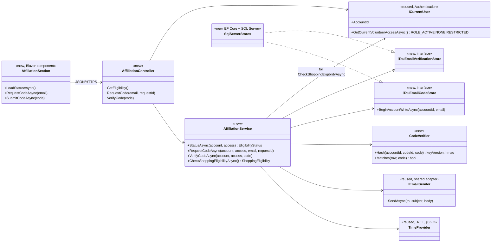
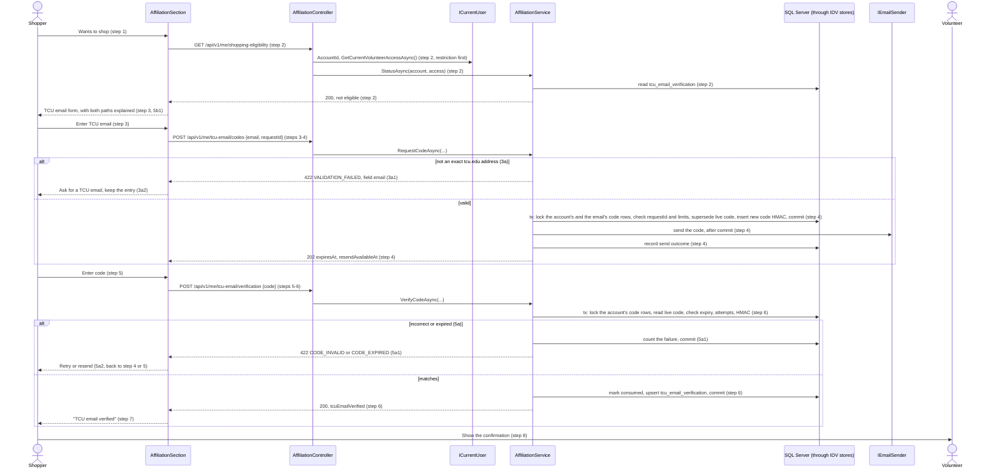
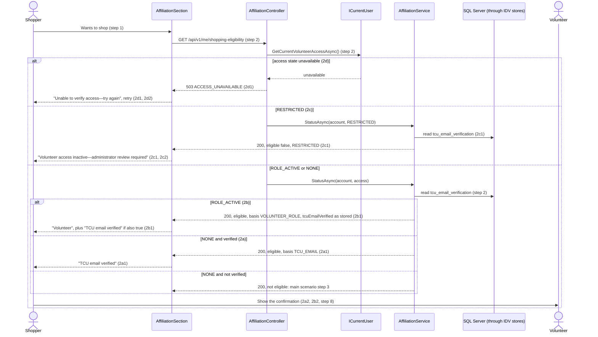
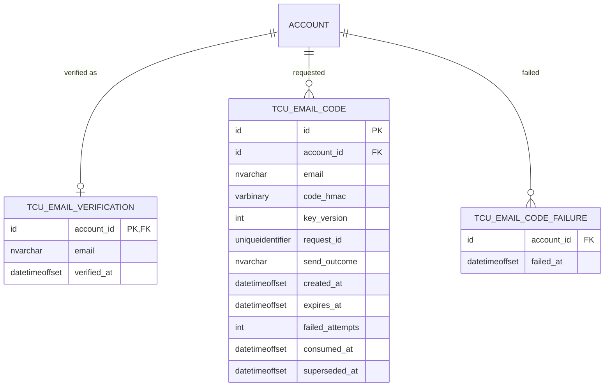

# Identity Verification Design

**Project:** ReFrog
**Team:** Team 3
**Area:** `IDV`

> **Realizes:** `UC-IDV-verify-affiliation`, `FR-AUTH-affiliation-from-signin`, `FR-AUTH-verification-code`, `FR-AUTH-verification-limits`, `FR-AUTH-verification-ownership`, IDV's part of `FR-AUTH-shopping-eligibility` (the eligibility check Shopping calls)
> **Depends on:** [Authentication](AUTH.md), `BR-shopper-tcu-affiliation`, `BR-shopper-verification`, `BR-tcu-email-domain`, `BR-volunteer-role-approval`, `BR-volunteer-role-lifecycle`, `FR-AUTH-enforce-permissions`, `FR-AUTH-volunteer-lifecycle`, `FR-VAL-server-validation`, `FR-VAL-field-feedback`, `FR-VAL-preserve-input`, `FR-SAVE-confirmed-success`, `FR-SAVE-unknown-outcome`, `ROB-external-service-failure`, `SEC-affiliation-data`, `SEC-authentication-provider`, `SEC-transport-encryption`, `UI-account-profile`, `KD-tcu-it-stack`
> **See:** [Use cases](../requirements/use-cases.md#area-identity-verification-idv), [Business rules](../requirements/business-rules.md), [Specification](../requirements/software-requirements-specification.md), [Architecture of record](architectural-design.md) (§5.2 components, §8 crosscutting concepts, §9.2 `KD-tech-stack`)
> **Designed against:** `d8893c1` (first draft); revised for `UC-IDV-verify-affiliation` against `main` `f781bf3` (which includes `KD-tech-stack`), 2026-10-30. `CurrentUser.volunteerAccess`, `VOLUNTEER_ACCESS_INACTIVE`, and `ACCESS_UNAVAILABLE` come from the VOL design merged in #66; re-checked against `main` after #66 and #69 (which added the `FR-AUTH-verification-*` requirements and `BR-tcu-email-domain`). No application code exists yet; every class below is new.

---

_**How to use this template.** Copy it to `docs/design/<area>.md`, named for the lowercase area code (`ord.md` for `UC-ORD-*`). Instructions appear in italic square brackets; leave them in place until the document is stable, because the agent reads them on every later pass. The full worked example is Project Pulse's [`not.md`](https://github.com/Washingtonwei/project-pulse/blob/main/docs/design/not.md); read it for the shape, not for the answers._

_**What this document is.** The **design-of-record** for one use case area: how the code will realize its use cases, written **before** the code and approved before anyone builds from it. It is the last document your agent reads before it writes code, so anything it leaves out, the agent invents. Your [architecture-of-record](architectural-design.md) is the map of the whole system and stops at each component's responsibility; this document goes one level down, inside one area, against real code._

_**What it is not.** A copy of your use cases. It **cites** `UC-*`, `FR-*`, and `BR-*` by identifier and never restates what the system shall do; it says only how. It is also not a transcript of the code. Once code exists, link to the files rather than describing every class, column, or getter._

_**One document per area, not per use case.** Your area gains use cases over the term. The overview, the class diagram, and the data model are **revised in place** when it does. The sequence diagrams, the API contract rows, and the test rows are **appended**, one set per use case. Never add a `## UC-…` section that repeats the whole skeleton._

_**How much to write.** Pin down what a wrong guess would break: a requirement, a business rule, a quality attribute, or the contract between two parts of your team. Leave the rest for the agent to derive while it builds: variable names, field types, exact JSON, column lengths. When you are unsure, ask which side of that line a detail falls on, not whether it is interesting._

---

## Overview

_[One paragraph: what this area does, which components of your [architecture-of-record](architectural-design.md) it lives in, and what it reads from or calls in other areas. Link the container diagram rather than redrawing it. If this design changes the architecture-of-record, say so here and list the change under "Changes to the architecture-of-record" below.]_

Identity Verification decides whether a signed-in account may shop from the persisted TCU verification and trusted current access state owned by [Authentication](AUTH.md) (`UC-IDV-verify-affiliation`, `FR-AUTH-shopping-eligibility`). Authentication also runs the shared email-code machinery for the later profile verification path. IDV owns only the shopping-eligibility decision and its presentation. The remaining Spring/Vue/PostgreSQL components and data model below are superseded and must be replaced in the dedicated IDV revision before implementation.

## Components & classes

_[One class diagram for the whole area, and one line per class or file saying what it does and whether it is **new** or **reused**. Show only what a reader needs to see how the parts relate: classes, their key methods, their dependencies. Fields and getters belong to the code._

_**If your repository has no code for this area yet**, which is the normal case for your proving slice, list the files you expect the agent to create, with the paths your architecture-of-record's conventions give them, and mark them all new. The agent then builds into the structure you chose rather than one it improvised.]_

The repository has no code yet, so every file is new. Paths use the `server/<module>/…` and `client/<module>/…` shorthand that [VOL.md](VOL.md) uses: `server` is the ASP.NET Core Application and `client` is the Blazor WebAssembly front end. The exact solution and project layout follows whatever the first code records under §8.2.4.

- `client/idv/AffiliationSection.razor` (new): the identity section of `UI-account-profile`. It renders the status from `GET /api/v1/me/shopping-eligibility`. It shows "TCU email verified" and the "Volunteer" role as separate facts (2b1). It shows "Volunteer access inactive—administrator review required" for `RESTRICTED` (2c1), and in that state never shows "TCU email verified", so the screen a volunteer sees at step 8 cannot read as a pass (`BR-volunteer-role-lifecycle`). It shows "Unable to verify access—try again" with a retry for `503 ACCESS_UNAVAILABLE` (2d1), and the same for a network failure or a `5xx` without an IDV code on the `GET`; it never shows a last-known status (§8.2.1). It offers the email form and code form only when the account is not eligible and not restricted. The explanation of both qualifying paths sits beside the email form, so a shopper with neither sees why they cannot shop (5b1). It does not check the email's domain itself; on `422` it names the bad field and keeps the typed email (§8.2.5). It offers resend after a rejected code (5a1), and disables resend until `resendAvailableAt`. It generates a new `requestId` (a GUID) for each explicit send and reuses it when it retries that same send after a dropped response.
- `server/idv/AffiliationController` (new): three endpoints, behind the application-wide "signed in" authorization policy Authentication provides. The controller also requires an authenticated user itself, so it is never anonymous before that policy exists; tests sign in through a test authentication handler. It takes the account only from `ICurrentUser` and validates request shape, nothing else.
- `server/idv/AffiliationService` (new): every IDV rule. It checks the restriction before eligibility, the exact domain, rate limits, code lifetime and attempts, and supersede-on-resend. It reads time only from the injected `TimeProvider`. `CheckShoppingEligibilityAsync()` is the only thing Shopping calls.
- `server/idv/ITcuEmailVerificationStore`, `server/idv/ITcuEmailCodeStore` (new): IDV's persistence abstraction (`MNT-data-access-abstraction`). `AffiliationService` sees only these interfaces and no Entity Framework Core or SQL Server type. `BeginAccountWriteAsync` opens the transaction for one code request or one verification and takes the locks described under Key decisions; everything else the service needs (the account's saved verification, limits, the live code, the outcome of a `requestId`) is read inside it.
- `server/idv/SqlServer…Store` implementations and their Entity Framework Core mappings and migration (new): the only IDV code that knows about Entity Framework Core, SQL Server types, or lock hints (architecture §8.2.8). Whether IDV has its own `DbContext` or adds its entities to a shared one follows the first code's convention; IDV's transactions touch only IDV's tables either way.
- `server/idv/CodeVerifier` (new): HMAC-SHA256 (`HMACSHA256`) over the account, code row, and code, using versioned keys from deployment secrets (§8.2.6). Codes come from `RandomNumberGenerator.GetInt32(0, 1_000_000)`, formatted to six digits. Comparison uses `CryptographicOperations.FixedTimeEquals`. All three are in .NET itself; IDV adds no cryptography package.
- `ICurrentUser` (reused contract, owned by Authentication): the account id and current volunteer access. [vol.md](vol.md) fixed event-scoped access for a shift. IDV has no shift and so no event, so it needs **`GetCurrentVolunteerAccessAsync()`**, which resolves the current annual event inside Authentication (see Key decisions and Open questions). It reads current state from the database on every call, never from role claims carried in the sign-in cookie, because `FR-AUTH-shopping-eligibility` forbids old session role claims from authorizing. It fails as unavailable rather than defaulting. IDV relies on this mapping, which Authentication must implement:
- `client/idv/AffiliationSection.razor` (new): the identity section of `UI-account-profile`. It renders the status from `GET /api/v1/me/shopping-eligibility`. It shows "TCU email verified" and the "Volunteer" role as separate facts (2b1). It shows "Volunteer access inactive—administrator review required" for `RESTRICTED` (2c1), and in that state never shows "TCU email verified", so the screen a volunteer sees at step 8 cannot read as a pass (`BR-volunteer-role-lifecycle`). It shows "Unable to verify access—try again" with a retry for `503 ACCESS_UNAVAILABLE` (2d1), and the same for a network failure or a `5xx` without an IDV code on the `GET`; it never shows a last-known status (§8.2.1). It offers the email form and code form only when the account is not eligible and not restricted. The explanation of both qualifying paths sits beside the email form, so a shopper with neither sees why they cannot shop (5b1). It does not check the email's domain itself; on `422` it names the bad field and keeps the typed email (§8.2.5). It offers resend after a rejected code (5a1), and disables resend until `resendAvailableAt`. It generates a new `requestId` (a GUID) for each explicit send and reuses it when it retries that same send after a dropped response.
- `server/idv/AffiliationController` (new): three endpoints, behind the application-wide "signed in" authorization policy Authentication provides. The controller also requires an authenticated user itself, so it is never anonymous before that policy exists; tests sign in through a test authentication handler. It takes the account only from `ICurrentUser` and validates request shape, nothing else.
- `server/idv/AffiliationService` (new): every IDV rule. It checks the restriction before eligibility, the exact domain, rate limits, code lifetime and attempts, and supersede-on-resend. It reads time only from the injected `TimeProvider`. `CheckShoppingEligibilityAsync()` is the only thing Shopping calls.
- `server/idv/ITcuEmailVerificationStore`, `server/idv/ITcuEmailCodeStore` (new): IDV's persistence abstraction (`MNT-data-access-abstraction`). `AffiliationService` sees only these interfaces and no Entity Framework Core or SQL Server type. `BeginAccountWriteAsync` opens the transaction for one code request or one verification and takes the locks described under Key decisions; everything else the service needs (the account's saved verification, limits, the live code, the outcome of a `requestId`) is read inside it.
- `server/idv/SqlServer…Store` implementations and their Entity Framework Core mappings and migration (new): the only IDV code that knows about Entity Framework Core, SQL Server types, or lock hints (architecture §8.2.8). Whether IDV has its own `DbContext` or adds its entities to a shared one follows the first code's convention; IDV's transactions touch only IDV's tables either way.
- `server/idv/CodeVerifier` (new): HMAC-SHA256 (`HMACSHA256`) over the account, code row, and code, using versioned keys from deployment secrets (§8.2.6). Codes come from `RandomNumberGenerator.GetInt32(0, 1_000_000)`, formatted to six digits. Comparison uses `CryptographicOperations.FixedTimeEquals`. All three are in .NET itself; IDV adds no cryptography package.
- `ICurrentUser` (reused contract, owned by Authentication): the account id and current volunteer access. [VOL.md](VOL.md) fixed event-scoped access for a shift. IDV has no shift and so no event, so it needs **`GetCurrentVolunteerAccessAsync()`**, which resolves the current annual event inside Authentication (see Key decisions and Open questions). It reads current state from the database on every call, never from role claims carried in the sign-in cookie, because `FR-AUTH-shopping-eligibility` forbids old session role claims from authorizing. It fails as unavailable rather than defaulting. IDV relies on this mapping, which Authentication must implement:
  - `ROLE_ACTIVE`: the role is held for the current event.
  - `RESTRICTED`: the role was explicitly removed, or it expired at an event's end and has not been renewed (`BR-volunteer-role-lifecycle`). This holds between events too.
  - `NONE`: the account never held the role, or has only a pending or declined request (`BR-volunteer-role-approval`: a request conveys no permissions, and a decline imposes no restriction).

  IDV's build adds **no** Authentication code: no sign-in, account table, cookie setup, or role resolution. It codes against `ICurrentUser` and `IVolunteerAccessStateProvider` and stubs them in tests. Using IDV end to end waits for Authentication to exist (`SEC-authentication-provider`, §8.1).
- `EmailSender` (reused, shared delivery adapter, architecture §3 and §5.1): the one adapter every area sends email through. Verification codes go by email only, never to the in-app inbox (SRS §5.2 notifications). If IDV is built before any other area that sends email, IDV's build creates only the provider-neutral interface and a test fake. The provider is not chosen, so no real implementation is written.
- `Clock` and the shared error handler (reused, §8.2.1, §8.2.2): same as VOL.

## Sequence

_[One sequence diagram per use case for its main success scenario, plus one for each extension that does not just return an error. **Label each interaction with the use case step it implements**, so a reviewer can check that every step is realized and nothing extra was invented. Use `alt` blocks for extensions that branch off the main flow. Give each use case its own `###` heading; that heading is the anchor your traceability matrix cites.]_

### UC-IDV-verify-affiliation: verifying shopping eligibility

#### Main success scenario, with 3a and 5a

#### Step 2 outcomes: 2a, 2b, 2c, 2d

If either read fails in any branch, the access read or the IDV store read, the result is the same `503 ACCESS_UNAVAILABLE` as 2d (§8.2.1).

**5b** has no server interaction. The not-eligible screen always explains that verified TCU email or a current approved volunteer role is required. No endpoint grants access any other way, and there is no visual-ID path (`OI-19`).

**Shopping (`UC-SHP-log-item-taken` PRE-1).** On each protected submission, Shopping calls `CheckShoppingEligibilityAsync()`, which follows the same step 2 order: `ICurrentUser.GetCurrentVolunteerAccessAsync()`, then `tcu_email_verification`. It returns `RESTRICTED`, `ELIGIBLE(VOLUNTEER_ROLE)`, `ELIGIBLE(TCU_EMAIL)`, or `NOT_ELIGIBLE`, or it throws the shared unavailable exception.

## API contract

_[One row per endpoint, scheduled job, or message this area adds or changes, appended per use case. **This section is never dropped**: before the code exists it is the only thing the person (or agent session) building the front end and the one building the back end both read. Name the caller and who may call it, the request fields, the success response, and the error each extension returns. Leave field types and exact JSON to the agent unless a wrong guess would break something, such as a format another system depends on. Use the error shape your architecture-of-record's section 8.2 fixes; do not invent one here.]_

Architecture §8.2.1 and §8.2.3 do not fix the response envelope yet, so this table fixes only the error **codes** the front end branches on, the same approach [VOL.md](VOL.md) takes. Each code sits in a machine-readable field of whatever envelope the team fixes, produced by the one shared error handler. `VOLUNTEER_ACCESS_INACTIVE` and `ACCESS_UNAVAILABLE` are the same codes VOL uses. "Access unavailable" reaches the handler as its own exception mapped to `503`, never the generic `500`. Times are ISO-8601 with their UTC offset. Enum values (`basis`, `volunteerAccess`) and error codes travel as the strings written here, never as numbers: .NET's JSON serializer writes enums as numbers unless it is configured once, application-wide, to write strings. Every retry time is in the response body. No endpoint accepts an account id or role from the browser. Within either `POST`, a database failure before the first write (taking the locks or reading) is `503 ACCESS_UNAVAILABLE`, the same as 2d. A failure at or after the first write, a deadlock or the commit included, rolls back and is the save failure: a `5xx` without an IDV code, with nothing saved and nothing sent.

| Endpoint or operation | Caller (who may) | Request | Success | Errors, by extension |
|---|---|---|---|---|
| `GET /api/v1/me/shopping-eligibility` | Any signed-in account, for itself only | None | `200`: `eligible`, `basis` (`TCU_EMAIL`, `VOLUNTEER_ROLE`, or none), `tcuEmailVerified`, `volunteerAccess` (`ROLE_ACTIVE`, `NONE`, or `RESTRICTED`), and `pendingCodeExpiresAt` only for a code that is not consumed or superseded, has fewer than five failures, and has not reached `expires_at`. Never the code, and not the verified email address. | 2a: `200`, eligible, `TCU_EMAIL`. 2b: `200`, eligible, `VOLUNTEER_ROLE`, `tcuEmailVerified` as stored. 2c: `200`, not eligible, `RESTRICTED`. 2d (access or database state unavailable): `503 ACCESS_UNAVAILABLE`. Not signed in: `401`. |
| `POST /api/v1/me/tcu-email/codes`: first send and resend | Any signed-in account that is not `RESTRICTED`, for itself only | `email`; `requestId` (client-generated GUID, new for each explicit send, reused only to retry that same send) | `202`: `expiresAt`, `resendAvailableAt`. It means the provider accepted the send, never that the email arrived. A repeat of the same `requestId` and email returns the original `202` only if that send was accepted, and sends nothing. | 3a: `422 VALIDATION_FAILED` naming `email`. 2c: `403 VOLUNTEER_ACCESS_INACTIVE`. 2d: `503 ACCESS_UNAVAILABLE`. Cooldown or hourly limit: `429 TOO_MANY_REQUESTS` with the retry time. The account is already verified: `409 ALREADY_VERIFIED`. Same `requestId` with a different email: `409 REQUEST_ID_REUSED`. Provider failure or timeout, or a retry whose send has no recorded outcome yet: `503 EMAIL_NOT_SENT`; the new code stays committed and the previous one stays superseded. Save failure: `5xx`, nothing saved or sent, and a retry with the same `requestId` is safe. Not signed in: `401`. Nothing is written for any error except `EMAIL_NOT_SENT`. |
| `POST /api/v1/me/tcu-email/verification` | Any signed-in account that is not `RESTRICTED`, for itself only | `code` (exactly six ASCII digits `0`–`9` after trimming surrounding whitespace; other Unicode digits are malformed; bound as a string so leading zeros are kept) | `200`: `tcuEmailVerified: true`, `verifiedAt`, and the same status fields as the `GET`. Sent only after the commit (`FR-SAVE-confirmed-success`). | 5a, wrong code with attempts left on it: `422 CODE_INVALID`. 5a, expired, superseded, already consumed, invalidated by its fifth failure, or no live code: `422 CODE_EXPIRED`. Both offer resend. Not exactly six digits after trimming: `422 VALIDATION_FAILED` naming `code`. Account failure budget exceeded: `429 TOO_MANY_REQUESTS` with the retry time. 2c: `403 VOLUNTEER_ACCESS_INACTIVE`. 2d: `503 ACCESS_UNAVAILABLE`. Save failure: `5xx`, nothing saved; on any `5xx` without one of these codes, or a dropped response, the client re-reads the `GET` (`FR-SAVE-unknown-outcome`). Not signed in: `401`. |
| `AffiliationService.CheckShoppingEligibilityAsync()` (in-process; Shopping) | Shopping's server code, on every protected submission; the account comes from `ICurrentUser` | None | `ELIGIBLE` with its basis, `NOT_ELIGIBLE`, or `RESTRICTED` | State unavailable: throws the shared unavailable exception (`503 ACCESS_UNAVAILABLE` at Shopping's HTTP boundary). Never returns `NOT_ELIGIBLE` for an unavailable lookup. |

There is no visual-ID override endpoint (5b, resolved `OI-19`). Volunteer requests, grants, removals, and renewals are not IDV endpoints; ADM and Authentication own them.

## Key decisions

_[Only the decisions a reader could not recover from the code: an invariant, who may do this and how it is enforced, a trade-off you chose, a reason you reused something rather than writing it. **Each one names what you chose, what you rejected, and why.** If you cannot name an alternative you considered, it probably was not a decision; leave it out._

_A decision that affects the whole system rather than this area is an architecture decision. It belongs in your architecture-of-record as a `KD-*` entry, not here.]_

**Restriction first, then either qualifying path.** `GetCurrentVolunteerAccessAsync()` is read before anything else. `RESTRICTED` ends the check whatever `tcu_email_verification` holds (2c, `FR-AUTH-volunteer-lifecycle`). `ROLE_ACTIVE` qualifies without email verification and never writes it (2b). `NONE` falls to the saved email verification. `RESTRICTED` is the only account restriction any requirement defines (`FR-AUTH-volunteer-lifecycle`); shopping-abuse review takes no automatic action (`BR-shopping-abuse-review`), so IDV checks no other. Rejected: one shared "verified" flag set by either path, because it would mark volunteers as email-verified and would survive role removal (`FR-AUTH-shopping-eligibility`).

**IDV asks Authentication for the current event's access, with no event id.** VOL passes a shift's event when it asks for access, but IDV has no shift. `GetCurrentVolunteerAccessAsync()` lets Authentication, which §5.2 already makes owner of event-scoped access and renewal state, decide which annual event is current. Rejected: IDV asking ADM for the current event and passing it in, because that adds an IDV→ADM dependency §5.2 does not list, and Shopping would have to repeat it. This is a contract the future `authentication.md` must adopt (see Open questions).

**Access comes from the database on every request, never from the cookie.** ASP.NET Core's cookie sign-in usually carries roles as claims, and `User.IsInRole` would read them. IDV never does: it asks `ICurrentUser`, which reads current state. Rejected: role claims, because a role removed or expired after sign-in would keep authorizing until the cookie expired, which `FR-AUTH-shopping-eligibility` and `FR-AUTH-volunteer-lifecycle` forbid.

**Any failure in either read is 2d.** Access state comes from Authentication and email verification from IDV's store. If either read fails, the answer is `503 ACCESS_UNAVAILABLE`. Rejected: reporting eligibility when one source answered and the other failed. `FR-AUTH-shopping-eligibility` permits skipping the second source, but the partial case adds branches and tests for nothing. Restriction state is still required on every path (§8.2.1). The two reads need no shared transaction; IDV writes nothing on this path.

**IDV asks Authentication for the current event's access, with no event id.** VOL passes a shift's event to `volunteerAccess(eventId)`, but IDV has no shift. `currentVolunteerAccess()` lets Authentication, which §5.2 already makes owner of event-scoped access and renewal state, decide which annual event is current. Rejected: IDV asking ADM for the current event and passing it in, because that adds an IDV→ADM dependency §5.2 does not list, and Shopping would have to repeat it. [AUTH.md](AUTH.md) adopts this contract.

**Commit the code first, then send the email outside the transaction.** The request transaction checks limits, supersedes the live code, inserts the new one, and commits. Only then does `IEmailSender` run, and its outcome is written afterwards in its own small write. Rejected: sending inside the transaction, which holds a database transaction open across a network call and can email a code whose row then rolls back. Consequence, approved 2026-10-16: if sending fails, the new code remains the live one and the old code stays superseded (`503 EMAIL_NOT_SENT`, retry within the limits). If the commit fails, nothing is sent and the previous code is untouched. If the provider accepts but recording that outcome fails, the response is `503 EMAIL_NOT_SENT` and the failure is logged; the code stays live, so if the email does arrive it still verifies.

**The send and its outcome write ignore the request's cancellation.** ASP.NET Core cancels a request's token when the browser drops the connection. If the send or the outcome write used that token, a phone losing signal mid-send would abort them and leave `send_outcome` empty, so the shopper's retry could only ever get `503 EMAIL_NOT_SENT`. After the commit, both run to completion, bounded by the email adapter's own timeout. Rejected: passing the request token through, which is the .NET default habit.

**One account's code writes run one at a time.** Each code request and each verification starts by taking an update key-range lock on that account's rows in `tcu_email_code` (SQL Server `UPDLOCK, HOLDLOCK` through the (`account_id`, `created_at`) index), inside its transaction. A second request or submission for the same account waits until the first commits, then sees its result. That makes the 60-second cooldown, supersede-on-resend, the attempt counts, and the ten-per-15-minutes budget exact under concurrency. Two concurrent submissions of the correct code consume it once. A filtered unique index allowing one live code per account stays as the database's backstop; a violation is answered as the cooldown's `429`. Consumption and the `tcu_email_verification` upsert commit or roll back together (§8.2.8). These hints lock and read current rows whether or not the database has `READ_COMMITTED_SNAPSHOT` on, which Azure SQL Database turns on by default.
Rejected:
- Checking "is there a live code" in C# and then writing, because two requests can both pass the check.
- Relying on the filtered unique index alone: in SQL Server a second request's `UPDATE` can miss the row a first request has just inserted, supersede it, and insert its own. Both then get `202` inside the cooldown. The PostgreSQL design was protected by that database's re-check behavior; SQL Server needs the explicit lock (`KD-tcu-it-stack` trade-off).
- A `SERIALIZABLE` isolation level for the whole transaction, which range-locks the per-email count as well as the account's rows and blocks unrelated accounts, with more deadlocks.
- `sp_getapplock`, an application lock tied to no data, which a maintainer cannot see in the schema (`MNT-operational-handoff`).

**The per-email hourly limit takes a second lock, always after the account's.** A code request also takes `UPDLOCK, HOLDLOCK` on the destination email's rows (the (`email`, `created_at`) index), after the account lock. So two accounts sending to one address at the same moment cannot both take its fifth slot (`FR-AUTH-verification-limits`). Every request takes the two locks in the same order, so two requests cannot deadlock on them. Rejected: counting the email's rows without a lock, which lets a concurrent pair exceed the limit at its boundary.

**IDV's store interfaces are its persistence abstraction.** `AffiliationService` depends on `ITcuEmailCodeStore` and `ITcuEmailVerificationStore` only. The Entity Framework Core mappings, the lock hints, and the SQL Server types live only in their implementations (architecture §8.2.8, `MNT-data-access-abstraction`). Rejected: the service using the database context or raw SQL directly, which would put SQL Server-specific code in business-rule code and make EAP's replacement of database details touch the rules.

**Codes are stored as a keyed HMAC, and keys are versioned.** `CodeVerifier` computes HMAC-SHA256 over the account, code row, and code. The key comes from deployment secrets through ASP.NET Core configuration, never from a settings file in source control (§8.2.6). Each row records its key version, so an old key is kept until its outstanding codes expire (approved 2026-10-16). Generate codes with `RandomNumberGenerator`, and generate again if the new code equals the one it supersedes (approved). The keys are checked at startup, and the Application does not start without a current key. A code row whose key version is no longer configured is answered as `CODE_EXPIRED`, which counts no failure (`FR-AUTH-verification-limits`), and is logged as an error. Rejected: plaintext, or a plain hash, because six digits are recovered from a leaked hash by trying all million values.

**IDV's own code tables, not ASP.NET Core Identity's email token providers.** Identity can generate six-digit email codes, but they are time-window codes that are never stored. They cannot enforce "only the latest code", "accepted at most once", or "invalidated by its fifth failure" (`FR-AUTH-verification-code`, `FR-AUTH-verification-limits`), and Authentication has not yet chosen whether it uses Identity at all. Rejected for those reasons.

**Limits are counted from database rows, not ASP.NET Core's rate-limiting middleware.** The middleware counts in memory, per server instance, and forgets on restart. `FR-AUTH-verification-limits` requires limits that hold across sessions on the server, so every limit is counted from `tcu_email_code` and `tcu_email_code_failure` rows. Rejected: the middleware, for those reasons.

**One shared email adapter.** IDV sends through the shared `IEmailSender` (charter; architecture §3, §5.1). Provider acceptance means "requested", never "received" or "verified". A provider timeout is `503 EMAIL_NOT_SENT` with no automatic background resend. Rejected: an IDV-only email client, which the earlier draft of this document had and which would put a second provider integration in the codebase.

**Exact `tcu.edu` only, with a lenient shape check, checked only on the server.** The domain rule is `BR-tcu-email-domain`. Trim the address and lowercase it with `ToLowerInvariant()`, so the stored address does not depend on the server's culture (under a Turkish culture, culture-aware lowercasing turns `I` into a dotless `ı`). It is well formed if it has exactly one `@`, a non-empty local part with no whitespace or control characters, and at most 254 characters. The local part's characters are otherwise not restricted, so a real TCU address is never rejected for its spelling (`BR-shopper-tcu-affiliation`). Then accept it only if the part after the `@` equals `tcu.edu` (approved 2026-10-16; source `OI-10`). Control of the inbox, proven by the code, is the real check. Subdomains such as `frog.tcu.edu` and lookalikes such as `tcu.edu.co` are rejected. The lowercased address is what is stored and what per-email limits count.
Rejected:
- Any domain ending in `tcu.edu`, because the approved boundary is the exact domain.
- A duplicate domain check in the Blazor component, because §8.2.4 forbids duplicating business rules between client and server.
- Sharing the validator with the client through a shared assembly, which is a repository-structure choice for §8.2.4, not for IDV. One round trip for one field costs the shopper nothing noticeable.

**Duplicate send actions are absorbed by `requestId`.** A retry of the same send, for example after a dropped response, returns the first outcome without a new code or email. The account lock means a retry that arrives while the first attempt is still in its transaction waits, then finds the row and returns the same outcome. A retry after `503 EMAIL_NOT_SENT` returns `503 EMAIL_NOT_SENT` again; it never re-dispatches an uncertain send. A retry that finds the row with no `send_outcome` yet gets the same response: the first send is still in flight, or the server stopped after the commit. Only a recorded acceptance ever produces `202` (`ROB-external-service-failure`, `ROB-submission-status`). If the outcome stays empty because the server stopped, the code still occupies the live slot and counts toward the limits, and the shopper recovers with an explicit resend after the cooldown. An explicit resend uses a new `requestId` and is subject to the cooldown (approved 2026-10-16). Rejected: relying on the cooldown alone, because then the client cannot tell a retry of its own send from a refused second send.

**A verified account cannot request another code.** Once verified, the profile shows the saved confirmation (2a) and offers no email form; a code request returns `409 ALREADY_VERIFIED` and changes nothing. Rejected: replacing the verified address, because no requirement asks for it (decided 2026-10-30, no added scope).

**Verification belongs to the account, not the email address** (`FR-AUTH-verification-ownership`). A code verifies only the account and address it was issued for. Verification never moves to another account because the email matches. It survives sign-in email changes on the same account, because the table is keyed by `account_id`. A second account may verify the same TCU address with its own code, because the FR says another account using the same email "shall complete its own verification". So `tcu_email_verification.email` is not unique. Rejected: keying by email address, which would let a second account inherit someone's verification.

**Successful verifications are not audited.** `verified_at` on the current row is the only record. Rejected: the per-verification audit history the earlier draft carried, because architecture §8.2.9 limits auditing to administrator sign-in and administrator changes, and SRS §7.4.5 requires client approval for additional personal data. Developer decision, 2026-10-30.

### Code and rate-limit policy

The values are `FR-AUTH-verification-code` (format, lifetime, latest code only) and `FR-AUTH-verification-limits` (attempt and request limits). All counts are enforced on the server from database rows, so they hold across sessions and concurrent requests. A refused request returns `429 TOO_MANY_REQUESTS` with the retry time; a resend supersedes the previous code without resetting the account-wide failure count.

Only a `CODE_INVALID` result counts as a failure: it increments that code's `failed_attempts` and writes one `tcu_email_code_failure` row. A submission against an expired, superseded, consumed, or missing code (`CODE_EXPIRED`), a malformed code (`VALIDATION_FAILED`), or one refused with `429` counts toward neither limit. A code request that ends in `503 EMAIL_NOT_SENT` still wrote its row, so it counts toward the cooldown and the hourly limits. When several limits apply, the retry time is the latest of them. The failure budget refuses only code submissions, never code requests. No network or IP-address limit is approved.

## Data model

_[The **change** this area makes to the data: new tables or entities, new columns, the migration that adds them. Draw an ER diagram when there is more than one new table. Do not redraw the domain model; your [specification](../requirements/software-requirements-specification.md) owns it, so link it and show only the change. If the area changes nothing, say "No change" and give the reason in one line; that is a design decision too.]_

Three new tables in Microsoft SQL Server, owned by IDV, created by IDV's first Entity Framework Core migration. `account` belongs to Authentication and is shown only for its foreign key; `account_id` takes whatever key type Authentication's account table uses.

- `tcu_email_verification`: one row per verified account. If there is no row, the account is not verified. It realizes "persisted TCU email verification" (`FR-AUTH-affiliation-from-signin`) and is stored separately from roles (SRS §7.4.5).
- `tcu_email_code`: one row per code request. Its indexes carry the design:
  - a **filtered unique index** on `account_id` `WHERE consumed_at IS NULL AND superseded_at IS NULL` is the one-live-code backstop;
  - a **unique index** on (`account_id`, `request_id`) absorbs duplicate send actions; `send_outcome` (accepted or failed) lets a retry return the first outcome;
  - an index on (`account_id`, `created_at`) is the range the account lock takes, and serves the cooldown (the newest row's `created_at`) and the per-account hourly count;
  - an index on (`email`, `created_at`) is the range the email lock takes, and serves the per-email hourly count.
- `tcu_email_code_failure`: one row per incorrect submission, for the ten-per-15-minutes budget that survives resends, indexed on (`account_id`, `failed_at`). It is written and committed even though the submission is refused.
- `email` (at most 254 characters) is stored already lowercased, so no comparison relies on SQL Server's case-insensitive default collation. `code_hmac` is the 32-byte HMAC in binary.
- All timestamps are `datetimeoffset`, written in UTC from `TimeProvider` and compared only with times from it (§8.2.2).
- No role, restriction, or event column is copied into IDV; `ICurrentUser` owns them. No code, HMAC key, or raw TCU ID is stored.
- Retention and pruning of old code and failure rows, and of verified emails, wait on `OI-6`. Rows older than one hour no longer affect any limit, so pruning them later changes no behavior.
- The SRS data dictionary's `Shopper.verificationStatus` and `affiliationType` are realized only as "row exists or not" in `tcu_email_verification`. The email check cannot tell student from staff, so no affiliation type is stored.

## Reuse & cross-cutting

_[Which existing services, components, and conventions this area uses rather than rebuilding: authentication, the error handler, email, the clock, another area's service. Cite your architecture-of-record's section 8.2 for each convention by name rather than restating it.]_

- **Authentication** (§8.1): `ICurrentUser` and `IVolunteerAccessStateProvider`. Session, cookie, and antiforgery handling for IDV's state-changing requests come from the application-wide ASP.NET Core configuration Authentication owns; IDV adds none.
- **Email:** the shared `EmailSender` adapter (§3, §5.1). The provider is not chosen, and no provider name appears in IDV code.
- **Error handling and API** (§8.2.1, §8.2.3): the shared handler, the codes above, and `/api/v1/me/...` naming consistent with VOL.
- **Time** (§8.2.2): `Clock` for expiry, cooldown, and rolling windows. `expiresAt` is displayed in `America/Chicago` on a 12-hour clock.
- **Validation** (§8.2.5): the server check is the one that counts; the client may pre-check the domain for feedback only.
- **Configuration and secrets** (§8.2.6): HMAC keys and their versions, and provider credentials, come from deployment secrets.
- **Logging** (§8.2.7): log outcomes such as code requested, delivery failed, or limit hit, with the account id only. Never log the code, the HMAC, a key, or the email address.
- **Persistence** (§8.2.8): one transaction for each code request and each verification, as described in Key decisions.
- **Auditing** (§8.2.9): none. IDV changes are not administrator changes.
- **Testing** (§8.2.10): synthetic accounts, a fake `IEmailSender`, a fixed `TimeProvider`, and a stubbed `ICurrentUser`. Integration tests run against a real SQL Server, never an in-memory provider or SQLite, because those support neither the filtered unique index nor the lock hints the concurrency rows test. Concurrency rows run with `READ_COMMITTED_SNAPSHOT ON`.
- **Service worker:** `/api/v1/me/shopping-eligibility` is network-only like every other `/api/v1/*` call; the Blazor PWA's service worker caches only the app's own static files, nothing is cached for an offline display (decided 2026-10-30), and no `POST` is queued, the same as VOL.

## Tests

_[One row per flow: the main success scenario and **every** extension of every use case this document realizes, appended per use case. Name the level (unit or integration) and what the test asserts. No code. This list is the definition of done that the reviewer approves; the agent writes these tests when it builds, and a reviewer can see at a glance whether an extension has no test.]_

"Unit (front end)" rows are Blazor component tests. "Integration" rows call the endpoints in-process against a real SQL Server (see Reuse & cross-cutting). The tools for both are a build prerequisite (Open questions).

| Use case, flow | Level | Asserts |
|---|---|---|
| UC-IDV-verify-affiliation main | integration | `NONE` account, valid `tcu.edu` email: `202`, the fake `IEmailSender` gets one code. Submitting it gives `200`, one `tcu_email_verification` row, and the code consumed. The `GET` then returns eligible with `TCU_EMAIL` |
| main, persists across sessions | integration | After verification, a new session's `GET` returns eligible with no code step (`FR-AUTH-affiliation-from-signin`) |
| main, wire format | integration | The `GET`'s `basis` and `volunteerAccess`, and every error code, are the strings in the API contract, not numbers |
| 2a | integration | Verified `NONE` account: `GET` gives `200`, eligible, `TCU_EMAIL`. No code is created |
| 2b, role only | integration | `ROLE_ACTIVE` account with no verification: `200`, eligible, `VOLUNTEER_ROLE`, `tcuEmailVerified: false`, and no row written |
| 2b, role and email | integration | `ROLE_ACTIVE` and verified: `200`, eligible, `tcuEmailVerified: true` reported separately |
| 2b and 2c, front end | unit (front end) | Shows "Volunteer" and "TCU email verified" as separate facts. A role-only account never shows "TCU email verified". `RESTRICTED` shows the inactive message, no email form, and never "TCU email verified", even when `tcuEmailVerified` is true |
| 2c, status | integration | `RESTRICTED` and verified: `GET` gives `200`, not eligible, `RESTRICTED`, `tcuEmailVerified: true` |
| 2c, writes | integration | `RESTRICTED`: both `POST`s give `403 VOLUNTEER_ACCESS_INACTIVE`, and nothing is written or sent |
| 2d | integration | `GetCurrentVolunteerAccessAsync()` unavailable, or the store read failing: the `GET` and both `POST`s give `503 ACCESS_UNAVAILABLE`. The existing `tcu_email_verification` row is unchanged. A retry after recovery succeeds |
| 2d, front end | unit (front end) | `503 ACCESS_UNAVAILABLE`, a network failure, and a `5xx` without an IDV code on the `GET` each show "Unable to verify access—try again" with retry, and no earlier status |
| 3a | unit | `a@tcu.edu` and `A@TCU.EDU` accepted and stored lowercase. `a@frog.tcu.edu`, `a@tcu.edu.co`, `a@xtcu.edu`, malformed addresses, and blank fail with `422 VALIDATION_FAILED` naming `email`, with no row and no email |
| 3a, shape | unit | `first.last+x@tcu.edu` and `o'neil@tcu.edu` are accepted. `a@b@tcu.edu`, `@tcu.edu`, an address containing a space, and a 255-character address are refused with `422` naming `email` |
| 3a, culture | unit | With the current culture set to `tr-TR`, `KIM@TCU.EDU` is stored as `kim@tcu.edu` |
| 3a, front end | unit (front end) | On `422` the typed email stays in the field and the field is named; the component sends a non-`tcu.edu` address to the server rather than rejecting it itself |
| 5a, wrong code | integration | Wrong code: `422 CODE_INVALID`, `failed_attempts` incremented, one failure row, no verification |
| 5a, fifth failure | integration | The fifth wrong code invalidates the code: even the correct code then gets `422 CODE_EXPIRED` |
| 5a, expiry boundary | unit | With a fixed `TimeProvider`, the correct code one second before `expires_at` is accepted, and at `expires_at` gets `CODE_EXPIRED` |
| 5a, resend | integration | After the cooldown, a resend with a new `requestId` supersedes the old code. The old code gets `CODE_EXPIRED` and the new one verifies |
| 5a, failure budget survives resend | integration | Ten failures across two codes inside 15 minutes: the eleventh submission gets `429` with a retry time, even with the correct code. It succeeds after the window passes |
| 5a, what counts as a failure | integration | `CODE_EXPIRED`, `VALIDATION_FAILED` (for example `12a456`, or six non-ASCII Unicode digits), and `429` submissions write no failure row and leave `failed_attempts` unchanged. Each `CODE_INVALID` writes exactly one |
| 5b | unit (front end) | The not-eligible screen explains both qualifying paths. No control or endpoint grants access without verified email or the role |
| Shopping check | integration | `CheckShoppingEligibilityAsync()` returns `RESTRICTED` for a restricted verified account, `ELIGIBLE(VOLUNTEER_ROLE)`, `ELIGIBLE(TCU_EMAIL)`, and `NOT_ELIGIBLE` for neither. It throws the unavailable exception, never `NOT_ELIGIBLE`, when access state fails |
| Access mapping assumed from Authentication | integration | With `ICurrentUser` stubbed to the contract's mapping: an expired role (`RESTRICTED`) with verified email is not eligible, and a declined request (`NONE`) with verified email is eligible with `TCU_EMAIL` |
| Revocation, existing session | integration | Role removed mid-session (stub changes to `RESTRICTED`): the next `CheckShoppingEligibilityAsync()` returns `RESTRICTED` |
| Cross-account | integration | A code issued to account A, submitted by account B, does not verify B (B has no live code: `CODE_EXPIRED`), and A's code is untouched |
| Concurrent verification | integration | With `READ_COMMITTED_SNAPSHOT ON`, two concurrent submissions of the correct code: exactly one `200`, one consumption, one verification row |
| Concurrent requests | integration | With `READ_COMMITTED_SNAPSHOT ON`, two concurrent requests from one account with different `requestId`s: one `202` and one `429`, one live code, and one email sent |
| Concurrent requests to one email | integration | With four requests to `x@tcu.edu` already in the hour, two different accounts request a code to it at the same moment: exactly one `202` and one `429` |
| Duplicate send action | integration | The same `requestId` twice: one code, one email, both `202` with the same `expiresAt`. The same `requestId` with a different email: `409 REQUEST_ID_REUSED` |
| Delivery failure | integration | `IEmailSender` throws or times out: `503 EMAIL_NOT_SENT`. The new code row is live, the previous code is superseded, and a retry with the same `requestId` returns `503 EMAIL_NOT_SENT` without sending |
| Retry while the send is in flight | integration | A same-`requestId` retry while the first request's `send_outcome` is still empty (`IEmailSender` blocked) returns `503 EMAIL_NOT_SENT`, never `202`, and sends nothing. A row left with an empty outcome blocks a new `requestId` only until the cooldown passes |
| Dropped connection during send | integration | The client aborts the request while the fake `IEmailSender` is blocked. After the sender is released, the row's `send_outcome` is recorded, and a same-`requestId` retry returns that outcome |
| Save failure | integration | Failing the verification commit: `5xx`, the code is not consumed, and there is no verification row. Failing a code request's commit: `5xx`, no new code row, no email, and the previous code still live. A database failure before the first write: `503 ACCESS_UNAVAILABLE` |
| Outcome not recorded | integration | The fake `IEmailSender` accepts, and the outcome write fails: `503 EMAIL_NOT_SENT`, the code is live and verifies |
| Request limits | integration | A second request within 60 seconds gets `429`, and is allowed at 60 seconds. The sixth request in a rolling hour gets `429` per account, and separately per destination email from two accounts. Boundaries use the fixed `TimeProvider` |
| Already verified | integration | A verified account's code request, for any address, gets `409 ALREADY_VERIFIED`; no code row, no email, and the saved verification is unchanged |
| Ownership | integration | Account A verified `x@tcu.edu`. Account B entering `x@tcu.edu` is not verified until B completes its own code, after which both are verified. A sign-in email change on A keeps A's verification with no new code, and the new sign-in email is not TCU-verified (`FR-AUTH-verification-ownership`) |
| Key rotation | unit | A code hashed under key version 1 still verifies after version 2 becomes current. A code whose key version is no longer configured gets `CODE_EXPIRED` and counts no failure |
| Code generation | unit | Codes are six digits with leading zeros kept. A replacement never equals the code it supersedes |
| Logging | integration | Application and database-command logs from the main flow, 5a, and delivery failure contain no code, HMAC, key, or email address, including when the fake `IEmailSender` throws with the recipient in its message. Delivery failure is logged at error level |
| Signed out | integration | All three endpoints give `401` |

## Changes to the architecture-of-record

_[Designing an area against real code is when the architecture's guesses meet reality. If this design needs a component the map does not have, moves a responsibility, or adds a dependency, **change [the architecture-of-record](architectural-design.md) in the same pull request** and list each change here in one line. If nothing changed, write "None". A design that silently disagrees with the architecture leaves two maps, and the agent will follow whichever it reads last.]_

In the 2026-11-04 stack revision (architecture version 0.6):

- §5.1: the Web Front End is a Blazor **WebAssembly** PWA served by the Application and calling it only through its JSON/HTTPS API; Blazor Server is not used for participant screens.
- §8.2.8: the persistence library is Entity Framework Core with its SQL Server provider and migrations, behind per-area store interfaces; only those implementations use Entity Framework Core or SQL Server-specific SQL and lock hints. The packages are added when a person confirms them.

§5.2 is unchanged: IDV's dependencies are still Authentication and the email delivery channel, and `GetCurrentVolunteerAccessAsync()` is a method on the existing Authentication component, not a new dependency.

## Open questions & risks

_[What this design could not settle and who can, and what could go wrong that you are accepting. A question for the client also goes in [`OPEN-ISSUES.md`](../requirements/OPEN-ISSUES.md).]_

| Item | Owner | Effect and what resolves it |
|---|---|---|
| `CurrentUser.currentVolunteerAccess()` | Authentication (and ADM for "which event is current") | IDV and Shopping need the current event's access without an event id. [AUTH.md](AUTH.md) adopts this method next to VOL's `volunteerAccess(eventId)`. Between events, the method's answer for a past volunteer follows `BR-volunteer-role-lifecycle`. |
| Shopping's contract | SHP owner | [SHP.md](SHP.md) calls `AffiliationService.isVerified` and refuses with `AFFILIATION_NOT_VERIFIED`, which leaves out the volunteer path and the restriction that `FR-AUTH-shopping-eligibility` requires. SHP should call `checkShoppingEligibility()` and map `RESTRICTED`, `NOT_ELIGIBLE`, and unavailable. This design does not edit SHP.md. |
| `OI-22`: expiry restricts past volunteers | Client | Under `BR-volunteer-role-lifecycle`, a past volunteer who is a TCU student cannot shop at the next event until renewed, even with verified email. This design builds the rule as written. |
| `OI-6` retention | Client and TCU data governance | Retention and pruning of verified emails and of code and failure rows. |
| Response envelope (**build prerequisite**) | Team | §8.2.1 and §8.2.3 still do not fix it, and IDV fixes only codes. `/implement` must not choose one: the team records it once in §8.2.3 before IDV's (or any area's) first endpoint is built. |
| Code machinery shared with registration | Authentication owner | Resolved in [AUTH.md](AUTH.md): AUTH owns one purpose-aware challenge service and persisted TCU verification for registration and later IDV verification. The IDV revision removes its duplicate code tables and verifier. |
| Authentication not built | Team (build order) | IDV can be built and tested against a stubbed `CurrentUser`, but it cannot run end to end, or create its `account` foreign key, until Authentication exists. |
| Email provider | Team (`OI-15` hosting) | The `202` means provider acceptance only. A slow provider shows up as `503 EMAIL_NOT_SENT` with retry; no background resend is designed. |

---

## Working this document with your agent

_[Delegate: drafting the diagrams from your sketch and the use case; listing the existing files a class should extend; filling the contract rows' request and response fields; proposing the test row for each extension; drafting the rejected alternative for a decision you have already made; checking that every identifier this document cites exists in the document that owns it._

_Keep human: which side of the "would a wrong guess break something" line each detail falls on; every key decision; and the approval, which is a teammate's review of the pull request, not the drafter's own reading._

_**The specific failure to watch for: scope that nobody asked for.** An agent drafting a design adds what designs it has read usually have: an admin override, a retry queue, a status field, a notification "while we are here". Each looks reasonable and none is in your use case, and once it is in the design the agent will build it, test it, and you will maintain it. Read the sequence labels: every interaction should name the use case step it implements. An interaction with no step is either a missing requirement, which goes to your specification and your client, or scope creep, which comes out.]_

---

## The questions test (before you open the pull request)

_[Start a **fresh** agent session in plan mode, so it carries nothing from the session that drafted this document. Give it only the use case, the business rules it cites, your architecture-of-record's section 8, and this document, and ask:_

> _List every point you would still have to guess to implement `<UC-ID>`. For each, say what you would guess and whether a wrong guess could violate a requirement. Do not write code._

_For each item on its list, either fix this document or keep the guess and write one line saying why a wrong guess breaks no requirement. Paste the list, with your answer to each item, into the pull request description under How it was verified, inside a collapsed `

Questions test
 … 
` block so the description stays short. The design is ready when nothing on the list could break a requirement.]_

**Status for the 2026-11-04 stack revision:** run on 2026-11-04 against this revision, in a fresh read-only session given only the use case, its five business rules, architecture §8, and this document. It found 39 guesses and three points this document reserves for the team. Of the 20 that could break a requirement, 16 are fixed in this document and 4 are settled by a cited requirement or an open question already here. The list, with an answer to each item, is in the pull request description. The 2026-10-30 run answered the Spring Boot draft.
