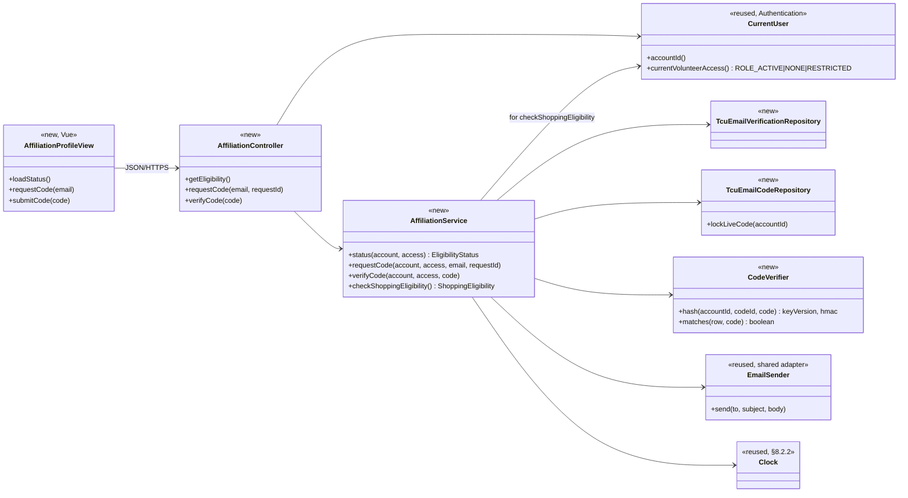
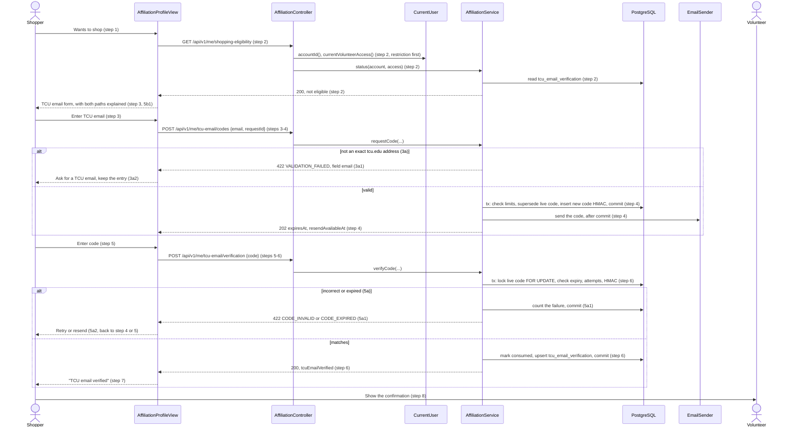
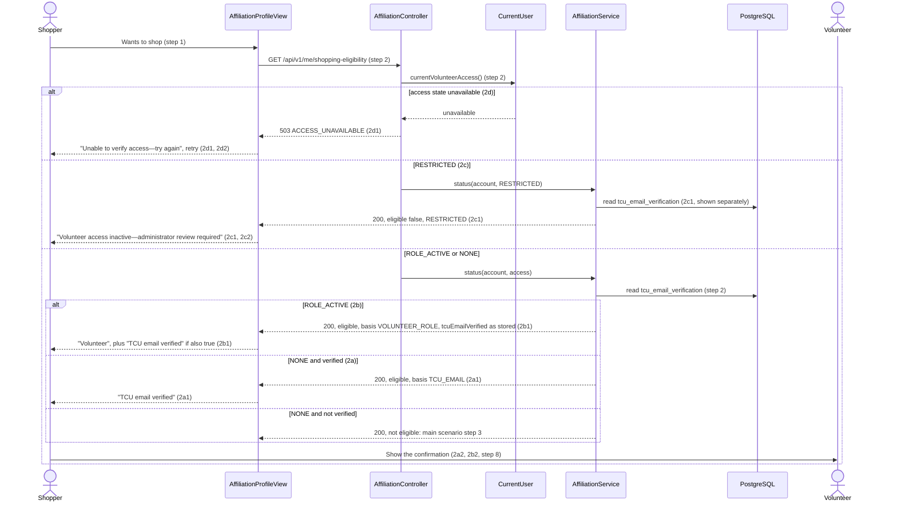
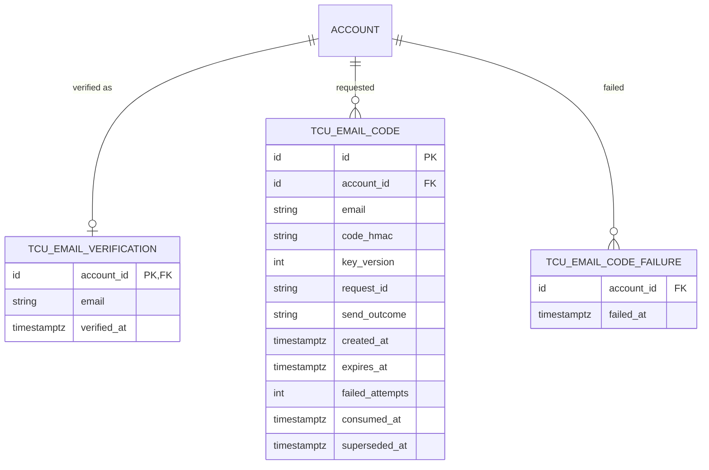

# Identity Verification Design

**Project:** ReFrog
**Team:** Team 3
**Area:** `IDV`

> **Realizes:** `UC-IDV-verify-affiliation`, `FR-AUTH-affiliation-from-signin`, `FR-AUTH-verification-code`, `FR-AUTH-verification-limits`, `FR-AUTH-verification-ownership`, IDV's part of `FR-AUTH-shopping-eligibility` (the eligibility check Shopping calls)
> **Depends on:** `BR-shopper-tcu-affiliation`, `BR-shopper-verification`, `BR-tcu-email-domain`, `BR-volunteer-role-approval`, `BR-volunteer-role-lifecycle`, `FR-AUTH-enforce-permissions`, `FR-AUTH-volunteer-lifecycle`, `FR-VAL-server-validation`, `FR-VAL-field-feedback`, `FR-VAL-preserve-input`, `FR-SAVE-confirmed-success`, `FR-SAVE-unknown-outcome`, `ROB-external-service-failure`, `SEC-affiliation-data`, `SEC-authentication-provider`, `SEC-transport-encryption`, `UI-account-profile`, `KD-tech-stack`
> **See:** [Use cases](../requirements/use-cases.md#area-identity-verification-idv), [Business rules](../requirements/business-rules.md), [Specification](../requirements/software-requirements-specification.md), [Architecture of record](architectural-design.md) (§5.2 components, §8 crosscutting concepts, §9.2 `KD-tech-stack`)
> **Designed against:** `d8893c1` (first draft); revised for `UC-IDV-verify-affiliation` against `main` `f781bf3` (which includes `KD-tech-stack`), 2026-10-30. `CurrentUser.volunteerAccess`, `VOLUNTEER_ACCESS_INACTIVE`, and `ACCESS_UNAVAILABLE` come from the VOL design merged in #66; re-checked against `main` after #66 and #69 (which added the `FR-AUTH-verification-*` requirements and `BR-tcu-email-domain`). No application code exists yet; every class below is new.

---

_**How to use this template.** Copy it to `docs/design/<area>.md`, named for the lowercase area code (`ord.md` for `UC-ORD-*`). Instructions appear in italic square brackets; leave them in place until the document is stable, because the agent reads them on every later pass. The full worked example is Project Pulse's [`not.md`](https://github.com/Washingtonwei/project-pulse/blob/main/docs/design/not.md); read it for the shape, not for the answers._

_**What this document is.** The **design-of-record** for one use case area: how the code will realize its use cases, written **before** the code and approved before anyone builds from it. It is the last document your agent reads before it writes code, so anything it leaves out, the agent invents. Your [architecture-of-record](architectural-design.md) is the map of the whole system and stops at each component's responsibility; this document goes one level down, inside one area, against real code._

_**What it is not.** A copy of your use cases. It **cites** `UC-*`, `FR-*`, and `BR-*` by identifier and never restates what the system shall do; it says only how. It is also not a transcript of the code. Once code exists, link to the files rather than describing every class, column, or getter._

_**One document per area, not per use case.** Your area gains use cases over the term. The overview, the class diagram, and the data model are **revised in place** when it does. The sequence diagrams, the API contract rows, and the test rows are **appended**, one set per use case. Never add a `## UC-…` section that repeats the whole skeleton._

_**How much to write.** Pin down what a wrong guess would break: a requirement, a business rule, a quality attribute, or the contract between two parts of your team. Leave the rest for the agent to derive while it builds: variable names, field types, exact JSON, column lengths. When you are unsure, ask which side of that line a detail falls on, not whether it is interesting._

---

## Overview

_[One paragraph: what this area does, which components of your [architecture-of-record](architectural-design.md) it lives in, and what it reads from or calls in other areas. Link the container diagram rather than redrawing it. If this design changes the architecture-of-record, say so here and list the change under "Changes to the architecture-of-record" below.]_

Identity Verification decides whether a signed-in account may shop, and runs the TCU email one-time-code check that is one of the two ways to qualify (`UC-IDV-verify-affiliation`, `FR-AUTH-shopping-eligibility`). It is the `IDV` component of the one Spring Boot Application, and its screen is a section of the Vue `UI-account-profile` view ([containers](architectural-design.md#51-containers), [components](architectural-design.md#52-use-case-areas-and-components)). It reads the account identity, current volunteer access, and lifecycle restriction from Authentication's `CurrentUser` (the contract [vol.md](vol.md) fixed), never from the browser. It sends codes through the one shared email delivery adapter (architecture §3, §5.1). It owns its own verification and code tables in PostgreSQL. Shopping calls `AffiliationService.checkShoppingEligibility()` on every protected submission, and IDV owns that method. This revision does not change the architecture-of-record.

## Components & classes

_[One class diagram for the whole area, and one line per class or file saying what it does and whether it is **new** or **reused**. Show only what a reader needs to see how the parts relate: classes, their key methods, their dependencies. Fields and getters belong to the code._

_**If your repository has no code for this area yet**, which is the normal case for your proving slice, list the files you expect the agent to create, with the paths your architecture-of-record's conventions give them, and mark them all new. The agent then builds into the structure you chose rather than one it improvised.]_

The repository has no code yet, so every file is new. Paths use the `server/<module>/…` and `client/<module>/…` shorthand that [vol.md](vol.md) uses. The exact package root follows whatever layout the first code records under §8.2.4.

- `client/idv/AffiliationProfileView` (new): the identity section of `UI-account-profile`. It renders the status from `GET /api/v1/me/shopping-eligibility`. It shows "TCU email verified" and the "Volunteer" role as separate facts (2b1). It shows "Volunteer access inactive—administrator review required" for `RESTRICTED` (2c1) and "Unable to verify access—try again" with a retry for `503 ACCESS_UNAVAILABLE` (2d1). It offers the email form and code form only when the account is not eligible and not restricted. The explanation of both qualifying paths sits beside the email form, so a shopper with neither sees why they cannot shop (5b1). It names the bad field and keeps the typed email on `422` (§8.2.5), offers resend after a rejected code (5a1), and disables resend until `resendAvailableAt`. It generates a new `requestId` for each explicit send and reuses it when it retries that same send after a dropped response.
- `server/idv/AffiliationController` (new): three endpoints. It takes the account only from `CurrentUser` and validates request shape, nothing else.
- `server/idv/AffiliationService` (new): every IDV rule. It checks the restriction before eligibility, the exact domain, rate limits, code lifetime and attempts, and supersede-on-resend. It reads time from the injected `Clock`. `checkShoppingEligibility()` is the only thing Shopping calls.
- `server/idv/TcuEmailVerificationRepository`, `server/idv/TcuEmailCodeRepository` (new), with their JPA entities: the only code that touches IDV's tables (see Data model). `lockLiveCode` reads the account's live code row with a `PESSIMISTIC_WRITE` lock (PostgreSQL `SELECT … FOR UPDATE`).
- `server/idv/CodeVerifier` (new): HMAC-SHA256 over the account, code row, and code, using versioned keys from deployment secrets (§8.2.6). Comparison is constant-time.
- `CurrentUser` (reused, owned by Authentication): the account id and current volunteer access. [vol.md](vol.md) fixed `volunteerAccess(eventId)`. IDV has no shift and so no event, so it needs **`currentVolunteerAccess()`**, which resolves the current annual event inside Authentication (see Key decisions and Open questions). It fails as unavailable rather than defaulting. IDV relies on this mapping, which Authentication must implement:
  - `ROLE_ACTIVE`: the role is held for the current event.
  - `RESTRICTED`: the role was explicitly removed, or it expired at an event's end and has not been renewed (`BR-volunteer-role-lifecycle`). This holds between events too.
  - `NONE`: the account never held the role, or has only a pending or declined request (`BR-volunteer-role-approval`: a request conveys no permissions, and a decline imposes no restriction).

  IDV's build adds **no** Authentication code: no sign-in, no account table, no Spring Security setup. It codes against the `CurrentUser` interface and stubs it in tests. Using IDV end to end waits for Authentication to exist (`SEC-authentication-provider`, §8.1).
- `EmailSender` (reused, shared delivery adapter, architecture §3 and §5.1): the one adapter every area sends email through. Verification codes go by email only, never to the in-app inbox (SRS §5.2 notifications). If IDV is built before any other area that sends email, IDV's build creates only the provider-neutral interface and a test fake. The provider is not chosen, so no real implementation is written.
- `Clock` and the shared error handler (reused, §8.2.1, §8.2.2): same as VOL.

## Sequence

_[One sequence diagram per use case for its main success scenario, plus one for each extension that does not just return an error. **Label each interaction with the use case step it implements**, so a reviewer can check that every step is realized and nothing extra was invented. Use `alt` blocks for extensions that branch off the main flow. Give each use case its own `###` heading; that heading is the anchor your traceability matrix cites.]_

### UC-IDV-verify-affiliation: verifying shopping eligibility

#### Main success scenario, with 3a and 5a

#### Step 2 outcomes: 2a, 2b, 2c, 2d

If the database read fails in any branch, the result is the same `503 ACCESS_UNAVAILABLE` as 2d (§8.2.1).

**5b** has no server interaction. The not-eligible screen always explains that verified TCU email or a current approved volunteer role is required. No endpoint grants access any other way, and there is no visual-ID path (`OI-19`).

**Shopping (`UC-SHP-log-item-taken` PRE-1).** On each protected submission, Shopping calls `checkShoppingEligibility()`, which follows the same step 2 order: `CurrentUser.currentVolunteerAccess()`, then `tcu_email_verification`. It returns `RESTRICTED`, `ELIGIBLE(VOLUNTEER_ROLE)`, `ELIGIBLE(TCU_EMAIL)`, or `NOT_ELIGIBLE`, or it throws the shared unavailable exception.

## API contract

_[One row per endpoint, scheduled job, or message this area adds or changes, appended per use case. **This section is never dropped**: before the code exists it is the only thing the person (or agent session) building the front end and the one building the back end both read. Name the caller and who may call it, the request fields, the success response, and the error each extension returns. Leave field types and exact JSON to the agent unless a wrong guess would break something, such as a format another system depends on. Use the error shape your architecture-of-record's section 8.2 fixes; do not invent one here.]_

Architecture §8.2.1 and §8.2.3 do not fix the response envelope yet, so this table fixes only the error **codes** the front end branches on, the same approach [vol.md](vol.md) takes. Each code sits in a machine-readable field of whatever envelope the team fixes, produced by the one shared error handler. `VOLUNTEER_ACCESS_INACTIVE` and `ACCESS_UNAVAILABLE` are the same codes VOL uses. "Access unavailable" reaches the handler as its own exception mapped to `503`, never the generic `500`. Times are ISO-8601 with their UTC offset. No endpoint accepts an account id or role from the browser.

| Endpoint or operation | Caller (who may) | Request | Success | Errors, by extension |
|---|---|---|---|---|
| `GET /api/v1/me/shopping-eligibility` | Any signed-in account, for itself only | None | `200`: `eligible`, `basis` (`TCU_EMAIL`, `VOLUNTEER_ROLE`, or none), `tcuEmailVerified`, `volunteerAccess` (`ROLE_ACTIVE`, `NONE`, or `RESTRICTED`), and `pendingCodeExpiresAt` only for a code that is not consumed or superseded, has fewer than five failures, and has not reached `expires_at`. Never the code, and not the verified email address. | 2a: `200`, eligible, `TCU_EMAIL`. 2b: `200`, eligible, `VOLUNTEER_ROLE`, `tcuEmailVerified` as stored. 2c: `200`, not eligible, `RESTRICTED`. 2d (access or database state unavailable): `503 ACCESS_UNAVAILABLE`. Not signed in: `401`. |
| `POST /api/v1/me/tcu-email/codes`: first send and resend | Any signed-in account that is not `RESTRICTED`, for itself only | `email`; `requestId` (client-generated, new for each explicit send, reused only to retry that same send) | `202`: `expiresAt`, `resendAvailableAt`. It means the provider accepted the send, never that the email arrived. A repeat of the same `requestId` and email returns the original `202` only if that send was accepted, and sends nothing. | 3a: `422 VALIDATION_FAILED` naming `email`. 2c: `403 VOLUNTEER_ACCESS_INACTIVE`. 2d: `503 ACCESS_UNAVAILABLE`. Cooldown or hourly limit: `429 TOO_MANY_REQUESTS` with the retry time. The account is already verified: `409 ALREADY_VERIFIED`. Same `requestId` with a different email: `409 REQUEST_ID_REUSED`. Provider failure or timeout, or a retry whose send has no recorded outcome yet: `503 EMAIL_NOT_SENT`; the new code stays committed and the previous one stays superseded. Not signed in: `401`. Nothing is written for any error except `EMAIL_NOT_SENT`. |
| `POST /api/v1/me/tcu-email/verification` | Any signed-in account that is not `RESTRICTED`, for itself only | `code` (six digits, leading zeros kept) | `200`: `tcuEmailVerified: true`, `verifiedAt`, and the same status fields as the `GET`. Sent only after the commit (`FR-SAVE-confirmed-success`). | 5a, wrong code with attempts left on it: `422 CODE_INVALID`. 5a, expired, superseded, already consumed, invalidated by its fifth failure, or no live code: `422 CODE_EXPIRED`. Both offer resend. Not exactly six digits after trimming: `422 VALIDATION_FAILED` naming `code`. Account failure budget exceeded: `429 TOO_MANY_REQUESTS` with the retry time. 2c: `403 VOLUNTEER_ACCESS_INACTIVE`. 2d: `503 ACCESS_UNAVAILABLE`. Save failure: `5xx`, nothing saved; on any `5xx` without one of these codes, or a dropped response, the client re-reads the `GET` (`FR-SAVE-unknown-outcome`). Not signed in: `401`. |
| `AffiliationService.checkShoppingEligibility()` (in-process; Shopping) | Shopping's server code, on every protected submission; the account comes from `CurrentUser` | None | `ELIGIBLE` with its basis, `NOT_ELIGIBLE`, or `RESTRICTED` | State unavailable: throws the shared unavailable exception (`503 ACCESS_UNAVAILABLE` at Shopping's HTTP boundary). Never returns `NOT_ELIGIBLE` for an unavailable lookup. |

There is no visual-ID override endpoint (5b, resolved `OI-19`). Volunteer requests, grants, removals, and renewals are not IDV endpoints; ADM and Authentication own them.

## Key decisions

_[Only the decisions a reader could not recover from the code: an invariant, who may do this and how it is enforced, a trade-off you chose, a reason you reused something rather than writing it. **Each one names what you chose, what you rejected, and why.** If you cannot name an alternative you considered, it probably was not a decision; leave it out._

_A decision that affects the whole system rather than this area is an architecture decision. It belongs in your architecture-of-record as a `KD-*` entry, not here.]_

**Restriction first, then either qualifying path.** `currentVolunteerAccess()` is read before anything else. `RESTRICTED` ends the check whatever `tcu_email_verification` holds (2c, `FR-AUTH-volunteer-lifecycle`). `ROLE_ACTIVE` qualifies without email verification and never writes it (2b). `NONE` falls to the saved email verification. Rejected: one shared "verified" flag set by either path, because it would mark volunteers as email-verified and would survive role removal (`FR-AUTH-shopping-eligibility`).

**IDV asks Authentication for the current event's access, with no event id.** VOL passes a shift's event to `volunteerAccess(eventId)`, but IDV has no shift. `currentVolunteerAccess()` lets Authentication, which §5.2 already makes owner of event-scoped access and renewal state, decide which annual event is current. Rejected: IDV asking ADM for the current event and passing it in, because that adds an IDV→ADM dependency §5.2 does not list, and Shopping would have to repeat it. This is a contract the future `authentication.md` must adopt (see Open questions).

**The status read is one read-only transaction, and any failure in it is 2d.** Access state, email verification, and role all come from the one PostgreSQL database, so the read either succeeds whole or returns `503 ACCESS_UNAVAILABLE`. Rejected: reporting eligibility when one source answered and the other failed. `FR-AUTH-shopping-eligibility` permits skipping the second source, but within one database the partial case adds branches and tests for nothing. Restriction state is still required on every path (§8.2.1).

**A restricted account gets `200` from the status read and `403` from the writes.** The profile must show the inactive message and still show retained email verification as a separate fact (2c1). Rejected: `403` on the `GET`, which would leave the profile unable to render 2c. The writes refuse because 2c ends the use case (2c2).

**Commit the code first, then send the email outside the transaction.** The request transaction checks limits, supersedes the live code, inserts the new one, and commits. Only then does `EmailSender` run. Rejected: sending inside the transaction, which holds a database transaction open across a network call and can email a code whose row then rolls back. Consequence, approved 2026-10-16: if sending fails, the new code remains the live one and the old code stays superseded (`503 EMAIL_NOT_SENT`, retry within the limits). If the commit fails, nothing is sent and the previous code is untouched.

**At most one live code per account, enforced by the database.** A partial unique index allows one row per account with neither `consumed_at` nor `superseded_at` set. Of two concurrent requests, the second fails that index and is answered as the cooldown's `429`. Verification locks the live row (`SELECT … FOR UPDATE`). Two concurrent submissions of the same code therefore run one after the other, and only the first can consume it. Consumption and the `tcu_email_verification` upsert commit or roll back together (§8.2.8). Rejected: checking "is there a live code" in Java and then writing, because two requests can both pass the check.

**Codes are stored as a keyed HMAC, and keys are versioned.** `CodeVerifier` computes HMAC-SHA256 over the account, code row, and code. The key comes from deployment secrets (§8.2.6), and each row records its key version, so an old key is kept until its outstanding codes expire (approved 2026-10-16). Generate codes with `SecureRandom`, and generate again if the new code equals the one it supersedes (approved). Rejected: plaintext, or a plain hash, because six digits are recovered from a leaked hash by trying all million values.

**One shared email adapter.** IDV sends through the shared `EmailSender` (charter; architecture §3, §5.1). Provider acceptance means "requested", never "received" or "verified". A provider timeout is `503 EMAIL_NOT_SENT` with no automatic background resend. Rejected: an IDV-only email client, which the earlier draft of this document had and which would put a second provider integration in the codebase.

**Exact `tcu.edu` only, with a lenient shape check.** The domain rule is `BR-tcu-email-domain`. Trim the address and lowercase it. It is well formed if it has exactly one `@`, a non-empty local part with no whitespace or control characters, and at most 254 characters. The local part's characters are otherwise not restricted, so a real TCU address is never rejected for its spelling (`BR-shopper-tcu-affiliation`). Then accept it only if the part after the `@` equals `tcu.edu` (approved 2026-10-16; source `OI-10`). Control of the inbox, proven by the code, is the real check. Subdomains such as `frog.tcu.edu` and lookalikes such as `tcu.edu.co` are rejected. The lowercased address is what is stored and what per-email limits count. Rejected: any domain ending in `tcu.edu`, because the approved boundary is the exact domain.

**Duplicate send actions are absorbed by `requestId`.** A retry of the same send, for example after a dropped response, returns the first outcome without a new code or email. If the first attempt is still in flight, the retry waits on the unique (`account_id`, `request_id`) index and then returns the same outcome. A retry after `503 EMAIL_NOT_SENT` returns `503 EMAIL_NOT_SENT` again; it never re-dispatches an uncertain send. A retry that finds the row with no `send_outcome` yet gets the same response: the first send is still in flight, or the server stopped after the commit. Only a recorded acceptance ever produces `202` (`ROB-external-service-failure`, `ROB-submission-status`). If the outcome stays empty because the server stopped, the code still occupies the live slot and counts toward the limits, and the shopper recovers with an explicit resend after the cooldown. An explicit resend uses a new `requestId` and is subject to the cooldown (approved 2026-10-16). Rejected: relying on the cooldown alone, because then the client cannot tell a retry of its own send from a refused second send.

**A verified account cannot request another code.** Once verified, the profile shows the saved confirmation (2a) and offers no email form; a code request returns `409 ALREADY_VERIFIED` and changes nothing. Rejected: replacing the verified address, because no requirement asks for it (decided 2026-10-30, no added scope).
**Verification belongs to the account, not the email address.** A code verifies only the account and address it was issued for. Verification never moves to another account because the email matches. It survives sign-in email changes on the same account, because the table is keyed by `account_id` (approved 2026-10-16). Rejected: keying by email address, which would let a second account inherit someone's verification.

**Successful verifications are not audited.** `verified_at` on the current row is the only record. Rejected: the per-verification audit history the earlier draft carried, because architecture §8.2.9 limits auditing to administrator sign-in and administrator changes, and SRS §7.4.5 requires client approval for additional personal data. Developer decision, 2026-10-30.

### Code and rate-limit policy

The values are `FR-AUTH-verification-code` (format, lifetime, latest code only) and `FR-AUTH-verification-limits` (attempt and request limits). All counts are enforced on the server from database rows, so they hold across sessions and concurrent requests. A refused request returns `429 TOO_MANY_REQUESTS` with the retry time; a resend supersedes the previous code without resetting the account-wide failure count.

Only a `CODE_INVALID` result counts as a failure: it increments that code's `failed_attempts` and writes one `tcu_email_code_failure` row. A submission against an expired, superseded, consumed, or missing code (`CODE_EXPIRED`), a malformed code (`VALIDATION_FAILED`), or one refused with `429` counts toward neither limit. A code request that ends in `503 EMAIL_NOT_SENT` still wrote its row, so it counts toward the cooldown and the hourly limits. When several limits apply, the retry time is the latest of them. No network or IP-address limit is approved.

## Data model

_[The **change** this area makes to the data: new tables or entities, new columns, the migration that adds them. Draw an ER diagram when there is more than one new table. Do not redraw the domain model; your [specification](../requirements/software-requirements-specification.md) owns it, so link it and show only the change. If the area changes nothing, say "No change" and give the reason in one line; that is a design decision too.]_

Three new tables, owned by IDV, created by IDV's first migration. `account` belongs to Authentication and is shown only for its foreign key.

- `tcu_email_verification`: one row per verified account. If there is no row, the account is not verified. It realizes "persisted TCU email verification" (`FR-AUTH-affiliation-from-signin`) and is stored separately from roles (SRS §7.4.5).
- `tcu_email_code`: one row per code request. A partial unique index on `account_id` where `consumed_at IS NULL AND superseded_at IS NULL` enforces one live code. A unique index on (`account_id`, `request_id`) absorbs duplicate send actions, and `send_outcome` (accepted or failed) lets a retry return the first outcome. Hourly limits count rows by `created_at`, per account and per `email`. The cooldown reads the newest row's `created_at`.
- `tcu_email_code_failure`: one row per incorrect submission, for the ten-per-15-minutes budget that survives resends. It is written and committed even though the submission is refused.
- All timestamps are `timestamptz` and are compared only with `Clock` (§8.2.2).
- No role, restriction, or event column is copied into IDV; `CurrentUser` owns them. No code, HMAC key, or raw TCU ID is stored.
- Retention and pruning of old code and failure rows, and of verified emails, wait on `OI-6`. Rows older than one hour no longer affect any limit, so pruning them later changes no behavior.
- The SRS data dictionary's `Shopper.verificationStatus` and `affiliationType` are realized only as "row exists or not" in `tcu_email_verification`. The email check cannot tell student from staff, so no affiliation type is stored.

## Reuse & cross-cutting

_[Which existing services, components, and conventions this area uses rather than rebuilding: authentication, the error handler, email, the clock, another area's service. Cite your architecture-of-record's section 8.2 for each convention by name rather than restating it.]_

- **Authentication** (§8.1): `CurrentUser.accountId()` and `currentVolunteerAccess()`. Session, cookie, and CSRF handling for IDV's `POST`s come from the application-wide Spring Security configuration Authentication owns; IDV adds none.
- **Email:** the shared `EmailSender` adapter (§3, §5.1). The provider is not chosen, and no provider name appears in IDV code.
- **Error handling and API** (§8.2.1, §8.2.3): the shared handler, the codes above, and `/api/v1/me/...` naming consistent with VOL.
- **Time** (§8.2.2): `Clock` for expiry, cooldown, and rolling windows. `expiresAt` is displayed in `America/Chicago` on a 12-hour clock.
- **Validation** (§8.2.5): the server check is the one that counts; the client may pre-check the domain for feedback only.
- **Configuration and secrets** (§8.2.6): HMAC keys and their versions, and provider credentials, come from deployment secrets.
- **Logging** (§8.2.7): log outcomes such as code requested, delivery failed, or limit hit, with the account id only. Never log the code, the HMAC, a key, or the email address.
- **Persistence** (§8.2.8): one transaction for each code request and each verification, as described in Key decisions.
- **Auditing** (§8.2.9): none. IDV changes are not administrator changes.
- **Testing** (§8.2.10): synthetic accounts, a fake `EmailSender`, a fixed `Clock`, and a stubbed `CurrentUser`.
- **Service worker:** `/api/v1/me/shopping-eligibility` is network-only like every other `/api/v1/*` call; nothing is cached for an offline display (decided 2026-10-30), and no `POST` is queued, the same as VOL.

## Tests

_[One row per flow: the main success scenario and **every** extension of every use case this document realizes, appended per use case. Name the level (unit or integration) and what the test asserts. No code. This list is the definition of done that the reviewer approves; the agent writes these tests when it builds, and a reviewer can see at a glance whether an extension has no test.]_

| Use case, flow | Level | Asserts |
|---|---|---|
| UC-IDV-verify-affiliation main | integration | `NONE` account, valid `tcu.edu` email: `202`, the fake `EmailSender` gets one code. Submitting it gives `200`, one `tcu_email_verification` row, and the code consumed. The `GET` then returns eligible with `TCU_EMAIL` |
| main, persists across sessions | integration | After verification, a new session's `GET` returns eligible with no code step (`FR-AUTH-affiliation-from-signin`) |
| 2a | integration | Verified `NONE` account: `GET` gives `200`, eligible, `TCU_EMAIL`. No code is created |
| 2b, role only | integration | `ROLE_ACTIVE` account with no verification: `200`, eligible, `VOLUNTEER_ROLE`, `tcuEmailVerified: false`, and no row written |
| 2b, role and email | integration | `ROLE_ACTIVE` and verified: `200`, eligible, `tcuEmailVerified: true` reported separately |
| 2b and 2c, front end | unit (front end) | Shows "Volunteer" and "TCU email verified" as separate facts. A role-only account never shows "TCU email verified". `RESTRICTED` shows the inactive message and no email form |
| 2c, status | integration | `RESTRICTED` and verified: `GET` gives `200`, not eligible, `RESTRICTED`, `tcuEmailVerified: true` |
| 2c, writes | integration | `RESTRICTED`: both `POST`s give `403 VOLUNTEER_ACCESS_INACTIVE`, and nothing is written or sent |
| 2d | integration | `currentVolunteerAccess()` unavailable, or the repository read failing: the `GET` and both `POST`s give `503 ACCESS_UNAVAILABLE`. The existing `tcu_email_verification` row is unchanged. A retry after recovery succeeds |
| 2d, front end | unit (front end) | `503 ACCESS_UNAVAILABLE` shows "Unable to verify access—try again" with retry |
| 3a | unit | `a@tcu.edu` and `A@TCU.EDU` accepted and stored lowercase. `a@frog.tcu.edu`, `a@tcu.edu.co`, `a@xtcu.edu`, malformed addresses, and blank fail with `422 VALIDATION_FAILED` naming `email`, with no row and no email |
| 3a, shape | unit | `first.last+x@tcu.edu` and `o'neil@tcu.edu` are accepted. `a@b@tcu.edu`, `@tcu.edu`, an address containing a space, and a 255-character address are refused with `422` naming `email` |
| 3a, front end | unit (front end) | On `422` the typed email stays in the field and the field is named |
| 5a, wrong code | integration | Wrong code: `422 CODE_INVALID`, `failed_attempts` incremented, one failure row, no verification |
| 5a, fifth failure | integration | The fifth wrong code invalidates the code: even the correct code then gets `422 CODE_EXPIRED` |
| 5a, expiry boundary | unit | With a fixed `Clock`, the correct code one second before `expires_at` is accepted, and at `expires_at` gets `CODE_EXPIRED` |
| 5a, resend | integration | After the cooldown, a resend with a new `requestId` supersedes the old code. The old code gets `CODE_EXPIRED` and the new one verifies |
| 5a, failure budget survives resend | integration | Ten failures across two codes inside 15 minutes: the eleventh submission gets `429` with a retry time, even with the correct code. It succeeds after the window passes |
| 5a, what counts as a failure | integration | `CODE_EXPIRED`, `VALIDATION_FAILED` (for example `12a456`), and `429` submissions write no failure row and leave `failed_attempts` unchanged. Each `CODE_INVALID` writes exactly one |
| 5b | unit (front end) | The not-eligible screen explains both qualifying paths. No control or endpoint grants access without verified email or the role |
| Shopping check | integration | `checkShoppingEligibility()` returns `RESTRICTED` for a restricted verified account, `ELIGIBLE(VOLUNTEER_ROLE)`, `ELIGIBLE(TCU_EMAIL)`, and `NOT_ELIGIBLE` for neither. It throws the unavailable exception, never `NOT_ELIGIBLE`, when access state fails |
| Access mapping assumed from Authentication | integration | With `CurrentUser` stubbed to the contract's mapping: an expired role (`RESTRICTED`) with verified email is not eligible, and a declined request (`NONE`) with verified email is eligible with `TCU_EMAIL` |
| Revocation, existing session | integration | Role removed mid-session (stub changes to `RESTRICTED`): the next `checkShoppingEligibility()` returns `RESTRICTED` |
| Cross-account | integration | A code issued to account A, submitted by account B, does not verify B (B has no live code: `CODE_EXPIRED`), and A's code is untouched |
| Concurrent verification | integration | Two concurrent submissions of the correct code: exactly one `200`, one consumption, one verification row |
| Concurrent requests | integration | Two concurrent requests with different `requestId`s: one `202` and one `429`, and one live code |
| Duplicate send action | integration | The same `requestId` twice: one code, one email, both `202` with the same `expiresAt`. The same `requestId` with a different email: `409 REQUEST_ID_REUSED` |
| Delivery failure | integration | `EmailSender` throws or times out: `503 EMAIL_NOT_SENT`. The new code row is live, the previous code is superseded, and a retry with the same `requestId` returns `503 EMAIL_NOT_SENT` without sending |
| Retry while the send is in flight | integration | A same-`requestId` retry while the first request's `send_outcome` is still empty (`EmailSender` blocked) returns `503 EMAIL_NOT_SENT`, never `202`, and sends nothing. A row left with an empty outcome blocks a new `requestId` only until the cooldown passes |
| Save failure | integration | Failing the verification commit: `5xx`, the code is not consumed, and there is no verification row |
| Request limits | integration | A second request within 60 seconds gets `429`, and is allowed at 60 seconds. The sixth request in a rolling hour gets `429` per account, and separately per destination email from two accounts. Boundaries use the fixed `Clock` |
| Already verified | integration | A verified account's code request, for any address, gets `409 ALREADY_VERIFIED`; no code row, no email, and the saved verification is unchanged |
| Key rotation | unit | A code hashed under key version 1 still verifies after version 2 becomes current |
| Code generation | unit | Codes are six digits with leading zeros kept. A replacement never equals the code it supersedes |
| Logging | integration | Logs from the main flow, 5a, and delivery failure contain no code, HMAC, key, or email address |
| Signed out | integration | All three endpoints give `401` |

## Changes to the architecture-of-record

_[Designing an area against real code is when the architecture's guesses meet reality. If this design needs a component the map does not have, moves a responsibility, or adds a dependency, **change [the architecture-of-record](architectural-design.md) in the same pull request** and list each change here in one line. If nothing changed, write "None". A design that silently disagrees with the architecture leaves two maps, and the agent will follow whichever it reads last.]_

None in this revision. Architecture §5.2 already lists IDV's dependencies as Authentication and the email delivery channel. `currentVolunteerAccess()` is a method on the existing Authentication component, not a new dependency.

## Open questions & risks

_[What this design could not settle and who can, and what could go wrong that you are accepting. A question for the client also goes in [`OPEN-ISSUES.md`](../requirements/OPEN-ISSUES.md).]_

| Item | Owner | Effect and what resolves it |
|---|---|---|
| `CurrentUser.currentVolunteerAccess()` | Authentication (and ADM for "which event is current") | IDV and Shopping need the current event's access without an event id. The architecture links an `authentication.md` that does not exist yet; whoever writes it adopts this method next to VOL's `volunteerAccess(eventId)`. Between events, the method's answer for a past volunteer follows `BR-volunteer-role-lifecycle`. |
| Shopping's contract | SHP owner | [shp.md](shp.md) calls `AffiliationService.isVerified` and refuses with `AFFILIATION_NOT_VERIFIED`, which leaves out the volunteer path and the restriction that `FR-AUTH-shopping-eligibility` requires. SHP should call `checkShoppingEligibility()` and map `RESTRICTED`, `NOT_ELIGIBLE`, and unavailable. This design does not edit shp.md. |
| `OI-22`: expiry restricts past volunteers | Client | Under `BR-volunteer-role-lifecycle`, a past volunteer who is a TCU student cannot shop at the next event until renewed, even with verified email. This design builds the rule as written. |
| `OI-6` retention | Client and TCU data governance | Retention and pruning of verified emails and of code and failure rows. |
| Response envelope (**build prerequisite**) | Team | §8.2.1 and §8.2.3 still do not fix it, and IDV fixes only codes. `/implement` must not choose one: the team records it once in §8.2.3 before IDV's (or any area's) first endpoint is built. |
| Authentication not built | Team (build order) | IDV can be built and tested against a stubbed `CurrentUser`, but it cannot run end to end, or create its `account` foreign key, until Authentication exists. |
| Email provider | Team (`OI-15` hosting) | The `202` means provider acceptance only. A slow provider shows up as `503 EMAIL_NOT_SENT` with retry; no background resend is designed. |

---

## Working this document with your agent

_[Delegate: drafting the diagrams from your sketch and the use case; listing the existing files a class should extend; filling the contract rows' request and response fields; proposing the test row for each extension; drafting the rejected alternative for a decision you have already made; checking that every identifier this document cites exists in the document that owns it._

_Keep human: which side of the "would a wrong guess break something" line each detail falls on; every key decision; and the approval, which is a teammate's review of the pull request, not the drafter's own reading._

_**The specific failure to watch for: scope that nobody asked for.** An agent drafting a design adds what designs it has read usually have: an admin override, a retry queue, a status field, a notification "while we are here". Each looks reasonable and none is in your use case, and once it is in the design the agent will build it, test it, and you will maintain it. Read the sequence labels: every interaction should name the use case step it implements. An interaction with no step is either a missing requirement, which goes to your specification and your client, or scope creep, which comes out.]_

---

## The questions test (before you open the pull request)

_[Start a **fresh** agent session in plan mode, so it carries nothing from the session that drafted this document. Give it only the use case, the business rules it cites, your architecture-of-record's section 8, and this document, and ask:_

> _List every point you would still have to guess to implement `<UC-ID>`. For each, say what you would guess and whether a wrong guess could violate a requirement. Do not write code._

_For each item on its list, either fix this document or keep the guess and write one line saying why a wrong guess breaks no requirement. Paste the list, with your answer to each item, into the pull request description under How it was verified, inside a collapsed `

Questions test
 … 
` block so the description stays short. The design is ready when nothing on the list could break a requirement.]_

**Status for the 2026-10-30 revision:** run on 2026-10-30. It found 22 guesses: 10 that could break a requirement and 12 that could not. The ten were settled in this document, sent to the client as open issues, or recorded as the envelope build prerequisite. The full list and the answer to each are in the pull request description. The earlier draft's table was removed because it answered against that draft.
