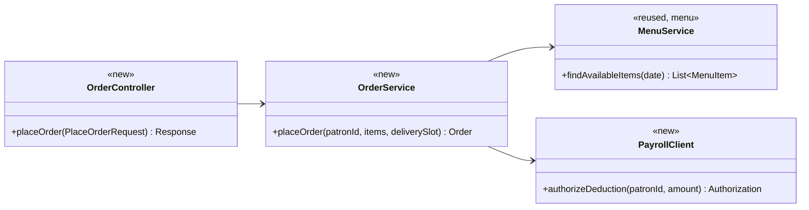
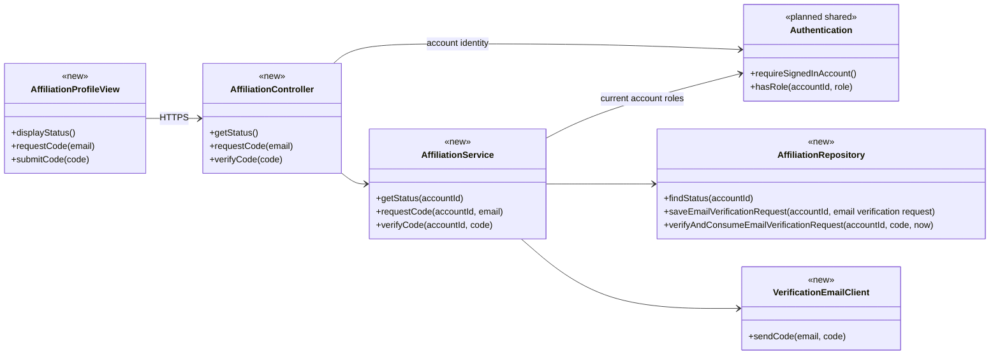
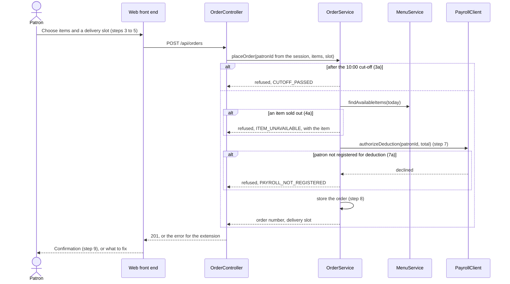
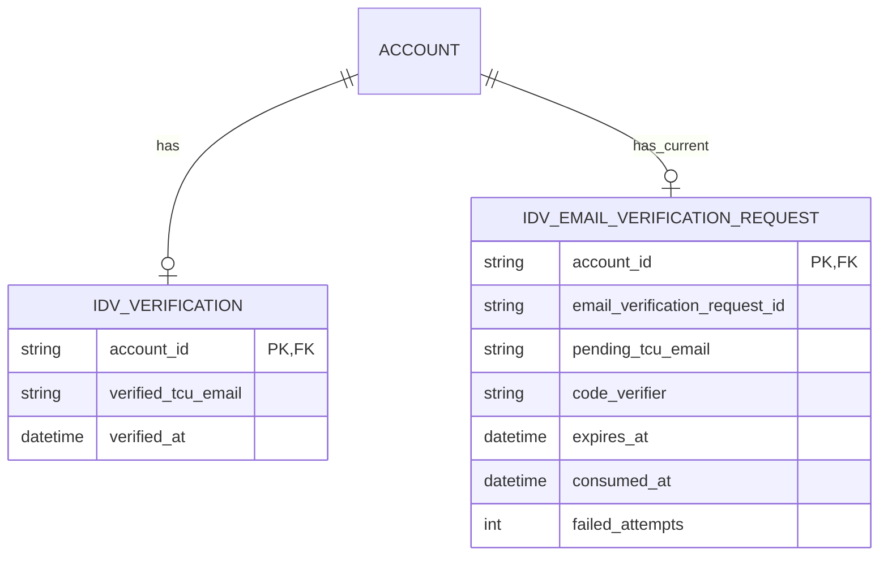

# Identity Verification Design

**Project:** ReFrog
**Team:** Team 3
**Area:** `IDV`

> **Realizes:** `UC-IDV-verify-affiliation`, `FR-AUTH-affiliation-from-signin`
> **Depends on:** `BR-shopper-tcu-affiliation`, `BR-shopper-verification`, `FR-AUTH-enforce-permissions`, `SEC-affiliation-data`, `SEC-authentication-provider`, `SEC-transport-encryption`
> **See:** [Use cases](../requirements/use-cases.md#area-identity-verification-idv), [Business rules](../requirements/business-rules.md), [Specification](../requirements/software-requirements-specification.md), [Architecture of record](architectural-design.md)
> **Designed against:** `d8893c1`
---

_**How to use this template.** Copy it to `docs/design/<area>.md`, named for the lowercase area code (`ord.md` for `UC-ORD-*`). Instructions appear in italic square brackets; leave them in place until the document is stable, because the agent reads them on every later pass. The full worked example is Project Pulse's [`not.md`](https://github.com/Washingtonwei/project-pulse/blob/main/docs/design/not.md); read it for the shape, not for the answers._

_**What this document is.** The **design-of-record** for one use case area: how the code will realize its use cases, written **before** the code and approved before anyone builds from it. It is the last document your agent reads before it writes code, so anything it leaves out, the agent invents. Your [architecture-of-record](architectural-design.md) is the map of the whole system and stops at each component's responsibility; this document goes one level down, inside one area, against real code._

_**What it is not.** A copy of your use cases. It **cites** `UC-*`, `FR-*`, and `BR-*` by identifier and never restates what the system shall do; it says only how. It is also not a transcript of the code. Once code exists, link to the files rather than describing every class, column, or getter._

_**One document per area, not per use case.** Your area gains use cases over the term. The overview, the class diagram, and the data model are **revised in place** when it does. The sequence diagrams, the API contract rows, and the test rows are **appended**, one set per use case. Never add a `## UC-…` section that repeats the whole skeleton._

_**How much to write.** Pin down what a wrong guess would break: a requirement, a business rule, a quality attribute, or the contract between two parts of your team. Leave the rest for the agent to derive while it builds: variable names, field types, exact JSON, column lengths. When you are unsure, ask which side of that line a detail falls on, not whether it is interesting._

_**Write it in this order.** Each step is one person's or one pair's work, and the order is the point:_

1. _**Sketch it yourselves first.** Before you open the agent, draw the main success scenario's sequence diagram and write the API contract rows by hand, from the use case and your architecture-of-record. Twenty minutes, on paper or in this file._
2. _**Have the agent draft it.** Give the agent this template, the use case, the business rules it cites, your architecture-of-record's section 8 (Crosscutting Concepts), and the relevant existing code, and ask for a draft of this document. Use plan mode, so it proposes before it writes._
3. _**Compare the two.** Where the agent's draft differs from your sketch, decide which is right and why. What it found that you missed goes in; what you knew that it could not have known is the context your specification is missing, so fix the specification too._
4. _**Run the questions test** (the last section) and fix what it finds._
5. _**Open a pull request.** A teammate who did not write it reviews and approves it. Nobody starts an implementation branch from this design until it is merged._

---

## Overview

_[One paragraph: what this area does, which components of your [architecture-of-record](architectural-design.md) it lives in, and what it reads from or calls in other areas. Link the container diagram rather than redrawing it. If this design changes the architecture-of-record, say so here and list the change under "Changes to the architecture-of-record" below._

_Example, from the Cafeteria Ordering System:_

_Ordering takes a patron's meal order from menu selection to a confirmed, payroll-charged order. It is the `ORD` area of the API ([containers](architectural-design.md#51-containers), [use case areas](architectural-design.md#52-use-case-areas-and-components)), reads the day's menu from `menu`, and asks the Payroll System to authorize the deduction before an order is stored (`DE-payroll-integration`).]_

The IDV area lives in the Application's Identity Verification component, with its interface on the PWA account profile page ([containers](architectural-design.md#51-containers), [components](architectural-design.md#52-use-case-areas-and-components)). Authentication identifies the signed-in account, and IDV determines shopping eligibility from either persisted TCU email verification or an administrator-granted volunteer role supplied by Authentication. Volunteers may also be TCU students, faculty, or staff with TCU email addresses; either eligibility path is sufficient, and volunteers without a TCU email can shop through their recognized volunteer status alone (`BR-shopper-tcu-affiliation`). For the email path, IDV sends a one-time code through the external email delivery channel, validates the submitted code on the server, and stores verified affiliation against the account in the Database for later visits. The profile displays the resulting eligibility confirmation for a volunteer to observe, and Shopping checks eligibility through the IDV service. The server reads the current volunteer role from trusted account records through Authentication rather than browser input, and volunteer eligibility does not mark an account as TCU-email-verified. A shopper who has neither recognized volunteer status nor access to TCU email uses the existing visual ID fallback with an on-site volunteer outside the application; that fallback does not itself update the account's email verification state.

## Components & classes

_[One class diagram for the whole area, and one line per class or file saying what it does and whether it is **new** or **reused**. Show only what a reader needs to see how the parts relate: classes, their key methods, their dependencies. Fields and getters belong to the code._

_**If your repository has no code for this area yet**, which is the normal case for your proving slice, list the files you expect the agent to create, with the paths your architecture-of-record's conventions give them, and mark them all new. The agent then builds into the structure you chose rather than one it improvised._

_Example:_]



- _`ordering/OrderController` (new): the HTTP entry point; validates the request shape and nothing else._
- _`ordering/OrderService` (new): checks the cut-off, availability, and payroll authorization, then stores the order._
- _`ordering/PayrollClient` (new): the only class that talks to the Payroll System._
- _`menu/MenuService` (reused): called through its service, never its repository._

### IDV components

The repository currently contains documentation only. All five IDV components below are proposed new files; Authentication is a planned shared dependency. The architecture has not selected a framework or source layout, so these logical paths and method names are provisional until the team establishes its code conventions.



- `client/idv/AffiliationProfileView` (new): collects the TCU email and verification code on the account profile page, offers resend after a rejected code, and displays shopping eligibility and the confirmation for a volunteer to observe. A recognized volunteer can receive eligibility confirmation without entering a TCU email or code. The server determines eligibility and keeps email verification status separate.
- `server/idv/AffiliationController` (new): handles status, code-request/resend, and code-verification requests; obtains the account identity from Authentication rather than a browser-supplied account identifier, validates request shape, and delegates to the service.
- `server/idv/AffiliationService` (new): validates the TCU email, generates a one-time code, and coordinates code verification and persistence using the server clock. Exposes saved verification status and shopping eligibility to Shopping through its service boundary. For a signed-in account, eligibility is satisfied by verified TCU email ownership or recognized volunteer status; either is sufficient, including volunteer status for someone without a TCU email. The only allowed email domain is `tcu.edu`. Code lifetime and resend/attempt limits follow the approved policy below.
- `server/idv/AffiliationRepository` (new): reads and writes account-associated verification state and email verification requests. Successful verification consumes an unexpired email verification request and records verified affiliation atomically so the same code cannot be accepted twice. Proposed storage uses a protected code verifier rather than plaintext; details belong in Data model.
- `server/idv/VerificationEmailClient` (new): adapts IDV to the external email delivery channel, sends codes, and reports delivery-request failures. The provider is not yet selected; this adapter stays inside the existing Identity Verification component.
- `Authentication` (planned shared dependency; file path pending): identifies the signed-in account and supplies its current administrator-granted roles. IDV uses this contract rather than implementing Google Sign-In or managing role assignments itself. This revises the dependency currently recorded in architecture section 5.2.


These components follow the shared time, validation, persistence, and error conventions in architecture section 8.2. The visual ID fallback remains outside the application. For volunteer eligibility, the service checks the signed-in account for the volunteer role through Authentication; it does not mark that account as TCU-email-verified.

## Sequence

_[One sequence diagram per use case for its main success scenario, plus one for each extension that does not just return an error. **Label each interaction with the use case step it implements**, so a reviewer can check that every step is realized and nothing extra was invented. Use `alt` blocks for extensions that branch off the main flow. Give each use case its own `###` heading; that heading is the anchor your traceability matrix cites._

_Example:]_

### _UC-ORD-place-order: placing an order_



### UC-IDV-verify-affiliation: verify shopping eligibility

**Access guard:** Before the eligibility flows below, Authentication must reject participant operations for a revoked or annually expired volunteer account under `FR-AUTH-volunteer-lifecycle`. Public general information remains accessible. The diagrams below apply only after that guard succeeds; saved TCU email verification cannot override it.

The diagrams use the step numbers in `UC-IDV-verify-affiliation`. The volunteer branch implements extension 2b of `UC-IDV-verify-affiliation`, supported by `BR-shopper-verification` and `BR-shopper-tcu-affiliation`. The use case and SRS now include role-based shopping eligibility; lifecycle restrictions are checked first under `FR-AUTH-volunteer-lifecycle`. Eligibility based on volunteer status does not set the email-verified flag.

#### Volunteer role boundary

For a signed-in account, IDV permits shopping when either the TCU email is verified or Authentication confirms the administrator-granted `volunteer` role. A volunteer may also be a TCU staff member, faculty member, or student; either path is sufficient, and the role alone permits shopping without a TCU email. IDV reads current role state for protected shopping checks rather than trusting a role selected in the browser or a stale eligibility display. Revoked or annually expired volunteer accounts have general-information access only; retained TCU email verification does not bypass this restriction. IDV checks the account restriction before either shopping eligibility path. Role removal clears active assignments; historical records follow retention policy. Annual event completion requires administrator renewal each year, while a verified email change on the same account preserves an active role. Declined role requests grant no volunteer permissions.

Administration owns two ways to grant this role:

- A signed-in user selects **Become a volunteer**. The application records a request and displays **Volunteer access pending approval**. An administrator approves or declines it; approval grants the role, while pending or declined requests grant no volunteer permissions.
- Wendy may manually approve a volunteer by email without requiring a user request. For an existing account, the grant must match its verified sign-in email. If no matching account exists, the approval remains pending until the person signs in with that verified email; entering an email in a profile is not sufficient to claim it.

Administrators grant and remove the role; Authentication owns the trusted account-role association and exposes it to IDV. Role grants and removals follow the administrator auditing convention. Becoming a volunteer and being assigned a particular shift are separate operations; cancelling a shift does not itself revoke the role. IDV does not process volunteer requests, create accounts, approve email-based grants, or assign shifts. Those workflows will be designed under Administration and Authentication.

#### Main email verification flow and input corrections

This flow applies when the signed-in shopper has neither saved email verification nor recognized volunteer status. Account identity comes from Authentication on each server request; the browser cannot supply another account's identity. Endpoint names and response codes will be defined in API contract.

```mermaid
sequenceDiagram
    actor S as Shopper
    participant UI as AffiliationProfileView
    participant C as AffiliationController
    participant A as Authentication
    participant SV as AffiliationService
    participant R as AffiliationRepository
    participant E as VerificationEmailClient
    actor V as On-site volunteer
    S->>UI: Begin shopping (step 1)
    UI->>C: Request eligibility (step 2)
    C->>A: Require signed-in account (PRE-1)
    A-->>C: Authenticated account (PRE-1)
    C->>SV: Read eligibility for account (step 2; BR-shopper-verification)
    SV->>R: Read saved verification (step 2)
    R-->>SV: Not email-verified (step 2)
    Note over SV: Volunteer status check shown in alternative-flow diagram
    SV-->>C: Not yet eligible (step 2)
    C-->>UI: Show TCU email form (step 3)
    loop Until an allowed TCU email is submitted (step 3; extension 3a)
        S->>UI: Enter TCU email (step 3)
        UI->>C: Request code for email (steps 3-4)
        C->>SV: Validate email for authenticated account (steps 3-4)
        alt Email is not an allowed TCU email (3a)
            SV-->>C: Reject email (3a1)
            C-->>UI: Ask for correction (3a1)
            UI-->>S: Return to email entry (3a2)
        else Email is valid
            SV->>SV: Generate time-limited one-time code (step 4)
            SV->>R: Store protected email verification request bound to account and email (steps 4-6)
            SV->>E: Send code to submitted TCU email (step 4)
            E-->>S: Verification email (step 4)
            SV-->>C: Code delivery requested (step 4)
            C-->>UI: Show code entry (step 5)
        end
    end
    loop Until a valid code is accepted or shopper leaves (steps 5-6; extension 5a)
        S->>UI: Enter code (step 5)
        UI->>C: Submit code (steps 5-6)
        C->>SV: Verify for authenticated account (step 6)
        SV->>R: Check email verification request and expiry; atomically consume and mark verified if valid (step 6)
        R-->>SV: Verification result (step 6; 5a)
        alt Code is incorrect, expired, or already consumed (single-use rule; 5a)
            SV-->>C: Reject code (5a1)
            C-->>UI: Show correction and resend options (5a1)
            UI-->>S: Retry code or request resend (5a2)
            opt Shopper requests resend (5a2)
                S->>UI: Request another code (5a2)
                UI->>C: Request code for account email (5a2)
                C->>SV: Repeat code-request flow (5a2; step 4)
                Note over SV,E: Repeat step 4 email verification request creation and email delivery
            end
        else Code is valid and verified status is persisted
            SV-->>C: Eligible through verified TCU email (step 6)
            C-->>UI: Display verified confirmation (step 7)
            UI-->>S: Confirmation available (step 7)
        end
    end
    S->>V: Show eligibility confirmation (step 8)
```

#### Returning shoppers and signed-in volunteers

```mermaid
sequenceDiagram
    actor S as Shopper
    participant UI as AffiliationProfileView
    participant C as AffiliationController
    participant A as Authentication
    participant SV as AffiliationService
    participant R as AffiliationRepository
    actor V as On-site volunteer
    S->>UI: Begin shopping (step 1)
    UI->>C: Request eligibility (step 2)
    C->>A: Require signed-in account (PRE-1)
    A-->>C: Authenticated account (PRE-1)
    C->>SV: Read account eligibility (step 2; BR-shopper-verification)
    SV->>R: Read saved email verification (step 2)
    R-->>SV: Saved verification status (step 2)
    alt TCU email was already verified (2a)
        SV-->>C: Eligible through verified TCU email (2a1)
        C-->>UI: Display saved confirmation; skip email/code entry (2a1)
        UI-->>S: Confirmation available (2a1)
        S->>V: Show confirmation (2a2; step 8)
    else No saved TCU email verification
        SV->>A: Check current volunteer role for authenticated account (BR-shopper-verification)
        A-->>SV: Administrator-granted volunteer role present or absent (BR-shopper-verification)
        alt Recognized volunteer, with or without TCU email
            SV-->>C: Eligible through volunteer status (BR-shopper-verification)
            C-->>UI: Display volunteer eligibility confirmation (BR-shopper-verification)
            UI-->>S: No TCU email/code required (BR-shopper-verification)
            S->>V: Show eligibility confirmation (BR-shopper-verification; step 8)
            Note over SV,R: Do not change email verification state
        else Not a recognized volunteer
            SV-->>C: Not yet eligible; offer email verification (steps 2-3)
            C-->>UI: Continue main email verification flow (step 3)
        end
    end
```

#### Visual ID fallback

```mermaid
sequenceDiagram
    actor S as Shopper
    actor V as On-site volunteer
    Note over S,V: Shopper has no recognized volunteer status and cannot access TCU email (5b)
    S->>V: Request in-person verification (5b)
    V->>S: Perform existing visual ID check (5b1)
    Note over S,V: App verification flow ends; no account email-verification update (5b2)
```

The visual ID fallback does not define a server-side override for submitting shopping records; digital access remains unresolved under `OI-19`. Email delivery and persistence failure behavior is specified in API contract and Data model below. Numeric resend/attempt limits follow the approved policy below; no diagram implies verification success after a required operation fails.

## API contract

_[One row per endpoint, scheduled job, or message this area adds or changes, appended per use case. **This section is never dropped**: before the code exists it is the only thing the person (or agent session) building the front end and the one building the back end both read. Name the caller and who may call it, the request fields, the success response, and the error each extension returns. Leave field types and exact JSON to the agent unless a wrong guess would break something, such as a format another system depends on. Use the error shape your architecture-of-record's section 8.2 fixes; do not invent one here._

_Example:]_

| Endpoint or job | Caller (who may) | Request | Success | Errors, by extension |
|---|---|---|---|---|
| _`POST /api/orders`_ | _A signed-in patron, for herself only; the patron comes from the session, never the body_ | _Menu item ids and quantities, delivery slot id_ | _`201`: order number, total, delivery slot_ | _3a: `409 CUTOFF_PASSED`. 4a: `409 ITEM_UNAVAILABLE` naming the item. 7a: `402 PAYROLL_NOT_REGISTERED`. Not signed in: `401`._ |
| _`GET /api/orders/{orderId}`_ | _The patron who placed it, or cafeteria staff_ | _None_ | _`200`: items, total, slot, status_ | _Another patron's order: `404`, so the response does not reveal that the order exists (`QS-cross-employee-order-denied`)._ |

### IDV API contract

These endpoint names and status codes are proposed contracts for team review under architecture section 8.2.3. The architecture has not fixed an exact shared error schema; use its common error handler once selected rather than defining a separate IDV JSON envelope. All account identity comes from Authentication. No endpoint accepts a volunteer role or target account identifier from the browser.

| Endpoint or operation | Caller and authorization | Request | Success | Errors and extension behavior |
|---|---|---|---|---|
| `GET /api/idv/status` | Signed-in account, self only | None | `200`: email-verification state, shopping eligibility, and basis: verified email or volunteer role. A restricted account receives general-information-only status with shopping eligibility false. | `401` signed out; `503` if current restriction state or eligibility cannot be established; an unnecessary second eligibility-source lookup is not required. Do not treat unavailable state as eligible. Returning verified shoppers follow 2a; active volunteer role holders follow 2b. |
| `POST /api/idv/code-requests` | Signed-in account, self only, not restricted by volunteer revocation/expiry | TCU email address and send-action request identifier | `202`: delivery service accepted the code request; does not imply receipt or completed verification | 3a: `400` invalid or disallowed TCU email. `401` signed out; `403` general-information-only account; `429` configured request limit; `503` email verification request persistence or delivery-service failure. Preserve email entry but never echo the code. |
| `POST /api/idv/code-verifications` | Signed-in account, self only, not restricted by volunteer revocation/expiry | One-time code | `200`: persisted email-verification status and resulting eligibility | 5a: `400` incorrect, expired, superseded, consumed, or absent code email verification request; offer retry or resend. `401` signed out; `403` restricted account; `429` configured attempt limit; `503` persistence failure. No success before the transaction commits. |
| Resend via `POST /api/idv/code-requests` | Same authorization as initial request | TCU email address and new send-action request identifier | Same accepted result; supersedes the previous email verification request | 5a2 returns to step 4. Apply approved limits and duplicate-action handling below; do not add automatic resend loops. |
| `AffiliationService.getShoppingEligibility(accountId)` | Trusted Shopping server operation using authenticated account identity | Account identity from trusted caller context | Current eligibility after restriction check, then verified-email or active-role check | State lookup failure denies the protected operation with a service-unavailable result; no browser display or old session role claim substitutes for the check. |

There is no in-app visual-ID override endpoint in this draft. Extension 5b ends outside the app, and `OI-19` must be resolved before digital access based on a visual check is designed. Volunteer requests, grants, removals, yearly renewal, and assignment cleanup are not IDV endpoints.

## Key decisions

_[Only the decisions a reader could not recover from the code: an invariant, who may do this and how it is enforced, a trade-off you chose, a reason you reused something rather than writing it. **Each one names what you chose, what you rejected, and why.** If you cannot name an alternative you considered, it probably was not a decision; leave it out._

_A decision that affects the whole system rather than this area is an architecture decision. It belongs in your architecture-of-record as a `KD-*` entry, not here._

_Example:]_

**_When the payroll deduction is authorized._** _Before the order is stored, in the same request. Rejected: storing the order first and charging later in a batch, because a declined deduction would then cancel an order the kitchen has already started (`ROB-order-persisted` promises the patron that a confirmed order stands)._

**_How the cut-off is checked._** _On the server, against the injected clock, in the cafeteria's time zone (architecture-of-record 8.2, time). Rejected: hiding the order button after 10:00 in the browser, because the browser's clock is the patron's and the check would be advisory._

### IDV decisions

**Allowed TCU email domain.** The approved allowlist contains only `tcu.edu` (user decision, 2026-10-16). Compare the complete domain, case-insensitively; reject all other domains, including subdomains, lookalike suffixes, and `frog.tcu.edu`. Rejected: accepting additional TCU-related domains without approval, because the eligibility boundary is the exact approved domain. This decision does not require the sign-in email to match the submitted verification email.

The following implementation choices are proposed for review; the eligibility and lifecycle policies come from the team decisions recorded in the requirements.

**Post-event retention direction.** User direction on 2026-10-16: retain records according to the applicable data standards and provide only a summary after the event. The user removed retention from this questions-test review. No specific standard, deletion deadline, summary fields, or backup schedule was selected in this discussion; use the governing policy rather than inventing these values. The broader policy reference remains in `OI-6`.

**Retain successful verification history.** Approved by the user on 2026-10-16: retain an audit history identifying the stable account and time of each successful TCU email verification, including successful address replacements. Record the history in the same transaction as code consumption and saved verification so failed or rolled-back attempts produce no successful-verification event. Never put verification codes, code verifiers, or credentials in audit or operational logs. Retention duration, deletion/backup handling, and audit access permissions remain unresolved under `OI-6`; this approval does not authorize indefinite retention or additional personal data in audit events. Use the shared auditing convention rather than a separate audit service.

**Replace a verified TCU address only after successful verification.** Approved by the user on 2026-10-16: an already verified shopper may request a code for a different allowed `tcu.edu` address. Preserve the existing verified address and eligibility while the replacement is pending, incorrect, expired, abandoned, or fails delivery/persistence. Only successful atomic code consumption and verification commit replaces the saved verified address and verification timestamp. Apply the same code and rate-limit policy to replacement attempts. Lifecycle restrictions continue to take precedence. Rejected: clearing existing verification when requesting a replacement, because an incomplete attempt must not remove the established verification.

**Keep verification tied to the original account.** Approved by the user on 2026-10-16: saved TCU email verification belongs to the stable Authentication account that completed it. A different or recreated account must complete its own verification; matching an email address does not automatically transfer verification. No account-merge or linking transfer workflow is authorized by this design. Rejected: copying verified status to another account solely because an email matches, because that bypasses account-bound verification. Same-account sign-in email changes follow the preservation decision below.

**Preserve TCU verification across sign-in email changes.** Approved by the user on 2026-10-16: changing the verified sign-in email on the same stable Authentication account preserves its saved TCU email verification and does not require another code. The separately stored verified TCU email remains unchanged; the new sign-in email is not thereby marked TCU-verified. Rejected: clearing affiliation solely because the sign-in email changed, because the approved verification belongs to the stable account. Lifecycle restrictions still take precedence over saved verification. This decision does not authorize verification transfer between accounts.

**Expire volunteer access at event end.** Approved by the user on 2026-10-16: volunteer access for the annual event expires at the event’s configured end timestamp. Evaluate the boundary using the server clock and the shared America/Chicago event-time convention; at or after that timestamp, Authentication must report the expired-account restriction, including for existing sessions. Retained TCU email verification cannot bypass the restriction. User also confirmed on 2026-10-16 that an administrator reviews volunteer access for each new annual event. Renewal requires administrator approval and is not automatic; until approved, the expired-account restriction remains in effect. IDV does not conduct reviews or renew access itself. Rejected: an unrelated calendar cutoff or continued access until the next sign-in, because access ends with the event.

**Keep eligibility separate from email verification.** Shopping accepts either verified TCU email or an active administrator-granted volunteer role, after rejecting a revoked/expired volunteer account. User confirmed on 2026-10-16 that the account restriction takes priority over either eligibility path; retained TCU verification must not restore shopping access. Authentication supplies explicit revoked/expired restriction state; absence of a volunteer role alone is not a restriction. Rejected: one shared verified flag, because it would falsely mark volunteers as email-verified and could retain access after removal (`FR-AUTH-shopping-eligibility`, `FR-AUTH-volunteer-lifecycle`).

**Show inactive volunteer access.** Approved by the user on 2026-10-16: when trusted current account state indicates revoked or expired volunteer access, the account profile shows “Volunteer access inactive—administrator review required”. Do not present the role as granting active volunteer access. This message does not grant participation or imply automatic reinstatement; shopping remains denied until authorized administrator action restores access. Saved TCU email verification remains a separate fact and cannot override the restriction.

**Display the current volunteer role in the account.** User direction on 2026-10-16: an account with the current trusted volunteer role displays its role as “Volunteer” in the account profile. This is separate from “TCU email verified”; role membership alone must not set or display email verification. When both apply, the profile may show both facts rather than selecting a single eligibility-basis label. Role display does not bypass account restrictions or the current server authorization required for shopping submissions. This decision does not authorize volunteer-role-only offline caching.

**Display the account’s TCU email verification status.** User direction on 2026-10-16: the email-verification confirmation shows “TCU email verified” for an account with persisted successful TCU email verification. This status describes verified email ownership; it does not by itself assert current permission to shop. Do not label volunteer-role-only eligibility as TCU email verification. The confirmation does not need the actual email address to communicate this status; existing email-visibility restrictions still apply. Account restrictions remain authoritative for shopping access.

**Show saved email-based eligibility offline.** Approved by the user on 2026-10-16: when offline, a shopper with previously saved successful TCU email verification may see the eligible status on the profile without a fresh server check. Use only verification previously confirmed by the server for that same account; pending codes or unsaved verification attempts cannot produce this display. This approval covers email-based offline display, not volunteer-role-only caching. The cached status cannot reflect restrictions added since the last synchronization. On reconnection, refresh current state and apply account restrictions first. This display does not authorize protected shopping submissions: those still require current server checks, and failed checks follow the unavailable-operation policy below. Rejected: hiding an already saved email-based eligible status solely because the device is offline.

**Handle unavailable access checks without changing verification.** Approved by the user on 2026-10-16: if the server cannot establish the account’s current restriction state or shopping eligibility, temporarily deny the protected shopping operation, return a service-unavailable result (`503` at the HTTP boundary), and display “Unable to verify access—try again”. Preserve saved verification; an unavailable dependency is neither proof of ineligibility nor grounds to clear verification. Never substitute a stale browser confirmation to authorize the protected operation. Offline profile display follows the separate saved-email eligibility decision above. Rejected: granting access on lookup failure or deleting verification, because neither follows from unavailable current state.

**Read current authorization at the server boundary.** User confirmed on 2026-10-16: after access is revoked, the next protected shopping submission is denied even when the app is already open or the session retains an earlier confirmation. Authentication supplies trusted account identity, current role state, and lifecycle restriction. Shopping invokes IDV on every protected submission. Revocation does not retroactively cancel an operation already authorized and in progress. Rejected: relying on the profile confirmation or an old role value in the browser, because removed privileges must affect existing sessions. The role source is Authentication, not shift assignment records.

**Bind each code to its account and email.** A email verification request can verify only the account that requested it and the associated email. Rejected: accepting a code against any account or updating an email address supplied independently at verification time, because that could verify the wrong account or address.

**Consume the code and persist verification atomically.** A successful verification transaction checks that the email verification request is current, unexpired, and unused, consumes it, and stores verified affiliation. Rejected: separate writes, because failure between them could consume a code without saving verification or permit replay. Concurrent submissions cannot consume the same email verification request twice.

**Replace the email verification request on resend.** Only the latest email verification request for an account is acceptable. Approved by the user on 2026-10-16: committing a replacement request invalidates the previous code even if delivery of the replacement fails or is uncertain; never restore the previous code after a delivery failure. If replacement persistence fails, no replacement has committed and the previous request is not invalidated by that failed write. Rejected: multiple simultaneously valid codes or restoring an older code after delivery failure, because those would make superseded codes usable again. Report delivery failure or uncertainty without reporting verification success; permit another request subject to the approved cooldown and limits. Previously saved successful TCU verification remains intact.

**Protect low-entropy codes at rest.** Generate codes with a cryptographically secure generator and store a keyed verifier bound to the account and email verification request, with the key in the deployment secret store. Rejected: plaintext storage or a plain unsalted hash, because short codes can be recovered by enumeration after a database leak. Never log codes or expose them through the status endpoint. Code lifetime, length, and request/attempt limits follow the approved policy below.

**Do not turn a visual check into a digital override.** Preserve the existing in-person fallback and defer its application-access behavior to `OI-19`. Rejected: silently granting a role or writing email-verified status after a physical ID check, because neither is established by the current fallback requirements.


### Approved technical implementation contracts

User approved this batch on 2026-10-16. These are design contracts, not implemented behavior.

| Area | Approved contract |
|---|---|
| Replacement | Keep one current request per account; serialize replacements. Generate a replacement value different from the immediately preceding code. |
| Duplicate send actions | Assign each send action a request identifier scoped to the authenticated account. Retries of the same action do not generate another code or send another email. An explicit resend uses a new identifier. Concurrent retries must share the same action outcome; a reused identifier with different input is rejected through the shared error convention. |
| Delivery | Use a provider adapter. Provider acceptance means requested, never received or verified. A timeout reports incomplete delivery with retry feedback; no automatic background resend. Repeating the same action must not redispatch an uncertain send; an explicit new action follows cooldown/limits. |
| Verifier keys | Version verifier keys; retain an old key until its outstanding codes expire. Keep keys in deployment secrets. |
| Authentication | Trusted server interfaces supply stable account identity, explicit restrictions, current role, event end and renewal state. Never authorize from browser claims; absence of a volunteer role alone is not a restriction. |
| Eligibility | Check current restrictions first, then saved email verification or active volunteer role. Once one path establishes eligibility, do not require the second. If no path establishes eligibility because a required lookup is unavailable, return unavailable rather than ineligible. A negative result requires enough successful lookups to rule out both paths. |
| Shopping and revocation | Check current trusted authorization on every protected Shopping submission. The next submission after revocation is denied. An operation already authorized and in progress is not retroactively cancelled by later revocation. |
| API | Keep the proposed routes/statuses. Use the team shared response envelope, stable machine-readable errors, field feedback, and retry timing; do not create an independent IDV envelope. |
| Persistence | Consume the code, update verification and append successful-verification history in one transaction. Preserve replacement serialization, duplicate-action state and rate-limit history using the eventual team database/migration conventions. |
| Logging | **Resolved technical contract:** sanitized outcomes and approved account/time history; no codes, verifiers, credentials or email addresses in operational logs. | Post-event handling follows governing data standards; no extra personal data is approved. |

The exact shared interface signatures, error envelope, schema and framework remain team integration prerequisites. Internal names, query/locking mechanism and migration filenames are implementation discretion only when these contracts remain true. No new account-management, background delivery or audit service is introduced.

### Approved code and rate-limit policy

Approved by the user on 2026-10-16:

| Setting | Contract |
|---|---|
| Code | Six decimal digits generated with a cryptographically secure generator; preserve leading zeros. |
| Lifetime | Ten minutes from server-side request creation; reject at or after `expires_at`. |
| Per-code failures | The fifth incorrect attempt invalidates that code. A new code is required. |
| Resend cooldown | At least 60 seconds between code requests. |
| Sending limits | At most five code requests per rolling hour per account and, independently, per destination email. |
| Overall guessing limit | At most ten failed submissions per account per rolling 15 minutes, across resends. |
| Recovery | Wait until every applicable limit permits the operation, then request a new code if needed; no permanent account lock. |
| Resend | Replace the previous code; do not reset the account-wide failed-submission history. |
| Limit response | Return `429` with an understandable message and retry time. |

Enforce limits on the server across sessions and concurrent requests. Request replacement must not erase account-wide or destination-wide rate-limit history; its persistence must be included in the eventual storage design. No numeric network/IP limit is approved by this decision. Rejected: unlimited requests, resetting the guessing budget on resend, and permanent lockout, because these respectively enable delivery abuse, bypass attempt limits, or prevent recovery.

## Data model

_[The **change** this area makes to the data: new tables or entities, new columns, the migration that adds them. Draw an ER diagram when there is more than one new table. Do not redraw the domain model; your [specification](../requirements/software-requirements-specification.md) owns it, so link it and show only the change. If the area changes nothing, say "No change" and give the reason in one line; that is a design decision too.]_

### IDV data changes

This is a proposed persistence model, not a replacement for the specification's domain model. The database, source layout, and migration mechanism are not selected; the first IDV migration must create these records using the team's eventual conventions before endpoint implementation.



- `ACCOUNT` is a planned Authentication-owned entity shown only to explain ownership; IDV does not create a second account table. IDs are conceptual and do not prescribe a database type.
- `IDV_VERIFICATION` holds at most one current successful verification record per account. Absence means email is not verified. Store the current verified email and time, subject to approved retention under `OI-6`.
- Successful verification audit history is separate from that current-state record: retain the stable account identifier and successful-verification timestamp for each committed success, including address replacements, using the shared audit persistence convention. The migration must support retaining earlier events when the current address is replaced. Write the event atomically with verification and consumption; failed transactions produce no success event. Do not store codes, code verifiers, or credentials in this history. Retention and access policy remain pending `OI-6`.
- `IDV_EMAIL_VERIFICATION_REQUEST` has at most one current email verification request per account. Its identifier distinguishes replacements; the pending email is immutable for that email verification request. Resend replaces the verifier and expiry and invalidates previous email verification requests. Verification locks or conditionally updates the current unused email verification request and writes verification in the same transaction.
- Role associations, event-specific expiry, account restrictions, request decisions, email-based role approvals, and shift assignments are owned outside IDV. Do not duplicate them in these tables. Email changes on the same Authentication account do not transfer or remove an active role; a separately entered TCU email cannot claim a manual role approval.
- Store expiry as an absolute timestamp; evaluate it with the injected server clock. Expiry is ten minutes after request creation. Cleanup and retention remain unresolved; request and attempt limits follow the approved policy.
- If email verification request creation fails, do not send a usable code. If delivery fails or its result is uncertain, report that verification is incomplete and allow retry; never roll forward to verified. If verification persistence fails, both consumption and verification changes roll back.

## Reuse & cross-cutting

_[Which existing services, components, and conventions this area uses rather than rebuilding: authentication, the error handler, email, the clock, another area's service. Cite your architecture-of-record's section 8.2 for each convention by name rather than restating it.]_

### IDV shared dependencies

| Dependency or convention | IDV use | Architecture reference |
|---|---|---|
| Authentication | Trusted account identity, current roles and restrictions, active event scope; no duplicate sign-in or role-management implementation | 5.2; 8.1 |
| Email delivery channel | VerificationEmailClient adapts the selected provider; no new queue or independent service is introduced | 5.1; 5.2 |
| Error handling and API conventions | Shared error handler and common response schema once selected; proposed endpoint outcomes above | 8.2.1; 8.2.3 |
| Time and time zones | Injected server clock for email verification request expiry and current lifecycle eligibility; event boundaries follow America/Chicago | 8.2.2 |
| Validation | Server enforces allowed email domains, request shape, code checks, and account binding | 8.2.5 |
| Configuration and logging | Delivery credentials and verifier key in secret configuration; no code, credential, or unnecessary email logging | 8.2.6; 8.2.7 |
| Persistence and concurrency | Atomic verification/consumption, replacement safety, and no false success after failed writes | 8.2.8 |
| Auditing | Successful IDV verifications record account/time history atomically through the shared audit convention; administrator role auditing stays in its owning area. Retention and access remain pending OI-6. | 8.2.9 |
| Testing | Unit rules and persistence/authentication integration tests with synthetic accounts and controlled delivery | 8.2.10 |

## Tests

_[One row per flow: the main success scenario and **every** extension of every use case this document realizes, appended per use case. Name the level (unit or integration) and what the test asserts. No code. This list is the definition of done that the reviewer approves; the agent writes these tests when it builds, and a reviewer can see at a glance whether an extension has no test._

_Example:]_

| Use case, flow | Level | Asserts |
|---|---|---|
| _UC-ORD-place-order main_ | _integration_ | _A registered patron's order before 10:00 is stored, charged once, and returned with an order number_ |
| _UC-ORD-place-order 3a_ | _unit_ | _At 10:00:01 by the injected clock the order is refused with `CUTOFF_PASSED` and nothing is stored or charged_ |
| _UC-ORD-place-order 4a_ | _unit_ | _A sold-out item refuses the whole order and names the item_ |
| _UC-ORD-place-order 7a_ | _integration_ | _A declined deduction stores no order_ |
| _Authorization_ | _integration_ | _A patron requesting another patron's order gets `404`_ |

### IDV test plan

These are acceptance assertions for future implementation, not tests already run.

| Use case or flow | Level | Asserts |
|---|---|---|
| UC-IDV-verify-affiliation main | Integration | Valid account-bound code before expiry is consumed once, verification is persisted, and confirmation appears only after commit. |
| 2a returning verified shopper | Integration | Saved verification survives sign-out/sign-in and skips code entry, unless account lifecycle restriction denies participation. |
| 2b approved volunteer | Integration | Current administrator-granted volunteer role permits shopping without TCU email; email-verification state remains unchanged. |
| 2b overlapping qualifications | Integration | An active volunteer with verified TCU email qualifies without needing both; a normal email-verified shopper requires no volunteer role. |
| 3a disallowed or invalid email | Unit | Reject malformed addresses and every domain except exact `tcu.edu` before email verification request storage or delivery. Accept domain case variations; reject `frog.tcu.edu`, subdomains and lookalike suffixes. |
| 5a incorrect code | Unit | Reject incorrect code without persisting verification; invalidate on the fifth incorrect attempt and enforce the account-wide failure budget across resends. |
| 5a expiry boundary | Unit | A code at or after expires_at is rejected by the fixed server clock; a valid unused code just before expiry is accepted. |
| 5a2 retry/resend | Integration | Corrected code can succeed; resend creates a replacement, and older codes cannot verify the account. |
| 5b visual fallback | Integration/manual | App grants no role or email verification based on leaving for the visual check; human fallback follows the current use case. Digital shopping access remains blocked on OI-19. |
| Different or recreated account | Integration | Saved verification remains with the original stable account. A different/recreated account does not inherit verification from a matching email and must complete its own account-bound verification. |
| Cross-account code submission | Integration | A code issued for one account/email cannot verify another account or a substituted email. |
| Code replay/concurrent verification | Integration | Only one transaction consumes a email verification request; no duplicate or contradictory verification state results. |
| Delivery and persistence failures | Integration | No false verification success. Committed replacement invalidates the old code even if delivery fails or is uncertain; do not restore it. Failed replacement persistence leaves the previous request unchanged. Failed verification transactions roll back consumption and verification together. Saved successful verification remains intact; retries obey approved limits. |
| Signed-out or forged role request | Integration | Signed-out calls denied; submitted account IDs, roles, or profile state cannot authorize another account or grant access. |
| Pending/declined volunteer request | Integration | Request status alone grants no role and cannot satisfy the volunteer eligibility path. |
| Manual role approval | Integration | Before trusted verified-email claim no volunteer access exists; after the administrator-approved role is applied, IDV recognizes it. Role-claim mechanics are tested by Authentication. |
| Role removal and existing session | Integration | After revocation, the next protected shopping submission is denied even if the app was already open, the session retains an old role/confirmation, or TCU email verification is retained. Only general information remains available. Assignment cleanup is verified by its owner. |
| Annual expiry and renewal | Integration | With a controlled server clock, active volunteer access remains available just before configured event end and expires at or after it, including existing sessions and accounts with retained TCU email verification. Event boundaries use America/Chicago configuration. A new annual event does not automatically renew access: the restriction remains until administrator review and approval renew access. IDV does not conduct review or renewal itself. |
| Successful verification audit history | Integration | Each committed verification, including address replacement, retains an account/time audit event; replacing current verification preserves earlier events subject to approved retention. Failed or rolled-back transactions create no success event. Audit and operational logs contain no codes, code verifiers or credentials. |
| Replacement TCU email verification | Integration | Existing verification remains valid while a different allowed TCU address is pending or its attempt fails, expires, or is abandoned. Successful verification atomically replaces the saved address and timestamp; failed persistence rolls back both replacement and consumption. Normal limits and lifecycle restrictions still apply. |
| Same-account sign-in email change | Integration | Saved TCU verification and an active volunteer role survive a verified sign-in email change on the same stable account; no new affiliation code is required. Stored verified TCU email remains unchanged, the new sign-in email is not automatically TCU-verified, and lifecycle restrictions still deny access. Changing a profile field cannot transfer access. |
| Inactive volunteer access display | Integration/client | Trusted revoked/expired account state displays inactive volunteer access and administrator-review guidance, never an active-access confirmation. Shopping remains denied despite saved TCU verification; the message alone cannot renew access. |
| Volunteer role display | Integration/client | Account profile displays current trusted role “Volunteer” separately from TCU email verification. A role-only account does not display “TCU email verified”; an account with both qualifications can show both. Role display cannot bypass restrictions or protected-submission authorization. |
| TCU email verification status display | Integration/client | Persisted email verification displays “TCU email verified”; role-only eligibility does not. A restricted account’s retained verification never authorizes shopping. The confirmation can communicate verified status without exposing the actual email address. |
| Offline email-verified status display | Integration/client | Offline profile shows eligible status from server-confirmed verification saved for the same account; pending or failed verification cannot create it. On reconnection refresh current state and enforce restrictions. Cached display never substitutes for protected-submission authorization. |
| Approved technical batch | Integration | Duplicate/concurrent retries of one send action create no additional code or email; explicit resends obey limits and cannot repeat the immediately previous value. Old verifier keys accept outstanding valid requests until expiry. Provider acceptance/timeouts never imply verification. Authorization checks restrictions first and can short-circuit after one qualifying path. Revocation denies the next submission without retroactively cancelling an already authorized operation. Successful consumption, verification update and history commit or roll back together. Operational logs exclude secrets and email addresses. |
| Dependency unavailable | Integration | If current restriction state or eligibility cannot be established, deny the protected operation with service-unavailable (`503` at HTTP), display “Unable to verify access—try again”, and preserve saved verification. Stale browser/session eligibility cannot authorize access. Successful retry reevaluates current state. |
| Request and attempt limits | Integration | Enforce the 60-second cooldown, independent five-per-rolling-hour account/email request limits, five failures per code, and ten failures per rolling 15 minutes per account. Test exact boundaries, concurrent requests, leading zeros, persistence across sessions/resends, retry-time feedback, and recovery without permanent lockout. |

## Changes to the architecture-of-record

_[Designing an area against real code is when the architecture's guesses meet reality. If this design needs a component the map does not have, moves a responsibility, or adds a dependency, **change [the architecture-of-record](architectural-design.md) in the same pull request** and list each change here in one line. If nothing changed, write "None". A design that silently disagrees with the architecture leaves two maps, and the agent will follow whichever it reads last.]_


Architecture section 5.2 now assigns IDV its Authentication and email-delivery dependencies, replacing its Volunteer Scheduling lookup. Authentication supplies current roles and lifecycle restrictions; Administration owns role request decisions, manual email-based grants, removal, and audit events. The requirements now define the supporting access use cases and `FR-AUTH-shopping-eligibility` / `FR-AUTH-volunteer-lifecycle`. No new deployable component is introduced. The architecture must retain the restriction-before-eligibility contract described here.

## Open questions & risks

_[What this design could not settle and who can, and what could go wrong that you are accepting. A question for the client also goes in [`OPEN-ISSUES.md`](../requirements/OPEN-ISSUES.md).]_

### IDV open questions and risks

| Item | Owner | Effect and required resolution |
|---|---|---|
| OI-19 visual ID fallback | Wendy and team | Decide who records a check, which account receives access, duration, and whether restricted accounts may use it. Do not implement an override until resolved. |
| Code lifetime, length, attempt and resend limits — resolved | Team | User approved the code and rate-limit policy above on 2026-10-16. Provider integration must preserve these limits. |
| OI-6 retention | Wendy and TCU data-governance owner | Approve retention and deletion for verification records/email verification requests, including backups; annual role expiry is not a deletion policy. |
| OI-18 declined-request resubmission resolved | Administration owner; Wendy for manual grants | A declined user may request access again for the next annual event; Wendy may manually approve the user earlier through the verified sign-in email workflow. Neither a decline nor a pending request grants a role. Shift approval remains outside IDV. |
| Shared API error schema and technology choices | Team | Architecture 8.2.3 remains provisional. Set the shared envelope and source/migration conventions before agents implement the proposed paths. |
| Role/event availability | Authentication and event configuration owners | Supply trusted active roles, event-end timestamps and revoked/expired restrictions, including existing sessions. Missing state must not grant access. |
| Email delay, resend races, connectivity | IDV owner | A code request is not verification success; reject superseded codes and preserve correction/retry paths. No background retry queue is designed. |

**Draft readiness:** Remaining template examples are retained by request and are not ReFrog contracts. The IDV additions are the applicable design. The fresh-session questions test has been performed and its answers are recorded below. This draft still needs teammate review, alignment of shared integration contracts, and resolution of requirement-breaking open items (including OI-19) before implementation approval.

---

## Working this document with your agent

_[Delegate: drafting the diagrams from your sketch and the use case; listing the existing files a class should extend; filling the contract rows' request and response fields; proposing the test row for each extension; drafting the rejected alternative for a decision you have already made; checking that every identifier this document cites exists in the document that owns it._

_Keep human: which side of the "would a wrong guess break something" line each detail falls on; every key decision; and the approval, which is a teammate's review of the pull request, not the drafter's own reading._

_**The specific failure to watch for: scope that nobody asked for.** An agent drafting a design adds what designs it has read usually have: an admin override, a retry queue, a status field, a notification "while we are here". Each looks reasonable and none is in your use case, and once it is in the design the agent will build it, test it, and you will maintain it. Read the sequence labels: every interaction should name the use case step it implements. An interaction with no step is either a missing requirement, which goes to your specification and your client, or scope creep, which comes out.]_

---

## The questions test (before you open the pull request)

_[Start a **fresh** agent session in plan mode, so it carries nothing from the session that drafted this document. Give it only the use case, the business rules it cites, your architecture-of-record's section 8, and this document, and ask:_

> _List every point you would still have to guess to implement `<UC-ID>`. For each, say what you would guess and whether a wrong guess could violate a requirement. Do not write code._

For `UC-IDV-verify-affiliation`, the table records retained fresh-review findings and their dispositions. Seven duplicate findings were consolidated into the existing shared dependencies, restriction-precedence, authorization-timing, status-display, and failure-handling decisions and tests. Annual lifecycle policy is owned by `BR-volunteer-role-lifecycle` and `FR-AUTH-volunteer-lifecycle`; IDV consumes Authentication’s resulting state. Removing those standalone findings does not remove their approved contracts.

| Point requiring a guess | What I would guess | Could a wrong guess violate a requirement? |
|---|---|---|
| Allowed TCU email domains | **Resolved:** only exact `tcu.edu`, compared case-insensitively; see IDV decisions and test plan. | No remaining domain-policy guess; accepting other domains would violate the recorded decision. |
| Code format and lifetime | **Resolved:** six random digits, including leading zeros; ten-minute lifetime with rejection at expiry. | No remaining policy guess; enforce the approved contract. |
| Failed-attempt policy | **Resolved:** invalidate after five incorrect attempts; ten failed submissions per account per rolling 15 minutes across resends; temporary recovery only. | No remaining threshold/recovery guess; storage must preserve the approved counters. |
| Resend and request limits | **Resolved:** 60-second cooldown; five requests per rolling hour independently per account and destination email; replacement preserves failure history; return retry time. | No remaining approved account/email-limit guess. Network/IP thresholds are not approved. |
| Replacement code collisions | **Approved scope:** replacement differs from the immediately previous code; keep only one current request. | Immediate collision behavior is settled. This does not guarantee that a short numeric value can never recur across all historical requests. |
| Failed replacement delivery | **Resolved:** user confirmed the previous code remains invalid after a committed replacement, even if delivery fails or is uncertain. Retry follows approved limits. | No remaining delivery-failure policy guess; never restore a superseded code or clear saved successful verification. |
| Delivery timeouts and duplicate requests | **Resolved:** account-scoped send-action identifiers deduplicate retries; explicit resend is a new action. Timeouts report incomplete delivery with no automatic resend. | No remaining duplicate-action policy guess; persist deduplication and replacement state consistently. |
| Email-provider success | **Resolved:** provider acceptance means requested, not received or verified; use an adapter and explicit timeout/failure feedback. | Provider choice is discretionary only if it preserves this contract. |
| Requesting verification again | **Resolved:** user approved retaining existing verification during replacement attempts; successful verification atomically replaces the saved TCU address and timestamp. | No remaining replacement-policy guess; unsuccessful attempts must preserve the existing record and lifecycle restrictions remain authoritative. |
| Sign-in email changes | **Resolved:** user approved preserving saved TCU verification when the sign-in email changes on the same stable account; no new code required. Stored verified TCU email remains unchanged. | No remaining same-account preservation guess; lifecycle restrictions still apply and cross-account transfer is not authorized. |
| Account merging or recreation | **Resolved:** user confirmed verification stays tied to the original stable account. Different/recreated accounts require their own verification; no automatic transfer or merge-transfer workflow is approved. | No remaining transfer-policy guess; matching email alone cannot copy verified status. |
| Confirmation contents | **Resolved:** user specified an account status of “TCU email verified” based on saved successful verification. Keep it separate from shopping permission and volunteer-role-only eligibility; do not require the address on the confirmation. | No remaining status-content guess. Existing privacy restrictions and account restrictions still apply; no screenshot-security feature is inferred. |
| Stale/offline confirmation | **Resolved for email-verified shoppers:** user approved showing saved email-based eligible status offline without a fresh check. Refresh on reconnection; protected submissions still require server authorization. | Cached display may lag new restrictions; this limitation is accepted for the offline display. Volunteer-role-only offline caching is not approved by this decision. |
| Visual fallback and digital access | **Unconfirmed by user (2026-10-16):** whether a physical-ID check grants digital shopping access remains pending Wendy/organizers under `OI-19`. Do not implement a digital override meanwhile. | **Requirement-sensitive blocker:** no policy approved; this item is not resolved by retaining an implementation guess. |


_For each item on its list, either fix this document or keep the guess and write one line saying why a wrong guess breaks no requirement. Paste the list, with your answer to each item, into the pull request description under How it was verified, inside a collapsed `<details><summary>Questions test</summary> … </details>` block so the description stays short. The design is ready when nothing on the list could break a requirement.]_
