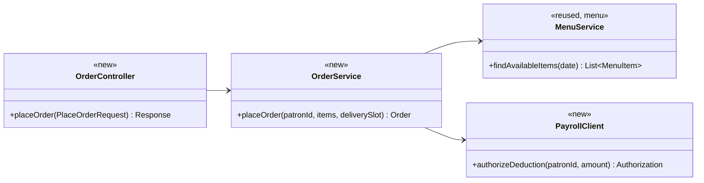
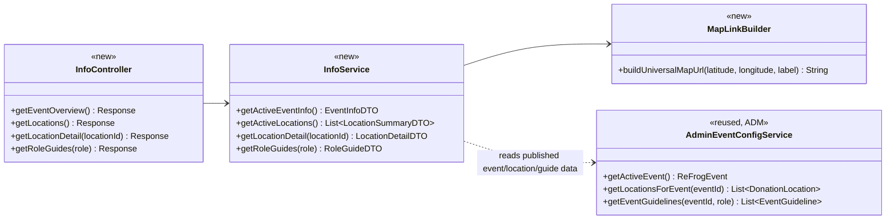
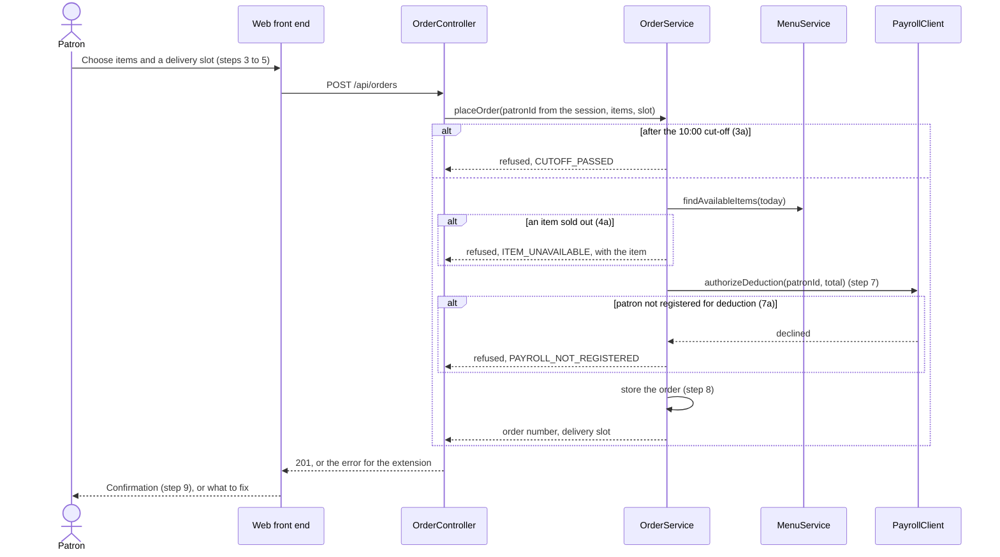
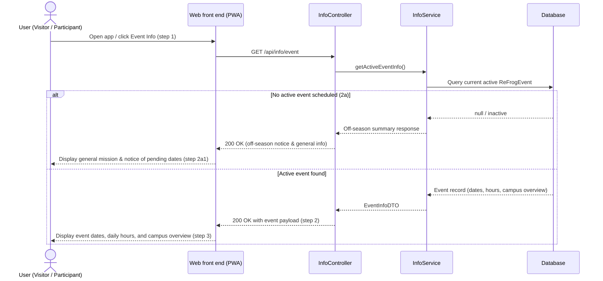
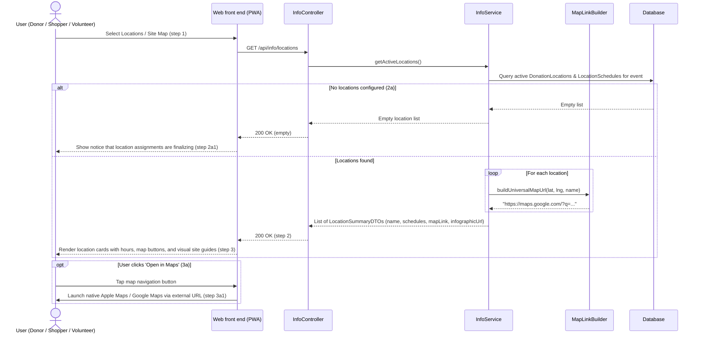
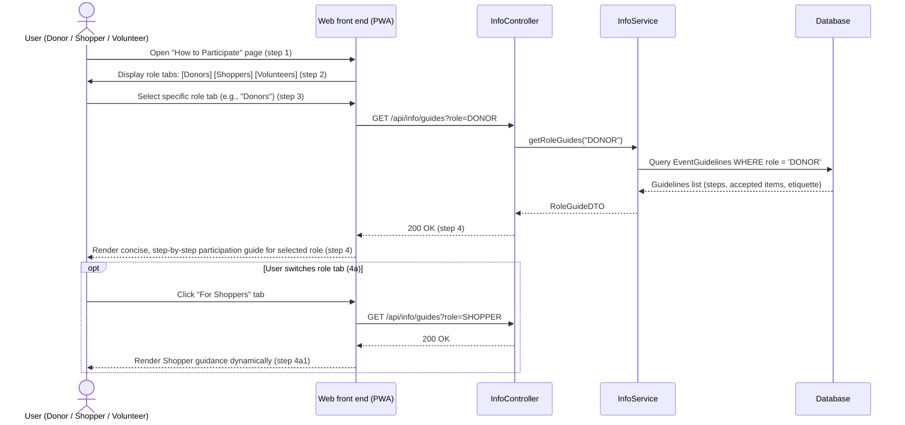
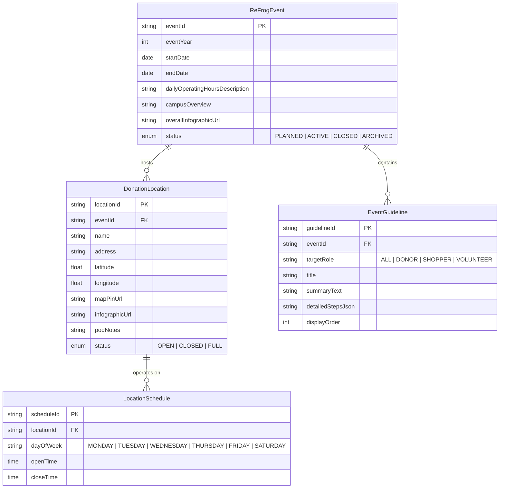

# Event & Location Information (`INF`) Design

**Project:** Refrog
**Team:** Team 03
**Area:** `UC-INF-*`

> **Realizes:** `UC-INF-view-event-info`, `UC-INF-view-locations`, `UC-INF-view-role-guides`
> **Depends on:** `BR-event-schedule`, `BR-event-in-person`, `BR-free-shopping`, `BR-shopper-tcu-affiliation`, `BR-donation-ease`, `BR-location-staffing`
> **See:** [use-cases.md](../requirements/use-cases.md#area-event--location-information-inf), [business-rules.md](../requirements/business-rules.md#event-operations), [architectural-design.md §5.2](architectural-design.md#52-use-case-areas-and-components)
> **Designed against:** `7ca0391`

---

_**How to use this template.** Copy it to `docs/design/<area>.md`, named for the lowercase area code (`ord.md` for `UC-ORD-*`). Instructions appear in italic square brackets; leave them in place until the document is stable, because the agent reads them on every later pass. The full worked example is Project Pulse's [`not.md`](https://github.com/Washingtonwei/project-pulse/blob/main/docs/design/not.md); read it for the shape, not for the answers._

_**What this document is.** The **design-of-record** for one use case area: how the code will realize its use cases, written **before** the code and approved before anyone builds from it. It is the last document your agent reads before it writes code, so anything it leaves out, the agent invents. Your [architecture-of-record](architectural-design.md) is the map of the whole system and stops at each component's responsibility; this document goes one level down, inside one area, against real code._

_**What it is not.** A copy of your use cases. It **cites** `UC-*`, `FR-*`, and `BR-*` by identifier and never restates what the system shall do; it says only how. It is also not a transcript of the code. Once code exists, link to the files rather than describing every class, column, or getter._

_**One document per area, not per use case.** Your area gains use cases over the term. The overview, the class diagram, and the data model are **revised in place** when it does. The sequence diagrams, the API contract rows, and the test rows are **appended**, one set per use case. Never add a `## UC-…` section that repeats the whole skeleton._

_**How much to write.** Pin down what a wrong guess would break: a requirement, a business rule, a quality attribute, or the contract between two parts of your team. Leave the rest for the agent to derive while it builds: variable names, field types, exact JSON, column lengths. When you are unsure, ask which side of that line a detail falls on, not whether it is interesting._

_**Write it in this order.** Each step is one person's or one pair's work, and the order is the point:_

1. _**Sketch it yourselves first.** Before you open the agent, draw the main success scenario's sequence diagram and write the API contract rows by hand, from the use case and your architecture-of-record. Twenty minutes, on paper or in this file._
2. _**Have the agent draft it.** Give the agent this template, the use case, the business rules it cites, your architecture-of-record's section 8 (Crosscutting Concepts), and the relevant existing code, and ask for a draft of this document. Use plan mode, so it proposes before it writes._
3. _**Compare the two.** Where the agent's draft differs from your sketch, decide which is right and why. What it found that you missed goes in; what you knew that it could not have known is the context your specification is missing, so fix the specification too._
4. _**Run the questions test** (the last section) and fix what it finds._
5. _**Open a pull request.** A teammate who did not write it reviews and approves it. Nobody starts an implementation branch from this design until it is merged._

---

## Overview

_[One paragraph: what this area does, which components of your [architecture-of-record](architectural-design.md) it lives in, and what it reads from or calls in other areas. Link the container diagram rather than redrawing it. If this design changes the architecture-of-record, say so here and list the change under "Changes to the architecture-of-record" below._

_Example, from the Cafeteria Ordering System:_

_Ordering takes a patron's meal order from menu selection to a confirmed, payroll-charged order. It is the `ORD` area of the API ([containers](architectural-design.md#51-containers), [use case areas](architectural-design.md#52-use-case-areas-and-components)), reads the day's menu from `menu`, and asks the Payroll System to authorize the deduction before an order is stored (`DE-payroll-integration`).]_

Event & Location Information (`INF`) provides public, unauthenticated access to active ReFrog event schedules, operational role participation guidelines, and physical site locations. It is the `INF` area of the API (formerly `LOC`, [containers](architectural-design.md#51-containers), [use case areas](architectural-design.md#52-use-case-areas-and-components)). It reads active event schedules, participation content, and location configurations initialized by `ADM`. Because location and operational details change each season (e.g., adding an 8th pod, varying weekday operating hours), `INF` serves dynamic location listings, map pin navigation URLs (for Google/Apple Maps), and visual guide/infographic assets. It prioritizes concise, actionable event instructions for donors, shoppers, and volunteers over static historical narrative.

## Components & classes

_[One class diagram for the whole area, and one line per class or file saying what it does and whether it is **new** or **reused**. Show only what a reader needs to see how the parts relate: classes, their key methods, their dependencies. Fields and getters belong to the code._

_**If your repository has no code for this area yet**, which is the normal case for your proving slice, list the files you expect the agent to create, with the paths your architecture-of-record's conventions give them, and mark them all new. The agent then builds into the structure you chose rather than one it improvised._

_Example:_]

- _`ordering/OrderController` (new): the HTTP entry point; validates the request shape and nothing else._
- _`ordering/OrderService` (new): checks the cut-off, availability, and payroll authorization, then stores the order._
- _`ordering/PayrollClient` (new): the only class that talks to the Payroll System._
- _`menu/MenuService` (reused): called through its service, never its repository._

- `info/InfoController` (new): public HTTP entry point serving event overview information, location summaries, location details, and role participation guidelines. Does not require authentication.
- `info/InfoService` (new): reads published event configuration, location schedules, and role guidelines, assembling responsive DTOs for the client.
- `info/MapLinkBuilder` (new): utility formatting external navigation URLs (Google Maps / Apple Maps universal web links) from coordinates and address labels.
- `adm/AdminEventConfigService` (reused, `ADM`): service providing published event metadata, dates, site schedules, and media/infographic references configured by administrators.

## Sequence

_[One sequence diagram per use case for its main success scenario, plus one for each extension that does not just return an error. **Label each interaction with the use case step it implements**, so a reviewer can check that every step is realized and nothing extra was invented. Use `alt` blocks for extensions that branch off the main flow. Give each use case its own `###` heading; that heading is the anchor your traceability matrix cites._

_Example:]_

### _UC-ORD-place-order: placing an order_

### UC-INF-view-event-info: View overall event dates and general information

### UC-INF-view-locations: View site locations, hours, map pins, and infographics

### UC-INF-view-role-guides: View participation guidelines for donors, shoppers, and volunteers

## API contract

_[One row per endpoint, scheduled job, or message this area adds or changes, appended per use case. **This section is never dropped**: before the code exists it is the only thing the person (or agent session) building the front end and the one building the back end both read. Name the caller and who may call it, the request fields, the success response, and the error each extension returns. Leave field types and exact JSON to the agent unless a wrong guess would break something, such as a format another system depends on. Use the error shape your architecture-of-record's section 8.2 fixes; do not invent one here._

_Example:]_

| Endpoint or job | Caller (who may) | Request | Success | Errors, by extension |
|---|---|---|---|---|
| _`POST /api/orders`_ | _A signed-in patron, for herself only; the patron comes from the session, never the body_ | _Menu item ids and quantities, delivery slot id_ | _`201`: order number, total, delivery slot_ | _3a: `409 CUTOFF_PASSED`. 4a: `409 ITEM_UNAVAILABLE` naming the item. 7a: `402 PAYROLL_NOT_REGISTERED`. Not signed in: `401`._ |
| _`GET /api/orders/{orderId}`_ | _The patron who placed it, or cafeteria staff_ | _None_ | _`200`: items, total, slot, status_ | _Another patron's order: `404`, so the response does not reveal that the order exists (`QS-cross-employee-order-denied`)._ |

| Endpoint or job | Caller (who may) | Request | Success | Errors, by extension |
|---|---|---|---|---|
| `GET /api/info/event` | Anyone (public, unauthenticated) | None | `200 OK`: `{ eventYear, status, scheduleWindow: { startDate, endDate, dailyHoursDescription }, campusOverview, overallInfographicUrl }` | Unexpected failure: `500`. |
| `GET /api/info/locations` | Anyone (public, unauthenticated) | Query param: optional `activeOnly` (default true) | `200 OK`: Array of `{ locationId, name, address, operatingSchedule: [{ dayOfWeek, openTime, closeTime }], mapUrl, latitude, longitude, infographicUrl, podNotes }` | Unexpected failure: `500`. |
| `GET /api/info/locations/{locationId}` | Anyone (public, unauthenticated) | Path param: `locationId` | `200 OK`: Detailed location object including access instructions, specific pod notes, accepted categories, mapUrl, and high-resolution infographic URL | Location not found: `404`. |
| `GET /api/info/guides` | Anyone (public, unauthenticated) | Query param: optional `role` (`DONOR`, `SHOPPER`, `VOLUNTEER`, `ALL`) | `200 OK`: Array or object of `{ role, title, summaryText, instructionalSteps: [{ stepNumber, title, body }], rulesSummary }` | Invalid role query: `400`. Unexpected failure: `500`. |

## Key decisions

_[Only the decisions a reader could not recover from the code: an invariant, who may do this and how it is enforced, a trade-off you chose, a reason you reused something rather than writing it. **Each one names what you chose, what you rejected, and why.** If you cannot name an alternative you considered, it probably was not a decision; leave it out._

_A decision that affects the whole system rather than this area is an architecture decision. It belongs in your architecture-of-record as a `KD-*` entry, not here._

_Example:]_

**_When the payroll deduction is authorized._** _Before the order is stored, in the same request. Rejected: storing the order first and charging later in a batch, because a declined deduction would then cancel an order the kitchen has already started (`ROB-order-persisted` promises the patron that a confirmed order stands)._

**_How the cut-off is checked._** _On the server, against the injected clock, in the cafeteria's time zone (architecture-of-record 8.2, time). Rejected: hiding the order button after 10:00 in the browser, because the browser's clock is the patron's and the check would be advisory._

**Broader Information area (`INF`) replaces isolated Location area (`LOC`).** Location data is conceptually part of public event information. Bundling event overview, role guidelines, and site locations into one cohesive `INF` component eliminates fragmenting public read-only views across separate modules. Rejected: keeping `LOC` strictly for physical coordinates and creating a separate `GEN` area for event text, which would artificially split a single public landing view into two microscopic services.

**Actionable event instructions prioritized over history.** Content is structured around operational clarity (event dates, daily hours, "How to Donate", "How to Shop", "How to Volunteer") with only brief context on ReFrog's sustainability mission. Rejected: exhaustive historical essays about founding years or past container statistics on the primary operational screen, which clutters mobile screens for students carrying heavy dorm items during move-out.

**Segmented role participation guidance in a single modular contract.** Role instructions for donors, shoppers, and volunteers are organized under a dedicated endpoint and data structure (`EventGuideline`) that the frontend renders as tabs or segmented views. Rejected: embedding donor and shopper instructions directly into location descriptions, which duplicates instructions across multiple pods and makes updates error-prone.

**Dynamic per-location schedules stored in database.** Operating days and hours are configured per location (e.g. King Family Commons open Mon–Sat, while Greek Village is Mon–Tue only; confirmed in 2026-10-02 client meeting). Rejected: assuming uniform event hours across all sites, which would provide incorrect guidance to participants and volunteers.

**External map application deep links over heavy custom map embeds.** The system provides clean, universal map launch URLs (`https://maps.google.com/?q=...` or universal geo URIs) that open natively on iOS (Apple Maps) and Android (Google Maps) along with uploaded static map infographics. Rejected: embedding a heavyweight, interactive third-party web map widget (e.g. full Google Maps JavaScript SDK) as a mandatory component, because it adds significant JavaScript weight to the mobile PWA, increases load times over spotty outdoor campus Wi-Fi/cellular, and risks incurring paid API tier billing.

**Image/Infographic hosting via static asset URLs.** Organizers frequently use campus map flyers and visual infographics. The data model stores an `infographicUrl` per location (and for the event overall), linking to optimized static image assets. Rejected: rendering vector campus layouts programmatically inside the frontend.

**Public, zero-auth access.** All `INF` endpoints are accessible without login or token validation, allowing visitors and unauthenticated students/parents to immediately see where and when to drop off items (`OI-4`).

## Data model

_[The **change** this area makes to the data: new tables or entities, new columns, the migration that adds them. Draw an ER diagram when there is more than one new table. Do not redraw the domain model; your [specification](../requirements/software-requirements-specification.md) owns it, so link it and show only the change. If the area changes nothing, say "No change" and give the reason in one line; that is a design decision too.]_

- `DonationLocation` (refined from SRS §7.1): stores site name, address, coordinates, external map link, infographic URL, and pod notes.
- `LocationSchedule` (new): supports per-location variation in operating days and hours.
- `EventGuideline` (new): holds concise instructional text and structured steps for general visitors, donors, shoppers, and volunteers.
- `ReFrogEvent` (reused/refined from SRS §7.1): holds overall move-out dates, daily hours description, event status, and campus-wide visual guide URL.

## Reuse & cross-cutting

_[Which existing services, components, and conventions this area uses rather than rebuilding: authentication, the error handler, email, the clock, another area's service. Cite your architecture-of-record's section 8.2 for each convention by name rather than restating it.]_

- **Public Access & Security:** Outside the authenticated trust boundary (§8.1); endpoints require no JWT or session tokens.
- **Error Handling:** Conforms to architecture §8.2.1; missing records return `404` with standard error JSON.
- **Timezone:** Displays all site hours in `America/Chicago` (§8.2.2).
- **Administration Component Reuse:** `INF` reads records created and configured by administrators (`UC-ADM-manage-shifts` and event setup).

## Tests

_[One row per flow: the main success scenario and **every** extension of every use case this document realizes, appended per use case. Name the level (unit or integration) and what the test asserts. No code. This list is the definition of done that the reviewer approves; the agent writes these tests when it builds, and a reviewer can see at a glance whether an extension has no test._

_Example:]_

| Use case, flow | Level | Asserts |
|---|---|---|
| _UC-ORD-place-order main_ | _integration_ | _A registered patron's order before 10:00 is stored, charged once, and returned with an order number_ |
| _UC-ORD-place-order 3a_ | _unit_ | _At 10:00:01 by the injected clock the order is refused with `CUTOFF_PASSED` and nothing is stored or charged_ |
| _UC-ORD-place-order 4a_ | _unit_ | _A sold-out item refuses the whole order and names the item_ |
| _UC-ORD-place-order 7a_ | _integration_ | _A declined deduction stores no order_ |
| _Authorization_ | _integration_ | _A patron requesting another patron's order gets `404`_ |

| Use case, flow | Level | Asserts |
|---|---|---|
| UC-INF-view-event-info main | integration | Public request to `/api/info/event` returns active event dates, hours description, and overview |
| UC-INF-view-event-info 2a (no active event) | unit | When no event is active, returns general off-season text without 500 error |
| UC-INF-view-locations main | integration | `/api/info/locations` returns all active locations with individual schedules and map links |
| UC-INF-view-locations 2a (no locations) | unit | Returns empty list with 200 OK when no locations are yet published |
| Map universal link generation | unit | `MapLinkBuilder` formats valid universal query URL given latitude, longitude, and title |
| Location detail lookup | integration | `/api/info/locations/{id}` returns specific pod access notes and infographic image URL |
| Location detail 404 | unit | Non-existent location ID returns standard `404` error payload |
| UC-INF-view-role-guides main | integration | `/api/info/guides?role=DONOR` returns structured donor participation guidelines and rules |
| UC-INF-view-role-guides tab switch | unit | Filtering `/api/info/guides` by different role enums returns distinct respective instructions |
| Unauthenticated access | integration | All `INF` endpoints respond with 200 OK when no authentication token/cookie is present |

## Changes to the architecture-of-record

_[Designing an area against real code is when the architecture's guesses meet reality. If this design needs a component the map does not have, moves a responsibility, or adds a dependency, **change [the architecture-of-record](architectural-design.md) in the same pull request** and list each change here in one line. If nothing changed, write "None". A design that silently disagrees with the architecture leaves two maps, and the agent will follow whichever it reads last.]_

- **Component rename & scope expansion:** Rename `Location Info` (`LOC`) to `Event & Location Information` (`INF`) in the component table (§5.2) and traceability matrix.
- **Responsibility update:** `INF` responsibility expands from strictly site coordinates/hours to also serving active event dates, general participation guidelines (donor, shopper, volunteer instructions), and visual guide/infographic references.

## Open questions & risks

_[What this design could not settle and who can, and what could go wrong that you are accepting. A question for the client also goes in [`OPEN-ISSUES.md`](../requirements/OPEN-ISSUES.md).]_

| Question / Risk | Who can answer | Impact if wrong |
|---|---|---|
| Will organizers provide pre-rendered infographic images for all locations, or only a single campus map? | Client (Wendy Macias) | Low impact: both are supported as optional image URLs in the data model. |
| Where will infographic image assets be hosted? | Development team / Hosting owner | Low: can be served as static files from the application container or external storage bucket. |
| Potential change of donation pod physical locations mid-event. | ReFrog organizers | Handled by keeping location configs dynamic in the database editable by administrators. |

---

## Working this document with your agent

_[Delegate: drafting the diagrams from your sketch and the use case; listing the existing files a class should extend; filling the contract rows' request and response fields; proposing the test row for each extension; drafting the rejected alternative for a decision you have already made; checking that every identifier this document cites exists in the document that owns it._

_Keep human: which side of the "would a wrong guess break something" line each detail falls on; every key decision; and the approval, which is a teammate's review of the pull request, not the drafter's own reading._

_**The specific failure to watch for: scope that nobody asked for.** An agent drafting a design adds what designs it has read usually have: an admin override, a retry queue, a status field, a notification "while we are here". Each looks reasonable and none is in your use case, and once it is in the design the agent will build it, test it, and you will maintain it. Read the sequence labels: every interaction should name the use case step it implements. An interaction with no step is either a missing requirement, which goes to your specification and your client, or scope creep, which comes out.]_

---

## The questions test (before you open the pull request)

_[Start a **fresh** agent session in plan mode, so it carries nothing from the session that drafted this document. Give it only the use case, the business rules it cites, your architecture-of-record's section 8, and this document, and ask:_

> _List every point you would still have to guess to implement `<UC-ID>`. For each, say what you would guess and whether a wrong guess could violate a requirement. Do not write code._

_For each item on its list, either fix this document or keep the guess and write one line saying why a wrong guess breaks no requirement. Paste the list, with your answer to each item, into the pull request description under How it was verified, inside a collapsed `

Questions test
 … 
` block so the description stays short. The design is ready when nothing on the list could break a requirement.]_

