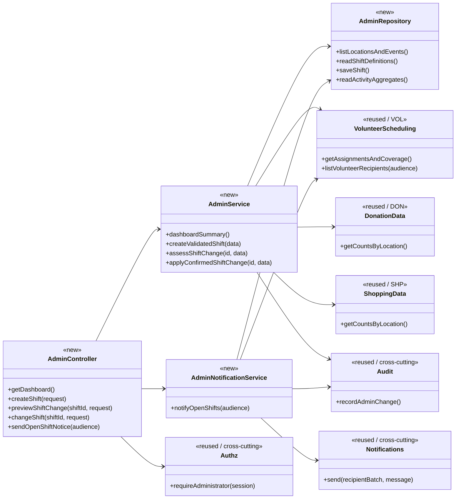
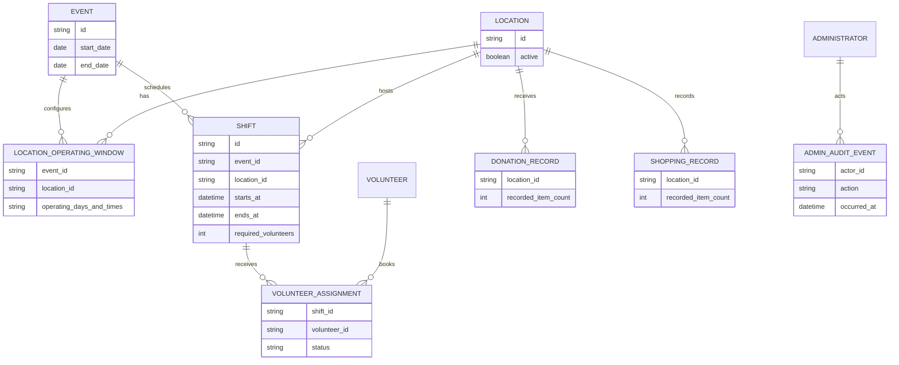

# Administration Design

**Project:** ReFrog  
**Team:** Team 03  
**Area:** `UC-ADM`  
**Area owner:** Ananye Kejriwal

> **Realizes:** `UC-ADM-view-dashboard`, `UC-ADM-manage-shifts`, `UC-ADM-notify-volunteers`  
> **Depends on:** `BR-location-staffing`, `BR-event-schedule`; `FR-AUTH-enforce-permissions`, `FR-VAL-server-validation`, `FR-VAL-field-feedback`, `FR-SAVE-confirmed-success`; `SEC-role-based-access`, `SEC-audit-log`, `ROB-duplicate-submission`, plus the applicable requirements in the [specification](../requirements/software-requirements-specification.md).  
> **See:** [Use cases](../requirements/use-cases.md), [Software Requirements Specification](../requirements/software-requirements-specification.md), [Business Rules](../requirements/business-rules.md), [Architecture of record](architectural-design.md).  
> **Designed against:** **TBD: insert the actual commit SHA of `main` reviewed before opening the PR.** The uploaded documents do not contain a verifiable repository commit ID.

---

## Overview

The Administration (`ADM`) area lets authorized ReFrog organizers view a consolidated dashboard of volunteer coverage, donations and shopping across locations; configure shifts for the event; and deliberately send volunteers a message about open shifts. It lives inside the Application container defined by [architecture section 5.1](architectural-design.md#51-containers) and implements the Administration component in [section 5.2](architectural-design.md#52-use-case-areas-and-components). It relies on cross-cutting Authentication for administrator identity and authorization, reads Volunteer Scheduling assignments and Donation and Shopping event records, reads active locations and event settings, and calls the shared Notifications component for administrator-triggered delivery. **ADM does not own volunteer sign-ups, donation/shopping entry, authentication, or the email provider.** Edits to an existing assigned shift require an explicit safeguard: impacted volunteers must be shown before changes are confirmed; the client has not yet decided the notification policy for those edits.

## Components & classes

These are **planned application boundaries**, not claims that the files already exist. The application framework, directory layout, database technology and provider adapter remain provisional in the architecture; the paths below are proposed logical paths and must be aligned to the repo conventions before implementation.



| Planned file / boundary | New or reused | Responsibility |
|---|---|---|
| `administration/AdminController` | New | Admin-only HTTP entry points and field-level error presentation; delegates business decisions |
| `administration/AdminService` | New | Dashboard aggregation, per-location shift validation, existing-shift change preview and protected writes |
| `administration/AdminNotificationService` | New | Explicit send action, audience selection, available-shift context, delivery result and retry behavior |
| `administration/AdminRepository` | New | Persistence queries for event/location configuration, shift definitions and dashboard aggregates |
| Authentication/authorization middleware | Reused, cross-cutting | Enforce administrator authorization on *every* ADM endpoint server-side |
| Volunteer Scheduling service | Reused, `VOL` | Own sign-ups, cancellations, assignments, volunteer records and derived coverage |
| Donation and Shopping services/read models | Reused, `DON`/`SHP` | Source-of-truth item activity used in dashboard totals |
| Notification delivery adapter | Reused, cross-cutting | Selected external delivery provider and its failure handling |
| Shared audit facility | Reused, cross-cutting | Capture administrator changes and authentication audit events without secrets |

**Integration boundary:** The ADM service may query approved read views over the shared database, or service methods, as the codebase supports; it must not duplicate the VOL enrollment or DON/SHP recording logic. VOL and ADM must agree on a single shift identifier, status/capacity meaning, and coverage calculation before coding.

## Sequence

### UC-ADM-view-dashboard: View the event dashboard

```mermaid
sequenceDiagram
    actor A as Administrator
    participant UI as Admin web interface
    participant API as AdminController
    participant AUTH as Authorization
    participant ADM as AdminService
    participant LOC as Location/event store
    participant VOL as Volunteer Scheduling
    participant DON as Donation records
    participant SHP as Shopping records
    A->>UI: Open dashboard (step 1)
    UI->>API: GET /api/admin/dashboard
    API->>AUTH: requireAdministrator (step 2)
    alt Not an administrator (extension 2a)
        AUTH-->>API: Denied
        API-->>UI: 403 Forbidden (or 401 if not signed in)
        UI-->>A: Access denied
    else Authorized
        API->>ADM: dashboardSummary (step 3)
        ADM->>LOC: List configured locations
        ADM->>VOL: Read shifts, capacities, assignments
        ADM->>DON: Count donated items by location
        ADM->>SHP: Count shopped items by location
        alt Location has no recorded activity (extension 3a)
            ADM->>ADM: Keep location; set recorded counts to zero and label no activity
        end
        ADM->>ADM: Mark unfilled coverage (step 4)
        ADM-->>API: Per-location summary
        API-->>UI: 200 Dashboard data
        UI-->>A: Show counts and unfilled shifts
    end
```

The dashboard includes **every configured relevant location even when no donation or shopping records exist**. Counts represent stored records, not estimated physical inventory; the client said donated goods are not individually tagged. The exact definition of the event/date filter must use the approved event configuration, not an invented calendar window.

### UC-ADM-manage-shifts: Create and configure volunteer shifts

```mermaid
sequenceDiagram
    actor A as Administrator
    participant UI as Admin web interface
    participant API as AdminController
    participant AUTH as Authorization
    participant SVC as AdminService
    participant DB as Shift/location/event store
    participant VOL as Volunteer Scheduling
    participant AUD as Shared audit
    A->>UI: Choose create shift (step 1)
    UI->>API: Load location and event choices (step 2)
    API->>AUTH: requireAdministrator
    alt Not an administrator (extension 2a)
        AUTH-->>API: Denied
        API-->>UI: 401/403
        UI-->>A: Access denied
    else Authorized
        API-->>UI: Active locations, operating windows
        UI-->>A: Ask for location, date, time, capacity
        A->>UI: Enter details and confirm (step 3)
        UI->>API: POST /api/admin/shifts
        API->>AUTH: requireAdministrator
        API->>SVC: createValidatedShift (step 4)
        SVC->>DB: Validate location, event/day/time, capacity
        alt Invalid details (extension 4a)
            SVC-->>API: Validation error by field
            API-->>UI: 422 INVALID_SHIFT_DETAILS
            UI-->>A: Preserve inputs; request corrections (step 3)
        else Valid details
            SVC->>DB: Persist shift in one transaction
            alt Save failed (extension 4b)
                DB-->>SVC: Failure / transaction rollback
                SVC-->>API: Save not confirmed
                API-->>UI: 503/500 SAVE_FAILED
                UI-->>A: Not saved; retry possible
            else Saved
                SVC->>AUD: Record shift creation
                SVC-->>API: Created shift
                API-->>UI: 201 Created (step 5)
                UI-->>A: Shift available for sign-up
            end
        end
    end
    opt Edit/remove existing shift with volunteers (extension 6a)
        A->>UI: Request change to existing shift
        UI->>API: Preview affected assignments
        API->>AUTH: requireAdministrator
        API->>VOL: Read currently assigned volunteers
        API-->>UI: Impact preview; confirmation required
        UI-->>A: Show affected volunteers before confirming
        Note over UI,API: Change must not silently remove assigned volunteers;
        Note over UI,API: notification policy requires client approval.
    end
```

**Scope note:** The use case's main success flow only specifies *creation*. The extension mentions editing/removing already-assigned shifts but does not settle what notification, reassignment, or cancellation is allowed. This design specifies the mandatory impact preview and **does not claim** approval for a destructive edit workflow. Until resolved, requests that would alter an assigned shift should be blocked after preview rather than silently applied.

### UC-ADM-notify-volunteers: Notify volunteers of open shifts

```mermaid
sequenceDiagram
    actor A as Administrator
    participant UI as Admin web interface
    participant API as AdminController
    participant AUTH as Authorization
    participant SVC as AdminNotificationService
    participant VOL as Volunteer Scheduling
    participant MSG as Shared Notifications
    A->>UI: Choose notify about open shifts (step 1)
    UI-->>A: Select everyone or no sign-ups (step 2)
    A->>UI: Choose audience and confirm (step 3)
    UI->>API: POST /api/admin/notifications/open-shifts
    API->>AUTH: requireAdministrator
    alt Not an administrator
        AUTH-->>API: Denied
        API-->>UI: 401/403
    else Authorized
        API->>SVC: notifyOpenShifts(audience) (step 4)
        SVC->>VOL: Resolve audience and open shift summary
        SVC->>MSG: Send using configured delivery channel
        alt Delivery unavailable / not accepted (extension 4a)
            MSG-->>SVC: Failure
            SVC-->>API: Send not confirmed
            API-->>UI: 503 NOTIFICATION_NOT_SENT
            UI-->>A: Not sent; retry after checking
        else Provider accepts delivery
            MSG-->>SVC: Accepted / provider reference
            SVC-->>API: Send accepted
            API-->>UI: 200 Accepted for delivery (step 5)
            UI-->>A: Notification submitted
        end
    end
```

**Delivery semantics:** A provider accepting a message does **not** prove that it reached every volunteer. Report provider acceptance accurately and log failures, avoiding a false statement that every message arrived. An administrator must trigger this operation; **cancelling a shift never automatically broadcasts a notice**. Provider, recipient contact preferences, and precise bulk-send partial-failure behavior require integration decisions; see open questions below.

## API contract

The endpoints below are **proposed contract names**, not a claim that these routes exist. Final code and OpenAPI should use the architecture's shared response/error conventions (section 8.2), with the same logical outcomes.

| Endpoint or job | Caller (who may) | Request | Success | Errors, by extension |
|---|---|---|---|---|
| `GET /api/admin/dashboard` | Authenticated ReFrog administrator | Optional approved event filter (default current configured event) | `200`: all configured locations, recorded donation counts, shopping counts, per-shift assigned/required coverage and unfilled indicators; zero/no-activity locations included | `401` unauthenticated; `403` non-admin (2a); `503` if required source unavailable, **not** a misleading partial “current” total |
| `GET /api/admin/shift-options` | Authenticated administrator | None or configured event | `200`: selectable active locations, operating days/windows, event dates | `401`/`403`; `503` configuration unavailable |
| `POST /api/admin/shifts` | Authenticated administrator | Location reference; shift start/end (local event time or approved representation); required volunteer count; request-retry key if architecture standardizes it | `201`: created shift ID, location, start/end and capacity, available to `VOL` | `401`/`403` (2a); `422 INVALID_SHIFT_DETAILS` (4a); `409` overlapping/duplicate shift where prohibited by confirmed model; `503/500 SAVE_FAILED` (4b). Do not claim creation without committed storage |
| `GET /api/admin/shifts/{shiftId}/impact` | Authenticated administrator | Intended edit/removal (preview only) | `200`: affected assigned volunteers/assignments and whether the change is currently permitted | `401`/`403`; `404` unknown shift; `409` stale shift state |
| `PATCH /api/admin/shifts/{shiftId}` / `DELETE /api/admin/shifts/{shiftId}` | Authenticated administrator, **only once client policy is approved** | Explicit confirmed edit/removal and expected version | Shift updated/removed only when policy allows; audit entry | `401`/`403`; `404`; `409 ASSIGNED_SHIFT_CHANGE_UNRESOLVED` until client decides extension 6a; validation/save errors as above |
| `POST /api/admin/notifications/open-shifts` | Authenticated administrator, explicit UI confirmation | Audience = `all_volunteers` or `no_shift_signups`; no arbitrary recipient list or automatic trigger | `200` or `202`: provider accepted sending; show number of resolved recipients if available, not guaranteed delivery | `401`/`403`; `422` invalid audience; `503 NOTIFICATION_NOT_SENT` (4a); if partial sends occur, return a **truthful partial result** and do not blindly resend to successful recipients |

**Cross-area contract to confirm:** Shift creation must expose one stable identifier and shared interpretation of required count / assigned count to `VOL`; donation and shopping provide aggregated counts by location and event with no personally identifying data needed by the dashboard. Recipient selection is owned by `VOL`/identity records, while the shared Notification adapter sends messages. API authentication derives administrator identity from the verified session/token; a request body cannot self-declare administrator privileges.

## Key decisions

**1. Dashboard is computed from authoritative records, not an independent mutable counter.** Choose: combine configured locations with persisted donation, shopping and volunteer-assignment records, showing zeros for locations with no activity. Reject: storing a second independent dashboard total that may drift from submitted records. Reason: dashboard counts must agree with confirmed saves and include otherwise-empty sites (`UC-ADM-view-dashboard` steps 3–4, 3a; `FR-SAVE-confirmed-success`).

**2. Central shift definition; Volunteer Scheduling owns enrollments.** Choose: store shift configuration once and have `VOL` reference it, with assigned count read from authoritative assignments. Reject: a separate ADM roster or sign-up counter. Reason: two owners for capacity/assignments cause misleading coverage and booking conflicts (`UC-ADM-manage-shifts`, `UC-VOL-signup`, `BR-location-staffing`).

**3. Server-side, per-location schedule validation.** Choose: require real active location, valid event day/time, positive capacity, and location-specific operating windows in the server transaction; present field corrections in the UI. Reject: a universal 2-volunteer minimum or client-only form checks. Reason: King Family Commons may need 3, other sites 2, and operating days differ (`BR-location-staffing`, `BR-event-schedule`, extension 4a). Use `America/Chicago` per architecture §8.2.2.

**4. Safe assigned-shift changes.** Choose: preview affected volunteer assignments and block changes that would invalidate those assignments until notification/cancellation policy is approved. Reject: silently deleting or moving occupied shifts. Reason: extension 6a expressly requires showing affected volunteers but has an unconfirmed subsequent workflow.

**5. Notifications are deliberate, not cancellation-triggered.** Choose: administrator explicitly chooses one of two audiences, confirms, and invokes the shared notification service. Reject: broadcasting every cancellation or every remaining empty slot. Reason: the client explicitly warned against overwhelming volunteers (`UC-ADM-notify-volunteers`; `OI-7` resolved).

**6. “Sent” means provider-accepted, not necessarily delivered.** Choose: show confirmation only for an acknowledged dispatch, and show failure/partial failure accurately. Reject: treating a request attempt as delivery success or blindly retrying after an ambiguous provider timeout. Reason: extension 4a and robustness requirements; provider and retry semantics still need agreement.

**7. Authorization and auditing are shared.** Choose: enforce administrator role within the server security boundary and record shift/configuration changes through the shared audit facility. Reject: hiding admin buttons as the only security check or building separate ADM authentication/audit stores. Reason: `SEC-role-based-access`, `FR-AUTH-enforce-permissions`, `SEC-audit-log`.

## Data model

These are logical changes and ownership boundaries, **not a final migration or mandated schema**. The actual repository schema and framework have to be inspected at the recorded `main` commit before migrations are authored.



- **ADM new or revised data:** shift definition referencing an event and location, with start/end and required volunteer count; configuration for per-location operating days/hours where not already stored; admin audit entries as required by shared security. Choose one canonical home for event/location data with `LOC` before creating tables.
- **Reused data:** Volunteer assignments and contact/recipient records (`VOL`), donation records (`DON`), and shopping records (`SHP`). **No new personal records are needed solely for dashboard totals.**
- **No independent “available slots” table:** compute `max(required volunteers – valid assigned volunteers, 0)` from one committed snapshot, while showing over-capacity as a separate problem if it occurs. Persist assignment capacity checks at the server/transaction boundary in the `VOL` implementation.
- **Notification outcome:** the shared Notifications component may need a minimal dispatch ID, audience and accepted/failed status for accurate reporting and retry; this is an **integration question**, not authorization to build a broad campaign/marketing or analytics system. Any retained recipient-level delivery data follows approved privacy and retention policy (`OI-6`).
- **Migration:** Add or adapt shift/event-location configuration in the chosen database schema, preserving existing records and foreign keys. The migration name and physical columns are intentionally deferred until the actual codebase and approved stack are available.

## Reuse & cross-cutting

- **Authentication/authorization:** Use the architecture's shared signed-in identity/administrator-role mechanism, not an email string supplied by the browser; apply server-side permission checks to reads and writes (architecture §8.1).
- **Time:** Store comparable machine-readable timestamps, interpret/display event time in `America/Chicago`, test with a fixed clock (architecture §8.2.2).
- **Errors and input:** Reuse shared structured error response, server-side input validation, field messages and input preservation (architecture §§8.2.1, 8.2.3, 8.2.5).
- **Persistence and concurrency:** Treat each shift create/edit as one atomic business operation; no acknowledged success before commit. Guard duplicate retries and races with appropriate database constraints/transactions (architecture §8.2.8).
- **Logging/auditing/privacy:** Reuse centralized safe logging and administrator audit events; avoid exposing volunteers' contact data in dashboard or routine error messages. Retention is client/TCU governed, not guessed (architecture §§8.2.6–8.2.9; `OI-6`).
- **Notifications:** Reuse one shared delivery adapter (also used for affiliation email and eventual reminders if specified), with no assumption about the selected provider or automatic push capability.

## Tests

Tests below are **specifications**, not code. They correspond to each main path and **every stated extension**; cross-cutting tests cover role enforcement and unreliable external dependencies.

| Use case, flow | Level | Asserts |
|---|---|---|
| `UC-ADM-view-dashboard` main | Integration | Admin receives all configured locations, correct persisted donation/shopping counts, volunteer required/assigned counts, and an unfilled-shift indicator |
| `UC-ADM-view-dashboard` 2a | Integration | Unauthenticated user gets `401`; signed-in non-admin gets `403`; neither receives dashboard data |
| `UC-ADM-view-dashboard` 3a | Integration | Location with no activity stays visible with zero/no-activity representation, not omitted or treated as unavailable |
| Dashboard source outage | Integration | If mandatory source is unavailable, request clearly fails rather than claiming stale/partial data is complete |
| `UC-ADM-manage-shifts` main | Integration | Admin creates a valid shift; committed shift has correct location/event, timing, required capacity, and appears in `VOL` sign-up; audit event recorded |
| `UC-ADM-manage-shifts` 2a | Integration | Non-admin and unauthenticated users cannot create, edit, delete, or preview protected assigned-volunteer information |
| `UC-ADM-manage-shifts` 4a | Unit + integration | Reject zero/negative capacity, unknown/inactive location, out-of-window day/time, malformed times; retain correct fields for correction; enforce location-specific requirements |
| `UC-ADM-manage-shifts` 4b | Integration | Storage error rolls back, produces no false confirmation or half-saved shift, supports safe retry |
| `UC-ADM-manage-shifts` 6a | Integration | Proposed edit/removal with assigned volunteers first shows impacted people; destructive action is blocked while policy unresolved; no silent assignment loss |
| Shift duplicate/concurrency | Integration | Concurrent identical create/retry cannot produce unintentional duplicate shift definitions; stale edit is rejected where versioning is supported |
| `UC-ADM-notify-volunteers` main | Integration with fake provider | Authorized admin deliberately chooses `all_volunteers` or `no_shift_signups`; correct audience resolved and one explicit dispatch attempted; UI reports acceptance accurately |
| `UC-ADM-notify-volunteers` 4a | Integration with failing provider | Provider unavailable or rejects send => non-success status, no claim messages were sent; admin can retry appropriately |
| Notification authorization | Integration | Non-admin cannot trigger a send, including direct HTTP requests |
| No automatic broadcast | Integration | Volunteer cancels a shift without an administrator send action => no broadcast to other volunteers |
| Notification partial/ambiguous outcome | Integration with fake provider | Partial acceptance or timeout does not incorrectly report all recipients as sent; retry does not intentionally duplicate previously confirmed recipients |
| Time-zone boundary | Unit | A shift scheduled/displayed across daylight-saving transitions obeys configured `America/Chicago` semantics and validates the actual event operating window |
| Audit/privacy | Integration | Successful admin shift changes generate audit entries; logs and normal dashboard results exclude secrets and unnecessary volunteer PII |

## Changes to the architecture-of-record

**None approved or required by this design.** The existing architecture already identifies Administration, Volunteer Scheduling, shared Authentication/Notifications and the supporting Donation/Shopping areas. **A future clarification is needed** on canonical event/location operating-window ownership and notification-provider/dispatch semantics; if this changes component responsibilities or dependencies, update `architectural-design.md` and record an appropriate `KD-*` decision **in the same PR** before implementing that change.

## Open questions & risks

| Question / risk | Owner or source | Impact / interim handling |
|---|---|---|
| **Actual `main` commit and real source paths not verified** | Area owner / repo | Fill in `Designed against` SHA and adjust proposed paths against repository conventions before the PR is submitted |
| **Assigned-shift edit/removal policy (extension 6a)** | Wendy Macias / ReFrog organizers | Need decision on cancellations, impact confirmation and whether/how assigned volunteers are told; until decided, preview only and block destructive changes |
| **Email/push/provider selection and send result semantics** | Team architecture/operations owner and client | No assumed platform, delivery guarantee, repeat cadence, or partial-retry design; provider adapter must expose reliable acceptance/failure status |
| **Which volunteer contacts are eligible for broad notification** | Client and `VOL`/Identity owners | Resolve recipient eligibility/availability, communication preference and whether “everyone” includes volunteers with no contact method; do not invent opt-in rules |
| **Where event/location schedule settings live** | `ADM` and `LOC` owners | Choose one owner; ensure location operating days/time are consistent for both public view and shift validation |
| **Concurrent staffing edits/assignment and duplicate submits** | `ADM`/`VOL` owners | Agree on shift/capacity invariant, shared IDs, transaction/locking and duplicate request strategy before independent implementations |
| **Retention and hosting ownership (`OI-6`, `OI-12`, related hosting questions)** | Client, TCU governance and team | Do not invent retention periods or hosting; implement under approved operational policy |
| **No unsupported analytics or auto-alert scope** | Area owner/reviewer | Keep MVP to the three assigned use cases; no automatic per-cancellation volunteer blast, marketing campaign features, real-time inventory, or abuse flagging inside ADM |

## Questions test (required before opening the PR)

In a **fresh agent session in plan mode**, provide only: the three ADM use cases, their cited business rules, architecture section 8, and **this** design. Ask:

> List every point you would still have to guess to implement `UC-ADM-view-dashboard`, `UC-ADM-manage-shifts`, and `UC-ADM-notify-volunteers`. For each, say what you would guess and whether a wrong guess could violate a requirement. Do not write code.

For each finding, update this design **or** state why the guess cannot violate a requirement. Paste the resulting question/answer list into the PR description under **How it was verified**, inside a collapsed `<details><summary>Questions test</summary>…</details>` section. A teammate other than this document's author must review and approve the PR before anyone starts implementation from it.
