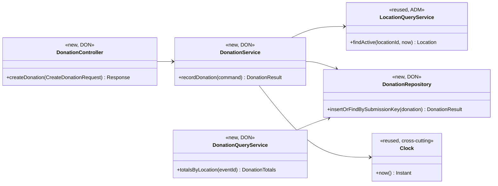
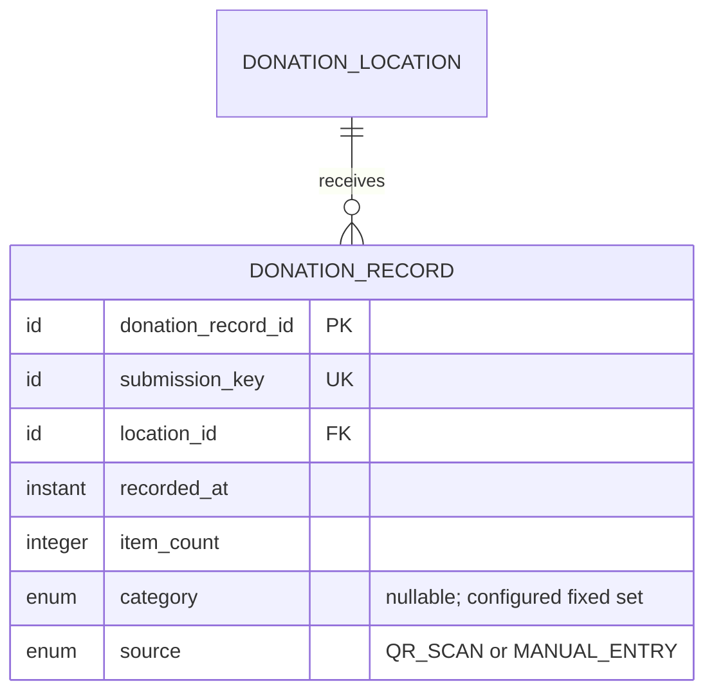

# Donation Design

**Project:** ReFrog
**Team:** Team 3
**Area:** `UC-DON`

> **Realizes:** `UC-DON-log-donation`
> **Depends on:** `BR-donation-location-recorded`, `BR-donation-count-recorded`, `FR-VAL-server-validation`, `FR-VAL-field-feedback`, `FR-VAL-preserve-input`, `FR-SAVE-confirmed-success`, `FR-SAVE-unknown-outcome`, `FR-SAVE-duplicate-submission`, `ROB-submission-status`, `ROB-duplicate-submission`, `ROB-invalid-input`, `ROB-connectivity-loss`, `USE-donation-completion`, `PER-form-submission`, `UI-donation-form`
> **See:** [use case](../requirements/use-cases.md#uc-don-log-donation-record-items-donated-at-a-location), [SRS non-use-case FRs](../requirements/software-requirements-specification.md#52-non-use-case-functional-requirements), [data dictionary](../requirements/software-requirements-specification.md#72-data-dictionary), [architecture-of-record](architectural-design.md) (section 5.2 components, section 8 crosscutting concepts)
> **Designed against:** `main` at `48cddd6` (2026-10-16). No application code exists yet; every DON class below is new.

---

_**How to use this template.** This is the design-of-record for the `DON` use case area. Keep the instructional text until the design is stable. The overview, class diagram, and data model are revised in place as the area grows; sequence, API, and test entries are appended per use case._

_This document cites requirements rather than restating them. It fixes implementation boundaries only where a wrong guess could break a requirement, business rule, quality attribute, or another area's contract. Exact framework types, JSON property casing, column lengths, and private helper names remain implementation choices._

## Overview

_State what this area does, where it lives, and what it reads or calls elsewhere. Record any resulting architecture change below._

Donation accepts a short, unauthenticated record of items dropped off at an active ReFrog location. It is the `DON` module inside the Application container ([containers](architectural-design.md#51-containers), [use case areas](architectural-design.md#52-use-case-areas-and-components)). The Web Front End presents `UI-donation-form`; the Application performs authoritative validation, reads active-location data owned by Administration, and commits one Donation record to the Database. The area exposes aggregate donation data to Administration's dashboard through a query service, not by giving Administration direct access to DON's repository. No authentication or external service is in the submission path.

## Components & classes

_Show the whole area's classes and the dependencies needed to understand its behavior. Because no application code exists, paths below are planned boundaries rather than framework-specific filenames._



| Planned file / boundary | New or reused | Responsibility |
|---|---|---|
| `donation/DonationController` | New | Public HTTP entry point; validates request shape, maps shared errors, and never requires a donor account |
| `donation/DonationService` | New | Applies donation validation, verifies the active location through ADM, assigns the server timestamp, and defines the transaction boundary |
| `donation/DonationRepository` | New | Persists Donation records and enforces uniqueness of the submission key |
| `donation/DonationQueryService` | New | Provides event/location aggregates to ADM without exposing DON persistence details |
| `administration/LocationQueryService` | Reused, ADM-owned | Resolves a location identifier and confirms that it accepts activity at the server's current time |
| Shared clock | Reused, cross-cutting | Supplies an injectable UTC instant for the recorded time and deterministic tests |
| `UI-donation-form` | New front-end view | Holds valid input through validation, connectivity, and save failures; reuses one submission key until success is confirmed |

The names above are logical boundaries. Once the stack and repository layout are selected, implementation paths may change without changing these ownership rules: DON owns Donation writes, ADM owns location configuration, and ADM reads donation aggregates only through `DonationQueryService`.

## Sequence

_Use one sequence diagram per use case, including extensions that change behavior. Every interaction is labeled with the use-case step or extension it realizes._

### UC-DON-log-donation: Record items donated at a location

```mermaid
sequenceDiagram
    actor D as Donor or volunteer acting for donor
    participant UI as Donation web form
    participant API as DonationController
    participant SVC as DonationService
    participant LOC as LocationQueryService (ADM)
    participant DB as DonationRepository / Database
    D->>UI: Open donation form (step 1)
    UI-->>D: Show active-location choice, positive item count, optional fixed category (step 2, 2a)
    D->>UI: Enter information and confirm (step 3)
    UI->>API: POST /api/donations with stable submissionKey
    API->>SVC: recordDonation(command)
    SVC->>DB: Find Donation by submissionKey (4b duplicate check)
    alt Same submissionKey already committed with same logical data (4b)
        DB-->>SVC: Existing Donation
        SVC-->>API: Existing donation confirmation
        API-->>UI: 200, recorded=true, replay=true
        UI-->>D: Confirm the existing entry (4b2)
    else Same key already committed with different logical data
        DB-->>SVC: Existing Donation does not match
        SVC-->>API: Conflict; nothing changed
        API-->>UI: 409 SUBMISSION_KEY_REUSED
        UI-->>D: Keep values; start a new submission before retrying
    else No Donation exists for key
        SVC->>SVC: Validate required fields, count, category, and source (3a)
        SVC->>LOC: findActive(locationId, now) (step 4 validation)
        alt Missing/invalid field or location not active (3a)
            LOC-->>SVC: Invalid or inactive
            SVC-->>API: Field errors; nothing written
            API-->>UI: 422 VALIDATION_FAILED
            UI-->>D: Preserve other values and identify corrections (3a1)
        else Valid submission
            SVC->>DB: Insert Donation in one transaction (step 4)
            alt A concurrent request committed the same key first (4b)
                DB-->>SVC: Unique conflict; fetch existing Donation
                SVC-->>API: Existing confirmation if data match, otherwise conflict
                API-->>UI: 200 replay=true, or 409 SUBMISSION_KEY_REUSED
            else Write fails or outcome is still unknown (4a)
                DB-->>SVC: Failure or indeterminate outcome
                SVC->>DB: Find committed Donation by submissionKey
                alt Donation is found
                    DB-->>SVC: Existing Donation
                    SVC-->>API: Existing donation confirmation
                    API-->>UI: 200, recorded=true, replay=true
                    UI-->>D: Confirm the existing entry (4b2)
                else No committed Donation can be confirmed
                    DB-->>SVC: Not found / unavailable
                    SVC-->>API: Save not confirmed
                    API-->>UI: 503 SAVE_NOT_CONFIRMED
                    UI-->>D: Preserve values and offer retry (4a1)
                end
            else Insert commits
                DB-->>SVC: New Donation
                SVC-->>API: New donation confirmation
                API-->>UI: 201, recorded=true, replay=false
                UI-->>D: Confirm the entry (step 5)
            end
        end
    end
```

The front end creates a high-entropy opaque `submissionKey` when a blank donation form becomes a new submission. It keeps that key and the entered values through validation errors, lost responses, and retries. It discards the key only after a `201` or replayed `200` confirms persistence, or when the user explicitly cancels and starts a new donation. Disabling the submit button reduces accidental clicks but is not the duplicate-prevention mechanism.

## API contract

_Name who may call each operation, its meaningful inputs and outputs, and every use-case extension. Exact JSON shape follows the team-wide API convention once selected._

| Endpoint or job | Caller (who may) | Request | Success | Errors, by extension |
|---|---|---|---|---|
| `GET /api/donation-options` | Public; no sign-in | Optional event context from the entry route | `200`: locations currently accepting donation activity and the configured fixed category set | `503 OPTIONS_UNAVAILABLE`; the form must not invent locations or categories |
| `POST /api/donations` | Public donor or volunteer acting for a donor; no sign-in | Opaque `submissionKey`; active `locationId`; positive whole-number `itemCount`; optional one value from the configured fixed category set; entry source context (`QR_SCAN` or `MANUAL_ENTRY`) | `201`: Donation identifier, server-recorded time, accepted location/count/category, `recorded: true`, `replay: false`. A retry of the same key and same logical request returns `200` with the same Donation identifier and `replay: true` | 3a: `422 VALIDATION_FAILED` with field-level errors. Same key/different logical request: `409 SUBMISSION_KEY_REUSED`. 4a: `503 SAVE_NOT_CONFIRMED`; never return success unless a committed record is found. Malformed request: shared `400` response |

`submissionKey` identifies one user's submit action, not a naturally unique donation. DON must not deduplicate on location, count, category, timestamp, browser, or network address: two real donors can legitimately submit identical donations. The success response echoes accepted values so the interface can confirm the stored record rather than merely confirm receipt of a request.

## Key decisions

_Record only decisions whose alternatives could not safely be recovered from code. Each decision names the choice, rejected alternative, and reason._

**1. Duplicate safety uses one stable submission key plus a database uniqueness constraint.** Choose: the client creates an opaque key for a new form submission, sends it on every retry, and the database uniquely constrains it. The service checks for an existing key before time-sensitive active-location validation, so a retry can confirm a record after the location closes. A repeated key with the same logical donation returns the existing record; the same key with different location, item count, category, or source is a conflict. The insert still handles a concurrent unique-key conflict by loading and comparing the winning record. Reject: comparing donation fields or timestamps, because separate legitimate drop-offs can have identical values; reject: relying only on a disabled button, because concurrent requests and interrupted responses still occur. This realizes extension 4b, `FR-SAVE-duplicate-submission`, and `ROB-duplicate-submission` under concurrency.

**2. Validation precedes persistence and is authoritative on the server.** Choose: validate required fields, positive whole-number count, configured category, and active location before opening the Donation insert transaction; client checks exist only for immediate feedback. Reject: trusting the browser or storing a record to validate later, because direct requests could bypass the form and invalid data would affect dashboard totals (`FR-VAL-server-validation`, `ROB-invalid-input`).

**3. A Donation is committed atomically before success is reported.** Choose: insert the record in the smallest transaction and return success only after commit. On an indeterminate write outcome, look up the same submission key before responding; if persistence cannot be confirmed, return `SAVE_NOT_CONFIRMED` and preserve the retry state. Reject: returning success when the request reaches the server, and reject: inserting a second record on retry. This satisfies `FR-SAVE-confirmed-success` and `FR-SAVE-unknown-outcome`.

**4. The server owns the recorded time; the request owns only entry-source context.** Choose: store an instant from the injected server clock and convert it to `America/Chicago` for display. The public client supplies only the allow-listed route context `QR_SCAN` or `MANUAL_ENTRY`; this metadata does not grant privileges. Reject: accepting a donor-entered date/time, which could make operational reporting inaccurate. `ADMIN_ENTRY` is reserved for a future authenticated administration workflow and is not accepted by this use case.

**5. Donation records are anonymous and aggregate.** Choose: store no donor identifier, name, affiliation, account, device identifier, or network address as Donation data. Reject: creating a Donator record merely because the domain model permits one, because the use case is unauthenticated and needs none of that data. This keeps the form low-friction and avoids inventing retention obligations.

**6. Category is one optional value on the Donation record for this use case.** Choose: persist a nullable value from the configured 5–6 option set alongside the aggregate item count. Reject: free text and per-item rows, because the use case defines one optional category selection and the client explicitly limited categorization effort. If later requirements permit multiple categories or per-category counts, that is a data-model change rather than an assumption here.

## Data model

_Show only the change this area makes, not the full SRS domain model._



`DONATION_RECORD.submission_key` has a unique constraint. `location_id` references the authoritative location identifier; the service also checks current active status because a foreign key alone cannot prove the location is accepting submissions. `item_count > 0` is protected by service validation and, where the selected database supports it, a check constraint. `recorded_at` is stored as a UTC instant. No mutable duplicate counter, donor table, per-item table, or status column is added.

The initial migration creates `donation_record` and indexes `location_id, recorded_at` for event/location dashboard aggregation. The category's allowed values come from the same configured set returned by `GET /api/donation-options`; implementation must not allow front-end and server lists to drift.

## Reuse & cross-cutting

_Name existing services and architecture conventions reused instead of rebuilt._

- Error mapping and response envelopes follow architecture section 8.2.1 and 8.2.3; DON adds logical error codes, not a second envelope.
- Recorded time follows section 8.2.2 and uses the shared injectable clock.
- Server-side field and reference checks follow section 8.2.5. The form follows `UI-validation-inline` and `UI-preserve-input`.
- The transaction, confirmed-save rule, and duplicate-safe retry behavior specialize section 8.2.8 for DON.
- Logging follows section 8.2.7. Logs may include a request correlation identifier and non-secret Donation identifier, but not form values or a persistent device/user identity.
- Automated coverage follows section 8.2.10 and uses non-production locations and donation data.
- Location validation reuses ADM's location query boundary; DON never reads or changes ADM's tables directly.
- Dashboard aggregation reuses DON's `DonationQueryService`; ADM never calculates totals from a second mutable counter.

## Tests

_One row covers the main flow and every extension, including concurrency and failures required by the cross-cutting requirements._

| Use case, flow | Level | Asserts |
|---|---|---|
| UC-DON-log-donation main | Integration | A public valid request returns `201`; exactly one Donation is committed with the requested active location, positive item count, optional configured category/source, and server time; no donor account is created |
| UC-DON-log-donation step 2 | Integration | Donation options contain only locations currently accepting activity and the configured fixed category set |
| UC-DON-log-donation 2a | Unit (front end) | Category is optional, displayed as click-box choices rather than free text, and a selected value is submitted |
| UC-DON-log-donation 3a, missing/invalid count | Integration | Missing, zero, negative, fractional, or nonnumeric item count returns `422` naming `itemCount`; nothing is written |
| UC-DON-log-donation 3a, location | Integration | Missing, unknown, closed, or inactive location returns `422` naming `locationId`; nothing is written |
| UC-DON-log-donation 3a, category | Integration | A category outside the configured set returns `422` naming `category`; nothing is written |
| UC-DON-log-donation 3a, preserve input | Unit (front end) | After one field fails, valid location/count/category values remain and the same submission key is retained |
| UC-DON-log-donation 4a, failed write | Integration | Simulated rollback returns `SAVE_NOT_CONFIRMED`; no Donation exists and no success confirmation is produced |
| UC-DON-log-donation 4a, connectivity | Unit (front end) | A lost response preserves every entered value and submission key and offers retry; it does not claim failure or success as fact |
| UC-DON-log-donation 4b, sequential replay | Integration | Sending the same key and logical request twice returns one `201`, then one replayed `200` with the same Donation identifier; one row contributes once to aggregates |
| UC-DON-log-donation 4b, concurrent replay | Integration | Two concurrent requests with the same key and payload commit exactly one row; both resolve to the same Donation without an unhandled uniqueness error |
| UC-DON-log-donation 4b, lost response | Integration | The first insert commits but its response is lost; retry finds that row and returns replayed success without inserting again |
| UC-DON-log-donation 4b, later replay | Integration | A retry of an already-committed request still returns its existing Donation after that location stops accepting new activity |
| Submission-key misuse | Integration | Reusing a committed key with a different location, count, category, or source returns `409 SUBMISSION_KEY_REUSED` and leaves the original unchanged |
| Legitimate identical donations | Integration | Two requests with different keys but identical business fields create two records; duplicate detection does not collapse real donations |
| Confirmation contents | Unit (front end) | The form shows success only for `201` or replayed `200` with `recorded: true`; `422`, `409`, `503`, timeout, and malformed responses retain the form |
| Public access | Integration | A valid request without a session succeeds; no path treats request body data as an administrator or donor identity |
| Dashboard hand-off | Integration | `DonationQueryService` returns submission count and summed item count from committed Donations by event/location and excludes failed/rolled-back attempts |
| Performance | Integration | Under the approved peak-load profile, the endpoint is measured against `PER-form-submission` without weakening validation or idempotency |

## Changes to the architecture-of-record

None. This design implements the existing `DON -> Administration` dependency for active-location validation and the existing `Administration -> Donation` dependency for dashboard reads. It specializes the duplicate-submission behavior that architecture section 8.2.8 intentionally left for a design-of-record; it does not impose this key format on other areas.

## Open questions & risks

_Record unsettled matters, who can settle them, and accepted risks. Client questions also belong in `OPEN-ISSUES.md`._

1. **The fixed category values are not final.** The client confirmed the 5–6-option shape but not the final list. The list must be deployment/application configuration shared by options and validation, not hard-coded independently in the UI and API. The product owner/client must approve it before implementation is accepted.
2. **`BR-donation-ease` is cited by `UC-DON-log-donation` but is not defined in `business-rules.md`.** The existing `USE-donation-completion` and `UI-donation-form` capture measurable low-friction behavior, but the owning requirements documents must either define `BR-donation-ease` or remove that dangling citation before this design is approved.
3. **The SRS data dictionary says `DonationRecord.itemCount` may be zero, while the use case requires a positive whole number.** This design follows the use case and architecture section 8.2.5 (`item_count > 0`). The SRS owner should correct the data dictionary so future implementers do not weaken validation.
4. **Location acceptance semantics are shared with ADM.** DON needs an authoritative query that answers whether a location accepts donation activity now. ADM's design must provide that contract when location configuration is implemented; DON must not infer it from a stale list.
5. **Browser-close persistence remains intentionally unresolved.** `ROB-connectivity-loss` requires preserving form values while the interface stays open and explicitly leaves survival across closing/reopening to the team. This design requires in-memory form retention and stable retry keys for the open interface only; it does not add local durable storage without a team privacy decision.

**Accepted risks:** A user can deliberately start two new submissions for one physical donation and receive two keys; the requirements demand protection from retries and rapid duplicate submission, not fraud detection or natural-key deduplication. The API may apply operational abuse controls later, but they must not replace the correctness constraint or collect new personal data without approval.

---

## Working this document with your agent

_Delegate drafting diagrams, contract fields, and test cases; keep human ownership of key decisions and approval. Watch for scope nobody requested: donor accounts, item-level inventory, admin overrides, offline queues, correction workflows, and notifications do not belong in this use case unless the requirements change._

## The questions test (before you open the pull request)

_Start a fresh agent session in plan mode. Give it only `UC-DON-log-donation`, `BR-donation-location-recorded`, `BR-donation-count-recorded`, the architecture-of-record's section 8, and this document. Ask:_

> _List every point you would still have to guess to implement `UC-DON-log-donation`. For each, say what you would guess and whether a wrong guess could violate a requirement. Do not write code._

_For each item, either fix this document or record why a wrong guess breaks no requirement. Put the result in the pull-request description under How it was verified. The design is ready when nothing left to guess could break a requirement._
