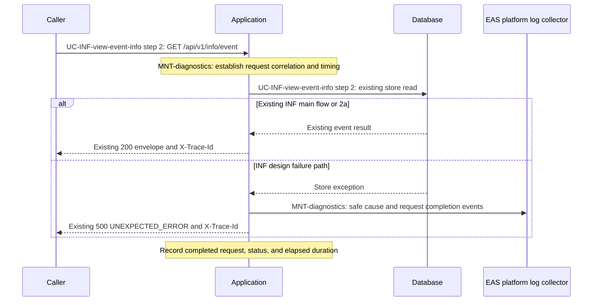

# Observability design

**Status:** proposed design for [#117](https://github.com/evelyntrann/cosc-40943-team-3-refrog/issues/117); runtime implementation follows its merge.

**Designed against:** `cbbaefb` on `main`.

**Supports:** `UC-INF-view-event-info`, `UC-AUTH-register-account`, `MNT-diagnostics`, `MNT-error-notification`, `ROB-external-service-failure`, `AVL-uptime`.

**Depends on:** [architecture §§7–8.2](architectural-design.md#7-deployment-view), [INF design and tests](INF.md#tests), [AUTH design and tests](AUTH.md#tests), `OI-6`, `OI-23`, `OI-25`, `OI-33`.

This crosscutting design adds diagnostics around existing flows; it does not replace either area's design or change account, event, delivery, or retry behavior. The operational procedure and evidence status live in [the observability runbook](../operations/observability.md). No new dependency, database table, business notification, or public failure-injection endpoint is proposed.

## Existing evidence and gaps

| Evidence at the designed-against revision | Consequence |
|---|---|
| [Program.cs](../../src/Backend/ReFrog.Server/Program.cs) event `UnexpectedRequestFailure` logs a fixed message with a null exception | An operator cannot identify the cause or reliably correlate the failure with the response |
| [RegistrationService.cs](../../src/Backend/ReFrog.Server/Features/Authentication/RegistrationService.cs) catches a thrown email-adapter failure without logging it | `UC-AUTH-register-account` 4b can be silent |
| [SmtpEmailSender.cs](../../src/Backend/ReFrog.Server/Features/Authentication/SmtpEmailSender.cs) passes the raw exception to its logger | Provider messages can contain private recipient or server data |
| [RegistrationFlowTests](../../tests/ReFrog.Server.Tests/Authentication/RegistrationFlowTests.cs) checks absent secrets using a capture provider that ignores scopes | An empty log can pass; structured fields and actual console output are not checked |
| Health and metrics routes are absent; [architecture §7](architectural-design.md#7-deployment-view) has no deployed topology | Proposed endpoints and platform collection must not be described as working |
| [Availability evidence](../operations/availability-slo.md) is explicitly local | Preserve its measurement and limitations; production remains unmeasured |

## Request and failure flow

For `UC-AUTH-register-account` step 4 and extension 4b, the existing shared email adapter remains the only delivery boundary. Record a safe diagnostic when an attempt throws or returns `Failed`/`Unknown`, with operation `registration-email` and the request's trace ID; preserve the existing send-outcome persistence, replay handling, and response. A replay records its HTTP outcome without implying another delivery attempt. No diagnostic event is evidence that a database write or delivery succeeded.

## Components

| Component | Reused or proposed | Responsibility |
|---|---|---|
| `Program.cs`, `ILogger<T>`, shared `ApiResponse<T>`, `TimeProvider` | Reused | Composition, logging interface, response contract, testable UTC instants |
| Request diagnostics middleware | Proposed, shared server code | Wrap the existing exception handler and authentication; scope correlation and timing; observe the handler's final status and failures handled below it |
| Safe failure projection and JSON console formatter | Proposed, shared server code | Extract exception type/code locations; allowlist emitted fields and scopes, including framework events, without serializing private content |
| Application metrics singleton | Proposed, shared server code | Thread-safe bounded counters, active-request gauge, and duration totals; no persistent history |
| Health and metrics endpoint mapping | Proposed, shared server code | Explicitly map the contracts below before the SPA/API fallbacks |
| `RegistrationService`, `SmtpEmailSender` | Existing, targeted changes | Cover registration delivery failures and replace raw SMTP exception logging with the safe projection |
| EAS host log collection | Operational prerequisite | Collect console output outside the process; grant operator access and retain it under approved policy |

This is one shared implementation scope. Do not split its middleware, endpoints, and tests into parallel use-case leaves. No persistence model or participant lifecycle changes.

## API contract

All JSON uses the existing `ApiResponse<T>` serializer and error categories (architecture §8.2.3); responses contain no configuration or dependency details. These routes are **proposed, not implemented**.

| Operation | Caller and input | Success | Refusals and limitations |
|---|---|---|---|
| `GET /health` | Anonymous, no request fields | `200`, JSON envelope whose data has `status: "UP"`; `Cache-Control: no-store` | Liveness only: confirms that the process can answer. No SQL or email call. Not a readiness or `AVL-uptime` measurement |
| `GET /api/v1/operations/metrics` | Current administrator session, no request fields; reuse `AdminAuthorization.RequireAdministratorAsync` | `200`, JSON envelope containing the snapshot below; `Cache-Control: no-store` | Existing `401 AUTHENTICATION_REQUIRED`, `403 ADMINISTRATOR_REQUIRED`, `503 AUTHENTICATION_UNAVAILABLE`; no snapshot on refusal and no redirect to HTML |
| Existing application responses | Existing callers and payloads | Add server-generated `X-Trace-Id` header without changing response bodies | Preserve existing status/error contracts, including the AUTH unavailable path and INF `500 UNEXPECTED_ERROR` |

Liveness must remain independent of cookie validation and the database, even when a caller supplies an expired or otherwise invalid cookie. Route it before authentication while retaining the host's HTTPS behavior. Metrics must run through authentication and the live administrator check; an old role claim is insufficient. Apply `no-store` to successful and failed management responses, and preserve correlation/cache headers when the error handler clears a response.

### Metrics snapshot

Measure application API requests under `/api/v1/`, excluding the metrics route itself. Include successful, validation, authorization, unavailable, and unexpected outcomes. Health polls, static assets, and SPA delivery are outside this population. Keep aggregate values only: no per-user, per-request, raw-path, query, or trace-ID dimensions.

| Proposed data field | Meaning and unit |
|---|---|
| `startedAtUtc`, `observedAtUtc` | Process-start and snapshot instants from `TimeProvider`, UTC |
| `requestsCompleted` | Count of measured API requests whose pipeline returned without an escaped exception or request cancellation, since process start |
| `serverErrors` | Such completed measured requests whose final HTTP status is 500–599, including failures caught by the existing handler |
| `activeRequests` | Measured requests currently executing; decrement in `finally`, including aborted/failed requests |
| `requestDurationSecondsTotal` | Sum of monotonic elapsed durations of completed measured requests, in seconds |
| `workingSetBytes` | Process working set at snapshot time, in bytes |

An escaped exception or signalled request cancellation is an aborted request: increment none of `requestsCompleted`, `serverErrors`, or `requestDurationSecondsTotal`, and always release `activeRequests` in `finally`. Its log records outcome `aborted`, elapsed time and a nullable status (only retain a status actually started); never invent a delivered `500` or label an escaped exception a successful `200`. A completed pipeline means a response was produced, not proof the caller received all bytes. Snapshot related counters under the same synchronization boundary; concurrency must not lose increments. Process resource sampling failure returns the shared safe unexpected-error response rather than a misleading zero value.

Across two snapshots from the same process, deltas give completed-request rate, 5xx fraction, and mean completed-request duration; aborted attempts are absent from all three and must be investigated through their logs. The active-request gauge and working set show load/resource use, not remaining capacity. Totals restart with the process and apply to one instance. They provide neither latency percentiles nor historical retention, database-pool saturation, or detection of requests that never reached the app. EAS must identify a collector before claiming dashboards or alerts work. No alert threshold is selected here (`OI-23`).

## Logging and privacy contract

Use the built-in console provider with one allowlisting JSON formatter based on the shared framework's `ConsoleFormatter` and `System.Text.Json`, with UTC timestamps for deployment. The default JSON formatter with `IncludeScopes=true` is insufficient: framework scopes can contain raw request paths and upstream trace metadata. The proposed formatter emits only the schema below from typed, code-owned values; it discards other state/scope values, formatted messages and exception strings. A message, if emitted, comes from a fixed event-to-template mapping, never a rendered caller/provider message. Unknown events retain safe timestamp/category/level/event-number metadata and projected exception details, not arbitrary payload. No second console provider may bypass this formatter.

EAS collects the process's console stream; the application does not select Azure, install an exporter, or keep a second log database. Local console output is useful development evidence but cannot satisfy the platform-stream exercise.

Each failed request must be reconstructable from the following allowlisted fields. Use structured parameters, not concatenated request content.

| Field | Source and purpose |
|---|---|
| UTC timestamp, level, logger category, event ID/name | Formatter and existing class logger; locate when and where the event happened |
| `traceId` | Server-generated W3C-formatted ID per request, returned in `X-Trace-Id` and shared across its logs; never echo a caller-supplied correlation string |
| `method`, `route` | Known HTTP method or `OTHER`; matched route template, never route values; fixed `unmatched` value if no template |
| `statusCode`, `elapsedMs`, `outcome` | Final status, monotonic duration, and fixed completed/aborted outcome; distinguish attempts from confirmed responses |
| `operation`, safe error code | Code-owned operation label and existing error code where available, to distinguish registration delivery from persistence or authorization failure |
| `exceptionType`, `causeType`, `stackFrames`, optional `providerErrorCode` | Runtime exception/inner-cause types and declaring type/method/IL-offset metadata from captured frames; code-owned extraction of a numeric SQL/SMTP error code where available; no messages, local values or source paths |

Create a fresh local diagnostic ID even if the framework's `Activity` adopted incoming trace context. Explicitly scope and emit this ID; discard automatic Activity/request scopes and unknown scope fields at formatting, including incoming IDs and raw request paths. Validate allowlisted field types and sources rather than trusting a same-named arbitrary scope field. Do not rely on an installed tracing exporter. This design requires correlation in logs, not a distributed tracing backend.

Project exception details from the caught exception object. Do not call its `ToString()`, copy `Message`/`Data`, serialize the object, or pass it unchanged to a formatter. In particular, SQL and SMTP exceptions may include connection, recipient, or payload content. Use runtime-generated type/method metadata only, without invoking custom exception formatting. A thrown provider failure must still log its safe type and code locations; omitting the entire failure is not redaction. Replace the existing SMTP raw exception path and test both it and registration's silent catch.

Never emit emails, passwords/hashes, codes/verifiers, tokens, cookies, authorization headers, raw TCU IDs, request/response bodies, query strings, route values, SQL text/parameters, connection strings, or exception messages. Audit framework/category output and logging scopes too; allowlisting a new application event does not sanitize other providers. Keep EF sensitive-data logging and HTTP body/header logging disabled. Avoid unrelated business-logging changes in this implementation.

Retain existing event levels unless a reviewed change is necessary; the new unexpected-failure diagnostic uses the existing error level. Notification severity, recipient, channel, escalation and retention are not determined by this document (`OI-23`, `OI-6`). `MNT-error-notification` remains unimplemented until those decisions and its integration evidence exist.

## Tests for the implementation PR

These are required future assertions, **not passing evidence**. Add them to `tests/ReFrog.Server.Tests/Observability/` using existing MSTest and WebApplicationFactory dependencies. Run SQL-backed tests against disposable SQL Server. Retain the complete [INF test list](INF.md#tests) and [AUTH test list](AUTH.md#tests), not only the subset below; do not upgrade either UC's verification state based on this design.

| Row | Level | Assertions |
|---|---|---|
| O1 — liveness | Integration, no SQL | Anonymous `/health` returns the JSON/envelope/status above; invalid cookies and broken SQL do not change liveness; no SPA HTML; no private fields; no-store |
| O2 — metrics access | SQL integration | Current administrator succeeds; anonymous, ordinary account, removed administrator, and unreadable authorization state receive their specified refusals with no metrics; no-store on all outcomes |
| O3 — measurement | Integration + deterministic unit | Success/4xx each add one completion and no server error; caught 500/503 each add one completion and one server error; durations add only for those completions; health/metrics add nothing; fixed-clock timestamps and monotonic duration units agree with logs |
| O4 — concurrent/aborted requests | Integration + unit | Concurrent requests lose no increments; cancellation or escaped exceptions add zero completions/errors/completed duration, release the active gauge and log aborted; snapshots are consistent; new singleton starts new totals; resource failure never appears as zero usage |
| O5 — INF failure and correlation | Integration, failing `IEventInfoStore` | Existing `500 UNEXPECTED_ERROR` and safe response remain; error and completion events exist, share the response ID, and include useful type/frame, route, status, duration; supplied correlation text is not echoed |
| O6 — registration 4b | SQL integration, fake `IEmailSender` | Thrown, Failed and Unknown delivery each produce an actionable safe diagnostic while retaining the AUTH 4b assertions; replay sends nothing again and does not invent another attempted delivery |
| O7 — privacy | Unit + integration, actual JSON formatter | Synthetic email/password/code/token/connection-string values in request fields, query, headers, raw paths, nested exception messages/data and arbitrary scopes appear nowhere in emitted logs; valid upstream `traceparent` is not copied into the local ID or framework scope output; positive assertions prove useful cause/type/frame/correlation information exists |
| O8 — SMTP failure | Adapter unit/integration | Synthetic recipient/provider secrets in an SMTP exception do not reach emitted JSON, state, scopes or exception output; safe cause details and failure outcome remain present |
| O9 — deployment | Operator evidence | From a deployed test instance: health JSON, admin metrics change, refused anonymous metrics, one deliberate failure's response ID and matching platform-stream entry, private-data inspection, and successful recovery; save the runbook evidence fields |
| O10 — notification | Deferred integration | After `OI-23` is resolved, an approved error reaches the approved destination with no sensitive content; do not mark this tested before policy and delivery exist |

Use capture providers that preserve structured state, scopes and exception output, plus assertions against real formatted console JSON. The existing message-only privacy capture is insufficient for O7. O5 must fail before the diagnostic change; a test that only finds no secrets can pass with no logs at all.

## Availability measurement

Keep the definition, source, good/all events, target, window and budget under [`AVL-uptime`](../requirements/software-requirements-specification.md#95-availability) and [availability-slo.md](../operations/availability-slo.md). Reuse [availability-slo.sh](../../scripts/availability-slo.sh); do not substitute `/health` or `1 - serverErrors / requestsCompleted` for the event-information SLI. The existing local 20/20 result and deliberate-failure samples remain unchanged. Production URL, probe host and actual window require operator inputs under `OI-33`; gaps in probe coverage must be reported with the result.

## Decisions, assumptions and open work

| Decision proposed for review | Rationale and limit |
|---|---|
| Public process-only health; existing event-information probe for user-visible availability | Avoid restarting a responsive app for an email outage; dependency health is not silently treated as readiness |
| Administrator JSON metrics with bounded in-memory aggregates | Gives this deployment an inspectable endpoint without unapproved exporter packages; not a Prometheus endpoint or historical monitoring service |
| Fresh local trace ID, safe exception projection and allowlisting console formatter | Correlates useful diagnostics without storing caller content, upstream request scopes or provider exception messages; default JSON scope serialization cannot enforce this boundary |
| Host collects console logs | Fits EAS hosting; the host-specific collection/access procedure remains pending, not an Azure assumption |

These are technical proposals requiring design review, not new client business rules. `OI-6` governs retention, `OI-23` governs automated error notification, `OI-25` governs the production mail provider, and `OI-33` governs production measurement inputs. Do not implement those unresolved choices. The public deployment URL, EAS host type, stream location and access have not been supplied; the runbook cannot record live evidence until they are.

**Architecture changes:** link this design from §8.2.7; add no deployment topology or operational policy without evidence. No use-case Build/Verify status changes.

## Questions test

A read-only agent review checked this design against `UC-INF-view-event-info`, `UC-AUTH-register-account`, both areas' failure-path test lists, architecture §8.2 and existing evidence. It found ambiguities in aborted-request counting, middleware placement, cookie validation during the deployed failure exercise, and automatic framework scopes. The revised contract fixes each and adds explicit assertions in O3–O7; re-review found no remaining blocking contradictions. This is design review, not runtime verification or teammate approval.

## Source references

- [Observability §4.3, §4.4, §4.7 and studio §7](https://washingtonwei.github.io/cosc-40943/modules/observability/): stack mapping, log collection, management access and deployed evidence.
- [Implementation §4.9](https://washingtonwei.github.io/cosc-40943/modules/implementation/#49-log-what-the-person-at-2-am-will-need): actionable diagnostics and private-data review. ReFrog's exception projection reconciles cause information with its stricter privacy boundary.
- Microsoft: [ASP.NET Core health checks](https://learn.microsoft.com/en-us/aspnet/core/host-and-deploy/health-checks?view=aspnetcore-10.0), [metrics](https://learn.microsoft.com/en-us/aspnet/core/log-mon/metrics/metrics?view=aspnetcore-10.0), and [JSON console formatting](https://learn.microsoft.com/en-us/dotnet/core/extensions/logging/console-log-formatter). Built-in instrumentation does not by itself collect or retain telemetry.
