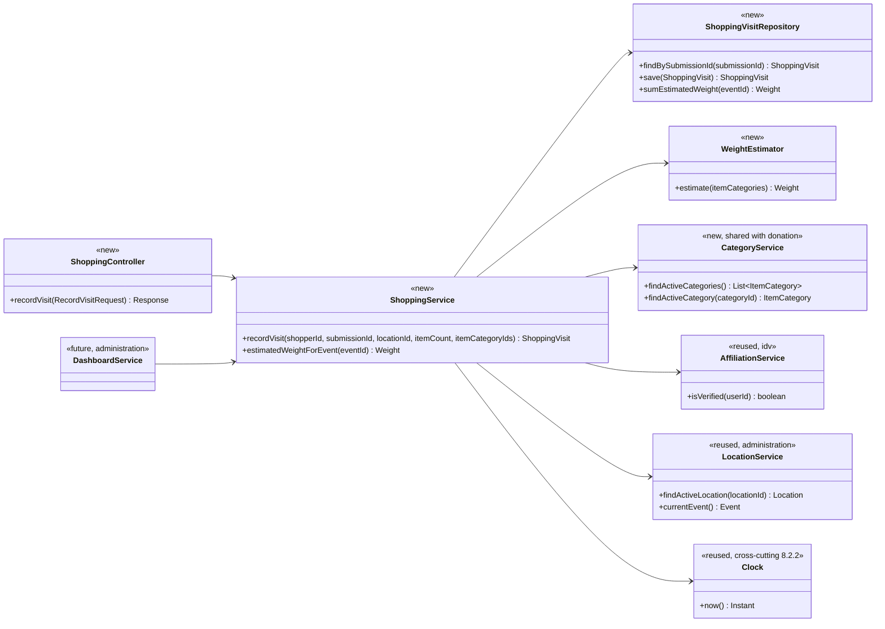
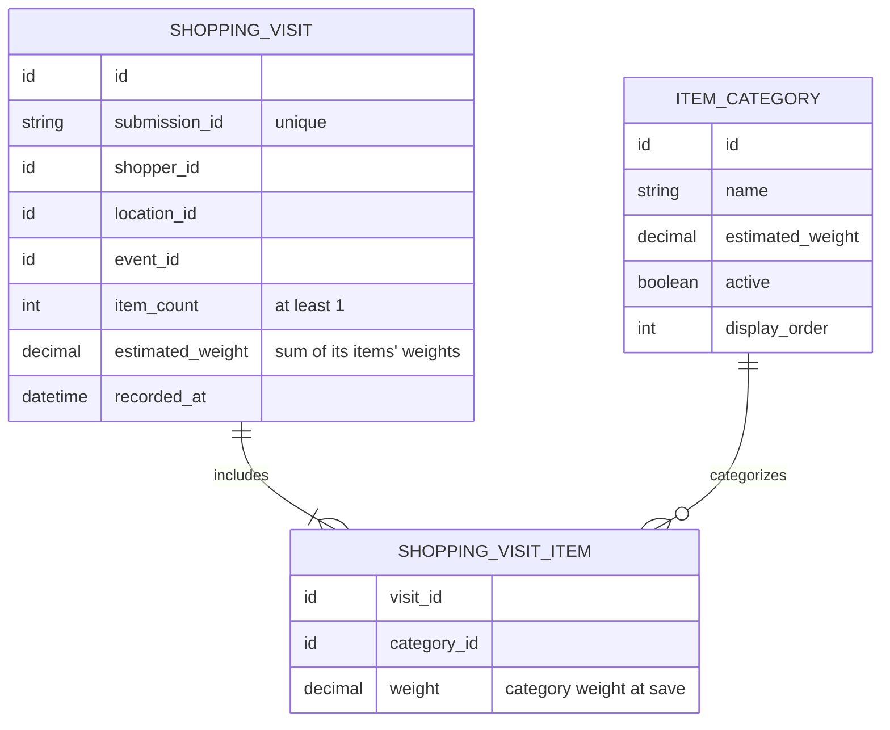

# Shopping Design

**Project:** Refrog
**Team:** 03
**Area:** `UC-SHP`

> **Realizes:** `UC-SHP-log-item-taken`; proposed `FR-SHP-estimated-weight` (**⚠ not yet in the specification**, see [Changes to the specification](#changes-to-the-specification-team-decision-2026-10-16))
> **Depends on:** Business rules `BR-shopping-activity-recorded`, `BR-free-shopping`, `BR-shopper-tcu-affiliation`, `BR-shopper-verification`, `BR-shopping-abuse-review`, `BR-event-schedule`, `BR-event-in-person`. Cross-cutting requirements `FR-AUTH-enforce-permissions`, `FR-AUTH-affiliation-from-signin`, `FR-VAL-server-validation`, `FR-VAL-field-feedback`, `FR-VAL-preserve-input`, `FR-SAVE-confirmed-success`, `FR-SAVE-unknown-outcome`, `FR-SAVE-duplicate-submission`. Quality attributes `ROB-duplicate-submission`, `ROB-connectivity-loss`, `ROB-invalid-input`, `ROB-submission-status`, `PER-form-submission`, `SEC-authentication-provider`, `SEC-role-based-access`, `SEC-least-privilege`, `USE-mobile-responsive`. User interface `UI-shopping-form`.
> **See:** [use case](../requirements/use-cases.md#uc-shp-log-item-taken-record-items-taken-while-shopping), [specification](../requirements/software-requirements-specification.md), [business rules](../requirements/business-rules.md), [architecture-of-record](architectural-design.md)
> **Designed against:** `d8893c1` (local `main`). No application code exists at this commit, so every class below is new.

> [!NOTE]
> **How guesses are marked in this document.** A yellow `[!WARNING]` box that starts **GUESS — needs team review** means the team or the client has not settled that point. Inside tables, lists, and diagrams the same thing is tagged **⚠ GUESS**. Every guess is also listed under [Open questions & risks](#open-questions--risks), so that table is the to-do list for this design.

---

_**How to use this template.** Copy it to `docs/design/<area>.md`, named for the lowercase area code (`ord.md` for `UC-ORD-*`). Instructions appear in italic square brackets; leave them in place until the document is stable, because the agent reads them on every later pass. The full worked example is Project Pulse's [`not.md`](https://github.com/Washingtonwei/project-pulse/blob/main/docs/design/not.md); read it for the shape, not for the answers._

_**What this document is.** The **design-of-record** for one use case area: how the code will realize its use cases, written **before** the code and approved before anyone builds from it. It is the last document your agent reads before it writes code, so anything it leaves out, the agent invents. Your [architecture-of-record](architectural-design.md) is the map of the whole system and stops at each component's responsibility; this document goes one level down, inside one area, against real code._

_**What it is not.** A copy of your use cases. It **cites** `UC-*`, `FR-*`, and `BR-*` by identifier and never restates what the system shall do; it says only how. It is also not a transcript of the code. Once code exists, link to the files rather than describing every class, column, or getter._

_**One document per area, not per use case.** Your area gains use cases over the term. The overview, the class diagram, and the data model are **revised in place** when it does. The sequence diagrams, the API contract rows, and the test rows are **appended**, one set per use case. Never add a `## UC-…` section that repeats the whole skeleton._

_**How much to write.** Pin down what a wrong guess would break: a requirement, a business rule, a quality attribute, or the contract between two parts of your team. Leave the rest for the agent to derive while it builds: variable names, field types, exact JSON, column lengths. When you are unsure, ask which side of that line a detail falls on, not whether it is interesting._

_**Write it in this order.** Each step is one person's or one pair's work, and the order is the point:_

1. _**Sketch it yourselves first.** Before you open the agent, draw the main success scenario's sequence diagram and write the API contract rows by hand, from the use case and your architecture-of-record. Twenty minutes, on paper or in this file._
2. _**Have the agent draft it.** Give the agent this template, the use case, the business rules it cites, your architecture-of-record's section 8 (Crosscutting Concepts), and the relevant existing code, and ask for a draft of this document. Use plan mode, so it proposes before it writes._
3. _**Compare the two.** Where the agent's draft differs from your sketch, decide which is right and why. What it found that you missed goes in; what you knew that it could not have known is the context your specification is missing, so fix the specification too._
4. _**Run the questions test** (the last section) and fix what it finds._
5. _**Open a pull request.** A teammate who did not write it reviews and approves it. Nobody starts an implementation branch from this design until it is merged._

---

## Overview

_[One paragraph: what this area does, which components of your [architecture-of-record](architectural-design.md) it lives in, and what it reads from or calls in other areas. Link the container diagram rather than redrawing it. If this design changes the architecture-of-record, say so here and list the change under "Changes to the architecture-of-record" below.]_

Shopping records what a TCU-affiliated shopper took during a visit, where they took it, and an **estimated weight**. The shopper reports this themselves (`OI-13`, resolved), and it replaces today's separate Google Form. It is the `SHP` module of the single **Application** container ([containers](architectural-design.md#51-containers), [use case areas](architectural-design.md#52-use-case-areas-and-components), `KD-deployment-shape`).

**How the weight works (team decision 2026-10-16, confirmed by the client, Wendy Macias).** At the end of a visit, the shopper enters the **number of items taken** and then picks a **category for each item**. One visit can therefore include items from several categories (clarified by the team). Each category has a configured estimated weight per item. The backend calculates the visit's estimated weight as **the sum of each item's category weight**; the shopper never enters a weight. The event's estimated total weight is the sum of every visit's estimated weight in the event. It is an estimate, not a measured weight.

Shopping reads from two other areas:
- **Identity Verification (`IDV`):** whether the signed-in shopper has completed TCU email verification (`UC-IDV-verify-affiliation`, `FR-AUTH-affiliation-from-signin`).
- **Administration (`ADM`):** which ReFrog locations are active, and the current event.

Shopping also reads the shared **item category list with each category's estimated weight**. It is new reference data shared with Donation; see [Components & classes](#components--classes) for where it lives.

Shopping writes `ShoppingVisit` records. The Administration dashboard (`UC-ADM-view-dashboard`) reads visit counts and the event's estimated total weight, and Shopping-Abuse Monitoring (`UC-ABU-review-alert`) will read the same records later. Category and count together are the signal `OI-11` points at ("20 mirrors would raise a red flag"), but SHP itself flags nothing (`BR-shopping-abuse-review`). Every visit is free, so nothing is priced or charged (`BR-free-shopping`, `LOC-currency-not-applicable`).

> [!IMPORTANT]
> **The weight feature is confirmed but not yet in the specification.** Wendy confirmed she wants the estimated weight of items taken (record the date of that confirmation in `OI-18`). It still does not appear in the use case (where category is optional extension 2a), in the SRS, or in a business rule. See [Changes to the specification](#changes-to-the-specification-team-decision-2026-10-16) for what to change before this design is approved.

This design proposes changes to the architecture-of-record; see [Changes to the architecture-of-record](#changes-to-the-architecture-of-record).

## Components & classes

_[One class diagram for the whole area, and one line per class or file saying what it does and whether it is **new** or **reused**. Show only what a reader needs to see how the parts relate: classes, their key methods, their dependencies. Fields and getters belong to the code._

_**If your repository has no code for this area yet**, which is the normal case for your proving slice, list the files you expect the agent to create, with the paths your architecture-of-record's conventions give them, and mark them all new. The agent then builds into the structure you chose rather than one it improvised.]_



- `shopping/ShoppingController` (new): the HTTP entry point. It checks only the request's shape and takes the shopper's identity from the session (`FR-AUTH-enforce-permissions`), never from the request body.
- `shopping/ShoppingService` (new): checks, in order, that the shopper is affiliated, that the location is active, that the count is valid, that there is exactly one category per item, and that every category is active. It then either returns the stored visit for a repeated submission id, or asks `WeightEstimator` for the weight and saves the visit and its items in one transaction. It also gives Administration the event's estimated total weight.
- `shopping/WeightEstimator` (new): the one place the estimate is calculated (the sum of each item's category weight). It is a pure function with no I/O, so the formula has one home and can be unit tested.
- `shopping/ShoppingVisitRepository` (new): the only class that touches the `shopping_visit` and `shopping_visit_item` tables. It totals an event's weight with one sum query.
- `shared/CategoryService` and `shared/ItemCategory` (new, shared with Donation): the category list and each category's estimated weight, stored as data rather than in code. Categories are shared with `UC-DON-log-donation` (confirmed 2026-10-02). **⚠ GUESS:** the location, the owner, and who edits the weights; see the box below.
- `idv/AffiliationService` (reused, but IDV is not built yet): called only through its service, never its repository. If IDV is not built when SHP is, SHP's build creates this one-method interface and IDV fills it in.
- `administration/LocationService` (reused, but Administration is not built yet): same arrangement as `AffiliationService`.
- `administration/DashboardService` (future, built with `UC-ADM-view-dashboard`): shown only to make clear that the dashboard calls `ShoppingService.estimatedWeightForEvent`. It does not read SHP's table directly.
- `Clock` (cross-cutting, arch §8.2.2): injected so tests can fix the time.

> [!WARNING]
> **GUESS — needs team review: package layout.** The package and file paths (`shopping/`, `shared/`, `idv/`, `administration/`) and the class names are proposals only. The technology stack is still "not yet chosen" (arch §5.1, §8.2.4), and the architecture-of-record gives no layout convention yet. Once the stack is chosen, rename these to match its conventions and record that layout in arch §8.2.4.

> [!WARNING]
> **GUESS — needs team review: who owns and edits the category weights.** This design stores categories and weights as **seed data in the database**, loaded by a migration. Changing a weight means a developer runs a new migration, and no screen exists for it, because no use case lets anyone edit categories. If administrators should edit weights themselves (`CO-nontechnical-administration` suggests they will want to), that needs a new use case such as `UC-ADM-manage-categories` and moves ownership of categories to Administration. Decide before Donation is designed, because Donation shares the list.

## Sequence

_[One sequence diagram per use case for its main success scenario, plus one for each extension that does not just return an error. **Label each interaction with the use case step it implements**, so a reviewer can check that every step is realized and nothing extra was invented. Use `alt` blocks for extensions that branch off the main flow. Give each use case its own `###` heading; that heading is the anchor your traceability matrix cites.]_

### UC-SHP-log-item-taken: recording items taken

```mermaid
sequenceDiagram
    actor S as Shopper
    participant WEB as Web Front End
    participant SC as ShoppingController
    participant SS as ShoppingService
    participant AS as AffiliationService
    participant LS as LocationService
    participant CS as CategoryService
    participant WE as WeightEstimator
    participant R as ShoppingVisitRepository
    S->>WEB: Finished selecting items (step 1)
    WEB->>SC: GET /api/item-categories (step 2, GUESS path)
    SC-->>WEB: active categories
    WEB-->>S: Ask for location (GUESS) and number of items taken (step 2)
    S->>WEB: Enter number of items
    WEB-->>S: Ask for a category for each item (2a, now required)
    S->>WEB: Pick a category per item, confirm (step 3)
    WEB->>WEB: Generate submission id once per form (4b, GUESS)
    WEB->>SC: POST /api/shopping-visits
    SC->>SS: recordVisit(shopperId from session, submissionId, locationId, itemCount, itemCategoryIds)
    SS->>AS: isVerified(shopperId) (PRE-1)
    alt not verified (PRE-1 fails; safeguard only, accounts verify at sign-up)
        SS-->>SC: refused, AFFILIATION_NOT_VERIFIED
    else verified
        SS->>R: findBySubmissionId(submissionId) (4b)
        alt already recorded (4b)
            R-->>SS: existing visit
            SS-->>SC: existing visit, not saved or weighed again (4b1)
        else new submission
            SS->>LS: findActiveLocation(locationId)
            SS->>CS: findActiveCategories()
            alt count not a positive whole number, categories not one per item, a category unknown, or location not active (3a)
                SS-->>SC: refused, VALIDATION_FAILED naming the field
            else valid
                SS->>WE: estimate(item categories) (FR-SHP-estimated-weight, proposed)
                WE-->>SS: sum of each item's category weight
                SS->>R: save(visit with location, count, estimated weight, event, now, plus one item row per category pick) (step 4)
                alt save fails (4a)
                    R-->>SS: error
                    SS-->>SC: NOT_RECORDED
                else saved
                    R-->>SS: stored visit
                    SS-->>SC: stored visit
                end
            end
        end
    end
    SC-->>WEB: 201 or 200 (4b), or the error for the extension
    WEB-->>S: Confirmation (step 5, 4b2), or what to fix while keeping entered values (3a1, 4a1)
```

Notes on the diagram:
- **2a, category, now required, one per item.** In the use case, category is an optional extension. Under the team decision, the shopper enters the number of items and then picks a category for each one (steps 2 and 3), so a visit with clothes and a lamp is one visit with two categories. The use case needs updating to match; see [Changes to the specification](#changes-to-the-specification-team-decision-2026-10-16).
- **3a, invalid input.** The front end may check the count and category too, for quicker feedback, but the server check is the one that counts (`FR-VAL-server-validation`, arch §8.2.5). The error names the field (`FR-VAL-field-feedback`), and the form keeps what was entered (`FR-VAL-preserve-input`).
- **Weight is calculated on the backend only.** The client sends only `itemCount` and one category id per item, never a weight, so the estimate cannot be changed from the browser.
- **4a, save failure.** The shopper never sees a confirmation unless the save is confirmed (`FR-SAVE-confirmed-success`), and no weight is counted for a failed save. If the response never arrives, the front end resends the **same** submission id. That returns either the stored visit or a real failure (`FR-SAVE-unknown-outcome`).
- **4b, repeated submission.** The stored visit is returned, so its weight is counted exactly once.
- **Event total.** It is not a step in this use case. `ShoppingService.estimatedWeightForEvent` is called by the dashboard (`UC-ADM-view-dashboard`) whenever it is shown, so the total is always current and nothing has to run "at the end of the event".

> [!NOTE]
> **Answered: items from several categories in one visit.** One visit can include many items across different categories; the shopper gives the number of items, then a category for each item. How much a shopper may take is Shopping-Abuse Monitoring's concern (`BR-shopping-abuse-review`, `OI-11`), not this form's.

> [!WARNING]
> **GUESS — needs team review: how the form and storage represent "a category per item".** The team described it as "a box for the number of items, then choose the category per item", noting that might not be the final implementation. This design takes it literally:
> - The request carries `itemCount` and a list of exactly `itemCount` category ids.
> - The backend stores one `shopping_visit_item` row per item.
>
> With a large count (say 20 shirts), picking 20 categories one by one is slow on a phone (`USE-mobile-responsive`). A front-end shortcut such as "apply this category to the remaining items" fixes that without changing the API. Confirm the form design before the front end is built.

> [!NOTE]
> **Answered: the shopper does not see the weight.** The confirmation (step 5) shows only that the visit was recorded. The estimated weight is for ReFrog's reporting. It is still returned in the API response, so showing it later would be a front-end-only change.

> [!WARNING]
> **GUESS — needs team review: where the location comes from.** The use case's main success scenario (step 2) asks only for the item count. But POST-1 and `BR-shopping-activity-recorded` require a location, and `UI-shopping-form` says the shopper enters "the number of items taken and the location". This design assumes the form sends a `locationId` that is **pre-filled from a per-location QR link when there is one, and otherwise picked by the shopper from the active locations**. Fix the use case's step 2 to mention location either way. Ask Wendy whether each location has its own QR code.

> [!WARNING]
> **GUESS — needs team review: the 4a2 volunteer fallback.** Extension 4a2 says the shopper "reports the count to a volunteer as a fallback". This design assumes the **volunteer writes it down outside the app**, so SHP has no volunteer-on-behalf endpoint. That means the weight of those visits is **missing from the event total**. If volunteers should enter them in the app, that needs a new flow, a role check, and a `verificationMethod` value. That change goes in the use case first.

> [!WARNING]
> **GUESS — needs team review: what happens when the shopper is not verified.** The use case has no extension for this, because PRE-1 assumes verification has already happened. This design refuses the request with `AFFILIATION_NOT_VERIFIED`, and the front end sends the shopper to `UC-IDV-verify-affiliation`. Consider adding this as an extension to the use case.

## API contract

_[One row per endpoint, scheduled job, or message this area adds or changes, appended per use case. **This section is never dropped**: before the code exists it is the only thing the person (or agent session) building the front end and the one building the back end both read. Name the caller and who may call it, the request fields, the success response, and the error each extension returns. Leave field types and exact JSON to the agent unless a wrong guess would break something, such as a format another system depends on. Use the error shape your architecture-of-record's section 8.2 fixes; do not invent one here.]_

| Endpoint or job | Caller (who may) | Request | Success | Errors, by extension |
|---|---|---|---|---|
| `GET /api/item-categories` **⚠ GUESS** (path; shared with Donation) | Any signed-in user. **⚠ GUESS:** Donation needs it without sign-in (`OI-4`), so it may need to be public. | None | `200`: active categories, each with its id and display name, in display order. Weights are not needed by the form. | Not signed in (if sign-in is required): `401` |
| `POST /api/shopping-visits` **⚠ GUESS** (path) | A signed-in shopper, recording for themselves only. The shopper comes from the session, never from the body; a `shopperId` in the body is ignored. | `submissionId` (generated by the client, one per form fill, reused on retry), `locationId`, `itemCount`, `itemCategoryIds` (required, one category id per item, so exactly `itemCount` entries; repeats allowed). **No weight is accepted from the client.** | `201`: visit id, location, item count, the categories, estimated weight with its unit, recorded time. Repeated `submissionId` (4b): `200` with the **already stored** visit, nothing saved or weighed again. | Not signed in: `401`. PRE-1 not verified: `403 AFFILIATION_NOT_VERIFIED`. 3a: a count that is not a positive whole number, a number of categories that does not match the count, an unknown or retired category, or a missing, unknown, or inactive location: `422 VALIDATION_FAILED`, naming each failing field. 4a save failure: `503 NOT_RECORDED`, saying nothing was recorded. All codes **⚠ GUESS** |
| `GET` active locations (owned by `ADM` / `LOC`, **not added here**) | Any user | None | List of active locations, used to fill the location picker | Owned by that area's design. This row is listed only so the front end knows SHP depends on it. |
| Event estimated weight: `ShoppingService.estimatedWeightForEvent(eventId)`, an **in-process call, not an HTTP endpoint** | Administration's dashboard only | Event id | Total estimated weight with its unit; zero if the event has no visits | None from SHP. The dashboard shows "unavailable" if the call fails (`FR-DISPLAY-unavailable-data`) |

> [!WARNING]
> **GUESS — needs team review: the error shape and status codes.** Arch §8.2.1 and §8.2.3 say errors must separate validation, authorization, unavailable-service, and unexpected failures, but they do not fix a JSON shape or the status codes yet. The codes above (`401`, `403`, `422`, `503`) and the error names are placeholders. When §8.2.3 fixes the shape, update this table to match. Do not invent a shape just for SHP.

## Key decisions

_[Only the decisions a reader could not recover from the code: an invariant, who may do this and how it is enforced, a trade-off you chose, a reason you reused something rather than writing it. **Each one names what you chose, what you rejected, and why.** If you cannot name an alternative you considered, it probably was not a decision; leave it out._

_A decision that affects the whole system rather than this area is an architecture decision. It belongs in your architecture-of-record as a `KD-*` entry, not here.]_

**An item count plus a category per item; the backend calculates the weight.** Decided by the team, 2026-10-16. The shopper sends `itemCount` and one category per item, and the backend adds up each item's category weight. Rejected: asking the shopper for a weight, because nobody at a location can weigh items and the answer would be a guess. Rejected: one category per visit, because a shopper who takes clothes and a lamp in one visit would have to split the visit or misstate the weight.

**Each visit keeps the weight calculated when it was saved.** Each item row stores its category's weight at that moment, the visit stores the resulting total, and event totals add up those stored values. Rejected: recalculating from the current category weight whenever a total is shown, because then correcting a weight after the event would silently change past events' totals, and a reported total could not be reproduced. The trade-off is that correcting a weight does not fix visits already saved. If the team wants past totals recalculated, that has to be a deliberate, separate step.

**The event total is summed when it is read, not kept as a running counter.** The event's estimated weight is one sum over its visits each time the dashboard asks. Rejected: adding each visit's weight to a stored event total, because two shoppers saving at once can lose an update, a repeated submission (4b) can add twice, and a failed save after the counter is updated leaves the total wrong. At `SCA-event-capacity` volumes (about 3,000 shoppers per event) the sum is cheap. Revisit only if `PER-*` measurements show the dashboard is slow.

**The weight is calculated in one class, from data.** `WeightEstimator` is the only code that multiplies count by weight, and the weights live in the category table, not in code. Rejected: hard-coding weights in the front end or in `ShoppingService`, because a weight change would then mean a code change and a release, and the browser could be made to report any weight.

**How a repeated submission is recognized.** **⚠ GUESS** (the team's call). The front end generates a `submissionId` when the form opens and sends the same id on every retry. The database enforces it as unique. A repeated id returns the stored visit, which covers 4b, `FR-SAVE-duplicate-submission`, `ROB-duplicate-submission`, and `FR-SAVE-unknown-outcome` with one mechanism, and it keeps the weight from being counted twice. Rejected: treating identical (shopper, location, count, categories) within a few minutes as a duplicate, because a shopper who really makes two trips with the same items would lose a record, and `BR-shopping-activity-recorded` requires every visit recorded. If DON and VOL adopt the same mechanism, it should move to arch §8.2.8 as a system-wide convention.

**Where affiliation is enforced.** On the server, on every submission, through `AffiliationService.isVerified`. Rejected: relying on `UI-shopping-form` hiding the form from unverified shoppers. The browser is outside the trust boundary (arch §8.1), so a hidden form only advises, and `BR-shopper-tcu-affiliation` would be unenforced against a direct request.

**Verification lasts per shopper, not per visit.** SHP asks whether the shopper has *ever* completed the TCU email check, following `UC-IDV-verify-affiliation` ("once per shopper, not once per visit") and `FR-AUTH-affiliation-from-signin`. Rejected: requiring a new check on each visit, which would contradict both.

> [!WARNING]
> **GUESS — needs team review: PRE-1 wording conflict.** `UC-SHP-log-item-taken` PRE-1 says affiliation is verified "**for this visit**", but IDV says verification happens once and persists. This design follows IDV. The use case author should change PRE-1 to "The shopper's TCU affiliation has been verified (`UC-IDV-verify-affiliation`)". The in-person volunteer glance at the verified screen (`BR-shopper-verification`) happens at the location and is not recorded by SHP.

**Every visit stores the shopper's id.** Each `ShoppingVisit` keeps `shopperId` so Shopping-Abuse Monitoring can later find repeat visits and category-and-quantity patterns (`BR-shopping-abuse-review`, `OI-11`, SRS §7.3.4). SHP itself flags nothing. Rejected: anonymous visits, as today's Google Form keeps them, because then `UC-ABU-review-alert` could never be built without changing the data. The trade-off is that SHP keeps a person-linked record, so it falls under `SEC-least-privilege`: only that shopper and administrators may read it. How long it is kept is `OI-6`.

**The event and the time are set on the server.** `eventId` comes from `LocationService.currentEvent()`, and `recordedAt` comes from the injected `Clock` (arch §8.2.2, `America/Chicago` for display). Rejected: taking either from the client, because a phone's clock and a stale page would put visits, and their weight, in the wrong event or day, and the dashboard counts visits by day.

## Data model

_[The **change** this area makes to the data: new tables or entities, new columns, the migration that adds them. Draw an ER diagram when there is more than one new table. Do not redraw the domain model; your [specification](../requirements/software-requirements-specification.md) owns it, so link it and show only the change. If the area changes nothing, say "No change" and give the reason in one line; that is a design decision too.]_

Three new tables. `shopping_visit` and `shopping_visit_item` implement the specification's `ShoppingRecord` (and its link to `Item`), and `item_category` implements `Item.category` with a weight added ([domain model §7.1](../requirements/software-requirements-specification.md#71-business-domain-model), [data dictionary §7.2](../requirements/software-requirements-specification.md#72-data-dictionary)).



| Table | Column | Meaning | Constraint |
|---|---|---|---|
| `item_category` (shared with Donation) | `id`, `name` | One category from the fixed list | Required. Name unique |
| | `estimated_weight` | Estimated weight of **one** item in this category | Required, greater than 0. Unit **⚠ GUESS** (pounds) |
| | `active` | Whether shoppers and donors can pick it | Required. A retired category stays so old visits still resolve |
| | `display_order` | Order in the picker | Required |
| `shopping_visit` | `id` | Visit identifier (`shoppingRecordId`) | Primary key |
| | `submission_id` | Client-generated id for spotting a repeated submission | Required, **unique** |
| | `shopper_id` | The signed-in shopper | Required, references the user account |
| | `location_id` | Where the items were taken (`BR-shopping-activity-recorded`) | Required, references an active location at save time |
| | `event_id` | The event this visit belongs to | Required, set on the server, indexed for the event total |
| | `item_count` | Number of items taken (`quantityTaken`, `BR-shopping-activity-recorded`) | Required, whole number ≥ 1, equal to the number of its item rows |
| | `estimated_weight` | Sum of its items' `weight` | Required, calculated by the backend, never sent by the client |
| | `recorded_at` | When it was saved (`shoppingDateTime`) | Required, set by the server clock |
| `shopping_visit_item` | `visit_id` | The visit this item belongs to | Required |
| | `category_id` | The category the shopper picked for this item | Required, references an active category at save time |
| | `weight` | The category's `estimated_weight` when the visit was saved | Required, copied by the backend |

**An event's estimated weight** is calculated, not stored: the sum of `estimated_weight` over every visit in the event.

The migration that adds these tables, and the one that seeds the categories and their weights, come with the first SHP pull request. They cannot be named until the stack is chosen.

> [!WARNING]
> **GUESS — needs team review: the category weights and unit.** This design has no actual weight values. Someone has to choose an estimated weight for each category and say where it came from (a weighed sample, a published average, Wendy's estimate). Under `business-rules.md`, a weight the client supplies is a **computation rule** that needs a source. A weight the team picks is a design choice and belongs in the specification. The unit is assumed to be **pounds**. Also decide on rounding: this design keeps decimals and leaves rounding to display.

> [!WARNING]
> **GUESS — needs team review: the category list.** The categories are shared with DON, but the client has not finalized the list ("5–6 click-box options, e.g., mattress toppers, headboards, large furniture"). SRS §7.2's `Item.category` lists a different set (furniture, appliance, clothing, linens, household goods, other). Each category now needs a weight, so a vague one like "other" or "household goods" will make the estimate rough. Confirm the list with Wendy.

> [!WARNING]
> **GUESS — needs team review: the specification disagrees with this design.**
> - **Item count.** SRS §7.2 gives `ShoppingRecord.quantityTaken` as "0 or greater". The use case (3a) and `FR-VAL-server-validation` reject zero. This design follows the use case (≥ 1).
> - **`verificationMethod`.** SRS §7.2 requires this field (visual ID check / digital check / admin override). SHP only accepts digitally verified shoppers, so the value would always be "digital". This design **leaves the column out**. Add it back only if the 4a2 volunteer fallback or a visual-ID fallback ever records visits in the app.
> - **Category and weight.** SRS §7.2's `ShoppingRecord` has no categories or estimated weight, and `Item` has no weight. These need adding, along with the fact that one visit has a category per item.

## Reuse & cross-cutting

_[Which existing services, components, and conventions this area uses rather than rebuilding: authentication, the error handler, email, the clock, another area's service. Cite your architecture-of-record's section 8.2 for each convention by name rather than restating it.]_

- **Authentication and authorization:** session identity from the Authentication component (own email-and-password accounts, `KD-own-accounts`). Shopping endpoints require sign-in (arch §8.1 Authorization, `FR-AUTH-enforce-permissions`, `SEC-role-based-access`).
- **Affiliation status:** `AffiliationService` from Identity Verification (arch §5.2 `IDV`). SHP never reads or stores the shopper's TCU email itself.
- **Locations and the current event:** `LocationService` from Administration (arch §5.2 `ADM`).
- **Item categories and weights:** `CategoryService` and the `item_category` table, shared with Donation. **⚠ GUESS:** whether Donation also records weight (for a "weight donated" total) is not decided. The shared table supports it either way.
- **Error handling:** the shared application error handler (arch §8.2.1 Error handling), so a 4a failure reports "not recorded" and exposes no internal details.
- **Time and time zones:** the injected clock and the stored timestamp format (arch §8.2.2 Time and time zones).
- **API conventions:** response and error shape (arch §8.2.3 API conventions). See the error-shape GUESS under API contract.
- **Validation:** server-side and authoritative, with feedback naming the field (arch §8.2.5 Validation).
- **Logging:** log failed saves and refusals with the visit's `submissionId`, but no TCU email or other unneeded personal data (arch §8.2.7 Logging, `SEC-affiliation-data`).
- **Persistence and concurrency:** one transaction per visit, covering the visit and its item rows, and a failed write is never reported as saved (arch §8.2.8 Persistence and concurrency). Event totals are read by summing, so there is no shared counter to fight over.
- **Testing:** the layers and test data rules of arch §8.2.10 Testing, which already calls for data-calculation rules to be tested. `WeightEstimator` is one.
- **Front end:** the form keeps entered values on any failure (`FR-VAL-preserve-input`, `UI-preserve-input`, `ROB-connectivity-loss`) and is phone-first (`USE-mobile-responsive`).

## Tests

_[One row per flow: the main success scenario and **every** extension of every use case this document realizes, appended per use case. Name the level (unit or integration) and what the test asserts. No code. This list is the definition of done that the reviewer approves; the agent writes these tests when it builds, and a reviewer can see at a glance whether an extension has no test.]_

| Use case, flow | Level | Asserts |
|---|---|---|
| UC-SHP-log-item-taken main | integration | A verified shopper's visit with an active location, a count of 3, and categories A, A, B is saved once, with the right shopper, location, event, count, three item rows, and estimated weight, and `201` is returned |
| UC-SHP-log-item-taken 2a, categories don't match count | unit | A count of 3 with 2 categories, or with 4, is refused, naming `itemCategoryIds`, and nothing is saved |
| UC-SHP-log-item-taken 2a, bad category | unit | A visit where any item has an unknown or retired category is refused, naming `itemCategoryIds`, and nothing is saved |
| UC-SHP-log-item-taken 3a, negative | unit | A count of −1 is refused, naming `itemCount`, and nothing is saved |
| UC-SHP-log-item-taken 3a, zero | unit | A count of 0 is refused, naming `itemCount`, and nothing is saved |
| UC-SHP-log-item-taken 3a, non-numeric | unit | A count of `"abc"` or `2.5` is refused, naming `itemCount`, and nothing is saved |
| UC-SHP-log-item-taken 3a, bypassing the interface | integration | An invalid count, missing category, or missing location sent straight to the endpoint is refused and nothing is saved (`FR-VAL-server-validation` verification) |
| Location not active | integration | A visit for an unknown or closed location is refused, naming `locationId`, and nothing is saved |
| Weight estimate | unit | With category A at 2.5 and B at 10.0 per item, items A, A, B give an estimated weight of 15.0 (`WeightEstimator`, `FR-SHP-estimated-weight` proposed) |
| Weight from the client ignored | integration | A request that includes a weight field is saved with the backend-calculated weight, not the client's |
| Weight kept at save time | integration | After a visit is saved, changing category A's weight does not change that visit's weight or the event total for it |
| Event total | integration | Three visits across two locations in one event, plus one visit in another event, give the first event's total as the sum of exactly its three visits' weights |
| Event total, no visits | integration | An event with no visits totals zero |
| UC-SHP-log-item-taken 4a | integration | When the repository is made to fail partway through saving item rows, no visit or item row exists, the event total is unchanged, and no success is returned (`FR-SAVE-confirmed-success`) |
| UC-SHP-log-item-taken 4b | integration | Sending the same `submissionId` twice, including concurrently, stores exactly one visit, the event total counts its weight once, and the second call returns that visit (`FR-SAVE-duplicate-submission`) |
| UC-SHP-log-item-taken 4b, unknown outcome | integration | After a save succeeds but the response is dropped, resending the same `submissionId` returns the stored visit, not a failure (`FR-SAVE-unknown-outcome`) |
| Two real visits | integration | Two submissions with different `submissionId`s and identical contents store two visits and count both weights |
| PRE-1 not verified | integration | A signed-in shopper without TCU verification is refused with `AFFILIATION_NOT_VERIFIED` and nothing is saved (`BR-shopper-tcu-affiliation`) |
| Authorization, not signed in | integration | A request with no session gets `401` and nothing is saved |
| Authorization, someone else's id | integration | A `shopperId` in the request body for another user is ignored, and the visit is saved under the session's shopper |
| Time | unit | With the clock fixed at 11:59 p.m. `America/Chicago`, `recordedAt` falls on that local day (arch §8.2.2) |

## Changes to the architecture-of-record

_[Designing an area against real code is when the architecture's guesses meet reality. If this design needs a component the map does not have, moves a responsibility, or adds a dependency, **change [the architecture-of-record](architectural-design.md) in the same pull request** and list each change here in one line. If nothing changed, write "None". A design that silently disagrees with the architecture leaves two maps, and the agent will follow whichever it reads last.]_

> [!WARNING]
> **GUESS — needs team review: these changes are proposed, not yet made in [architectural-design.md](architectural-design.md).** Apply them in this pull request, or reject them and remove this box.
> - **§5.2, `SHP` row:** add **Authentication** to "Depends on". SHP needs the signed-in shopper's identity (`FR-AUTH-enforce-permissions`), and today the row lists only Identity Verification and Administration.
> - **§5.2, `SHP` row:** change Responsibility to "Owns recording what a shopper takes during a visit, by category, and the estimated weight taken."
> - **§5.2, new home for item categories:** the shared category list and weights need an owner. Either add a cross-cutting **Item Categories** row (used by Shopping and Donation), or add categories to **Administration**'s responsibility if administrators will edit them. See the ownership GUESS under Components & classes.
> - **§5.1, Database description:** add "item categories and their estimated weights".
> - **§5.2, `ADM` row:** the dashboard now also shows the event's estimated weight taken, read through Shopping.
> - **§5.2, `SHP` row (optional):** note that `shopper_id`, category, and count are kept for `ABU`.
> - **Outside this area, for whoever owns §5.2:** the line saying `DON`'s dependency on Authentication is left out "since `OI-4` … is still open" is stale. `OI-4` was resolved 2026-10-02 (no sign-in for donations).

## Changes to the specification (team decision, 2026-10-16)

The template says that what the team knew but the agent could not is context the specification is missing. Requiring a category and estimating weight is that kind of context, so these changes belong in the requirements documents, not only here. **None of them is made yet.**

> [!WARNING]
> **GUESS — needs team review: proposed specification changes.**
> - **`use-cases.md`, `UC-SHP-log-item-taken`:**
>   - Move category from optional extension 2a into steps 2 and 3: the shopper enters the number of items, then a category for each item.
>   - Add "categories missing or not one per item" to 3a.
>   - Add the estimated weight to POST-1.
>   - Change `category` in Associated Information from Optional to Required.
>   - Add `estimated weight` as a derived field.
> - **`software-requirements-specification.md` §5.2:** add a candidate **`FR-SHP-estimated-weight`**. For example: "When a shopping visit is recorded, the system shall calculate its estimated weight as the sum of the configured estimated weight of each item's selected category, and shall report the event's estimated total weight as the sum over its visits." Verification: the weight-estimate and event-total test rows above.
> - **SRS §7.2:** add `category` and `estimatedWeight` to `ShoppingRecord`, add `estimatedWeight` to `Item.category`, and fix `quantityTaken` to ≥ 1.
> - **SRS §7.3 and `UI-admin-dashboard`:** add the event's estimated weight taken to the summary report and dashboard.
> - **`UI-shopping-form`:** category becomes required.
> - **`business-rules.md`:** only if Wendy supplies the weights. Then they become a computation rule with her as the source (for example `BR-category-estimated-weight`). If the team picks them, they stay in the specification and no rule is added.
> - **`OPEN-ISSUES.md`:** `OI-18` is partly answered: Wendy confirmed she wants the estimate. The per-category weights and unit are still open.

## Open questions & risks

_[What this design could not settle and who can, and what could go wrong that you are accepting. A question for the client also goes in [`OPEN-ISSUES.md`](../requirements/OPEN-ISSUES.md).]_

| # | Question or risk | Current guess in this design | Who can answer | Could a wrong guess break a requirement? |
|---|---|---|---|---|
| 1 | ~~Does the client want the weight estimate?~~ **Answered:** yes, Wendy confirmed it. Whether she has weights per category is question 2 | Build it | Answered by Wendy | — |
| 2 | What is each category's estimated weight, where does it come from, and in what unit? | No values yet; pounds; decimals kept | Team or Wendy (see the business-rule note) | Yes: wrong weights make the reported total wrong |
| 3 | Who maintains categories and weights: developers through seed data, or administrators through a screen? | Seed data; no admin screen | Team, then Wendy | Yes, for `CO-nontechnical-administration`, if admins must change weights mid-event |
| 4 | ~~What does a shopper who took items from several categories do?~~ **Answered:** one visit, a category per item | Request carries `itemCount` plus one category id per item; one `shopping_visit_item` row per item. **⚠ GUESS:** the exact form, and a shortcut for large counts | Team (form design) | Low: the API stays the same whatever the form looks like |
| 5 | Should correcting a weight recalculate past visits? | No; each visit keeps the weight it was saved with | Team | Low, if the reporting purpose is understood |
| 6 | Does Donation also record weight? | Not decided; the shared table allows it | Team, when Donation is designed | No |
| 7 | ~~Does the shopper see the estimated weight?~~ **Answered:** no | Not shown on the confirmation; in the API response only | Answered by the team | — |
| 8 | Where does the location come from: picked by the shopper, or pre-filled from a per-location QR code? | The client sends `locationId`; the QR link pre-fills it when there is one, and otherwise the shopper picks | Client: Wendy (does each location have its own QR?); use case author fixes step 2 | Yes: `BR-shopping-activity-recorded` needs the right location |
| 9 | How is the 4a2 "report to a volunteer" fallback recorded? | Outside the app; no SHP endpoint, so those visits are missing from the weight total | Team, then Wendy if it should be in the app | Yes, if those visits must reach the dashboard and total |
| 10 | What happens when a shopper who is not verified submits? | `403 AFFILIATION_NOT_VERIFIED`, and the shopper is sent to IDV | Use case author (add an extension) | No: the refusal itself is required by `BR-shopper-tcu-affiliation` |
| 11 | PRE-1 says "for this visit"; IDV says once per shopper | Once per shopper | Use case author | Low: following IDV matches the client's stated intent |
| 12 | Error JSON shape and status codes | `401` / `403` / `422` / `503` with named codes | Team, via arch §8.2.3 | Yes: the front end and back end must agree |
| 13 | How repeated submissions are recognized | A client-generated `submissionId`, unique in the database | Team | Yes: `FR-SAVE-duplicate-submission`, and the weight would be counted twice |
| 14 | SRS §7.2 allows a count of 0 and lacks category and weight | ≥ 1; category and weight added | Team (update the SRS) | No: following the use case is stricter |
| 15 | SRS §7.2 requires `verificationMethod` | Column left out | Team (update the SRS) | Low, unless a non-digital fallback is added |
| 16 | The category list is not final, and SRS and the use case list differ | One shared `item_category` table, list to be confirmed | Client: Wendy | Yes now: category is required and drives the weight |
| 17 | Does the category endpoint need to be public for Donation? | Signed-in only for SHP; Donation may need it public | Team, when Donation is designed | No, for SHP |
| 18 | Package layout and class names | `shopping/`, `shared/`, `idv/`, `administration/` | Team, once the stack is chosen (arch §5.1, §8.2.4) | No |
| 19 | IDV and ADM are not built yet | SHP builds against their one-method interfaces | Team (build order) | No, if the interfaces are kept |
| 20 | **Risk:** outdoor locations with poor connectivity (`ROB-connectivity-loss`, vision §3.2) | The form keeps values and retries with the same `submissionId`; **no offline queue** | Team; revisit after the first event | Possibly: if signal is too poor to submit at all, visits and their weight are lost unless the 4a2 fallback catches them |
| 21 | **Risk:** a `PER-form-submission` two-second response at peak | One indexed lookup plus one insert per visit | Team, at load test | Unlikely at `SCA-event-capacity` volumes |
| 22 | How long visits linked to a shopper are kept | Not decided here | Client and TCU data governance (`OI-6`) | Yes, for `CO-tcu-data-governance` |

---

## Working this document with your agent

_[Delegate: drafting the diagrams from your sketch and the use case; listing the existing files a class should extend; filling the contract rows' request and response fields; proposing the test row for each extension; drafting the rejected alternative for a decision you have already made; checking that every identifier this document cites exists in the document that owns it._

_Keep human: which side of the "would a wrong guess break something" line each detail falls on; every key decision; and the approval, which is a teammate's review of the pull request, not the drafter's own reading._

_**The specific failure to watch for: scope that nobody asked for.** An agent drafting a design adds what designs it has read usually have: an admin override, a retry queue, a status field, a notification "while we are here". Each looks reasonable and none is in your use case, and once it is in the design the agent will build it, test it, and you will maintain it. Read the sequence labels: every interaction should name the use case step it implements. An interaction with no step is either a missing requirement, which goes to your specification and your client, or scope creep, which comes out.]_

---

## The questions test (before you open the pull request)

_[Start a **fresh** agent session in plan mode, so it carries nothing from the session that drafted this document. Give it only the use case, the business rules it cites, your architecture-of-record's section 8, and this document, and ask:_

> _List every point you would still have to guess to implement `<UC-ID>`. For each, say what you would guess and whether a wrong guess could violate a requirement. Do not write code._

_For each item on its list, either fix this document or keep the guess and write one line saying why a wrong guess breaks no requirement. Paste the list, with your answer to each item, into the pull request description under How it was verified, inside a collapsed `<details><summary>Questions test</summary> … </details>` block so the description stays short. The design is ready when nothing on the list could break a requirement.]_
