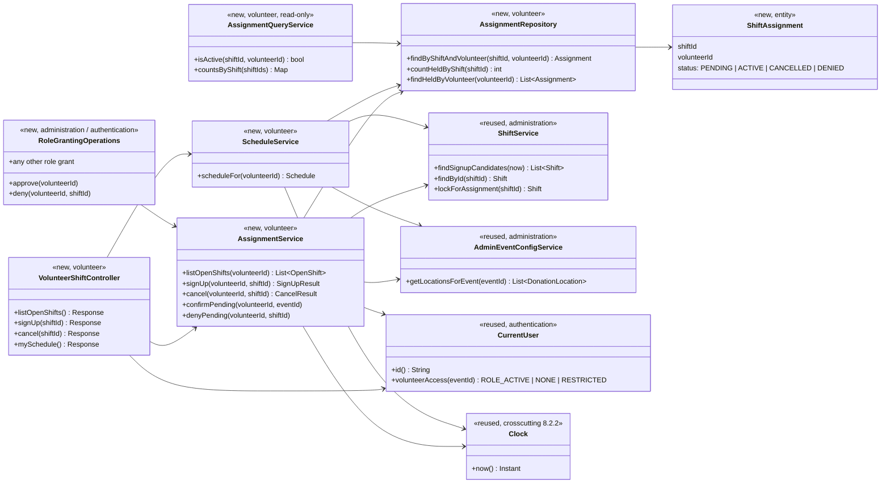
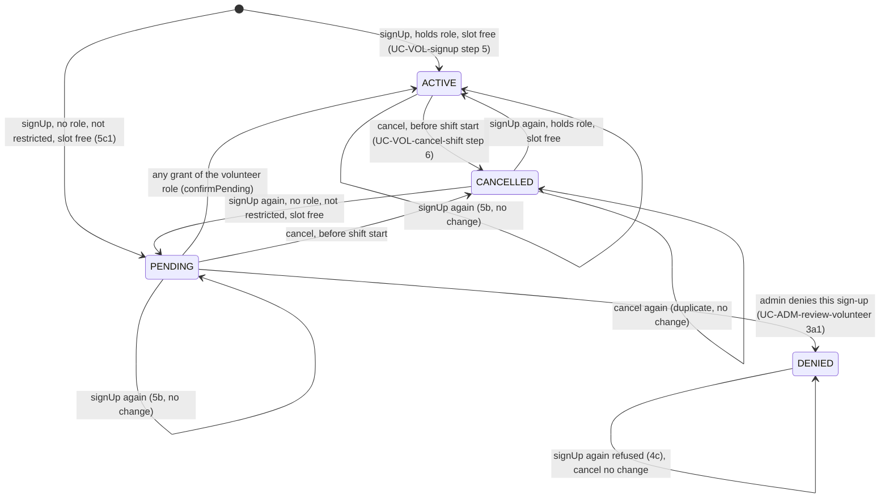

# Volunteer Scheduling Design

**Project:** ReFrog
**Team:** Team 3
**Area:** `UC-VOL`

> **Realizes:** `UC-VOL-signup`, `UC-VOL-cancel-shift`, `UC-VOL-view-schedule`
> **Supports:** `UC-ADM-review-volunteer` (VOL's part only: confirming or releasing pending sign-ups)
> **Depends on:** `BR-volunteer-assignment`, `BR-location-staffing`, `BR-event-schedule`, `BR-volunteer-role-approval`, `BR-volunteer-role-lifecycle`, `FR-AUTH-enforce-permissions`, `FR-AUTH-volunteer-role`, `FR-AUTH-volunteer-lifecycle`, `FR-VAL-server-validation`, `FR-SAVE-confirmed-success`, `FR-SAVE-unknown-outcome`, `FR-SAVE-duplicate-submission`, `ROB-duplicate-submission`, `USE-volunteer-signup-completion`, `PER-form-submission`, `SEC-least-privilege`, `UI-volunteer-schedule`, `KD-tech-stack`
> **See:** [use cases](../requirements/use-cases.md#area-volunteer-scheduling-vol), [SRS non-use-case FRs](../requirements/software-requirements-specification.md#52-non-use-case-functional-requirements), [data dictionary](../requirements/software-requirements-specification.md#72-data-dictionary), [architecture-of-record](architectural-design.md) (§5.2 components, §8 crosscutting concepts, §9.2 `KD-tech-stack`)
> **Designed against:** `main` at `4323d3d` (2026-10-16); `UC-VOL-signup` revised against `tech_stack` at `9175280` (`main` `612c5cc` plus `KD-tech-stack`, 2026-10-30). No application code exists yet; every class below is new.

---

_**How to use this template.** Copy it to `docs/design/<area>.md`, named for the lowercase area code (`ord.md` for `UC-ORD-*`). Instructions appear in italic square brackets; leave them in place until the document is stable, because the agent reads them on every later pass. The full worked example is Project Pulse's [`not.md`](https://github.com/Washingtonwei/project-pulse/blob/main/docs/design/not.md); read it for the shape, not for the answers._

_**What this document is.** The **design-of-record** for one use case area: how the code will realize its use cases, written **before** the code and approved before anyone builds from it. It is the last document your agent reads before it writes code, so anything it leaves out, the agent invents. Your [architecture-of-record](architectural-design.md) is the map of the whole system and stops at each component's responsibility; this document goes one level down, inside one area, against real code._

_**What it is not.** A copy of your use cases. It **cites** `UC-*`, `FR-*`, and `BR-*` by identifier and never restates what the system shall do; it says only how. It is also not a transcript of the code. Once code exists, link to the files rather than describing every class, column, or getter._

_**One document per area, not per use case.** Your area gains use cases over the term. The overview, the class diagram, and the data model are **revised in place** when it does. The sequence diagrams, the API contract rows, and the test rows are **appended**, one set per use case. Never add a `## UC-…` section that repeats the whole skeleton._

_**How much to write.** Pin down what a wrong guess would break: a requirement, a business rule, a quality attribute, or the contract between two parts of your team. Leave the rest for the agent to derive while it builds: variable names, field types, exact JSON, column lengths. When you are unsure, ask which side of that line a detail falls on, not whether it is interesting._

_**Write it in this order.** Each step is one person's or one pair's work, and the order is the point:_

1. _**Sketch it yourselves first.** Before you open the agent, draw the main success scenario's sequence diagram and write the API contract rows by hand, from the use case and your architecture-of-record. Twenty minutes, on paper or in this file._
2. _**Have the agent draft it.** Give the agent this template, the use case, the business rules it cites, your architecture-of-record's section 8 (Crosscutting Concepts), and the relevant existing code, and ask for a draft of this document. Use plan mode, so it proposes before it writes._
3. _**Compare the two.** Where the agent's draft differs from your sketch, decide which is right and why. What it found that you missed goes in; what you knew that it could not have known is the context your specification is missing, so fix the specification too._
4. _**Run the questions test** (the last section) and fix what it finds._
5. _**Open a pull request.** A teammate who did not write it reviews and approves it. Nobody starts an implementation branch from this design until it is merged._

---

## Overview

_[One paragraph: what this area does, which components of your [architecture-of-record](architectural-design.md) it lives in, and what it reads from or calls in other areas. Link the container diagram rather than redrawing it. If this design changes the architecture-of-record, say so here and list the change under "Changes to the architecture-of-record" below.]_

Volunteer Scheduling lets a signed-in volunteer claim an open slot on a shift, give a slot back, and see their own upcoming shifts and credited hours. It is the `VOL` module of the single Application container ([containers](architectural-design.md#51-containers), [use case areas](architectural-design.md#52-use-case-areas-and-components), `KD-deployment-shape`). It **owns one thing: the shift assignment**, the record that one volunteer holds one slot on one shift. It does not own shifts. Shifts, with their location, time, and required volunteer count, are created by Administration (`UC-ADM-manage-shifts`). VOL reads them through Administration's service and takes a row lock on a shift while it changes that shift's assignments. Location names and addresses also come from Administration, which owns event and location configuration ([INF.md](INF.md)). The signed-in user and their **current volunteer access** come from Authentication: the account holds the current volunteer role, holds no role, is restricted because its access was removed or expired (`FR-AUTH-volunteer-lifecycle`), or the state cannot be established. "Approved" in `UC-VOL-signup` 5c means "holds the current volunteer role" (`BR-volunteer-role-approval`). A restricted account may not sign up at all (`UC-VOL-signup` 1a). Every operation that grants the role (`UC-ADM-review-volunteer`, `UC-ADM-review-volunteer-request`, `UC-ADM-grant-volunteer-access`, annual renewal) calls VOL to confirm the person's pending sign-ups, and `UC-ADM-review-volunteer` can also deny one. VOL sends no notifications. Cancelling does not notify anyone (`OI-7`, resolved). Shift reminders and admin-triggered notifications belong to the Notifications component, which reads VOL's assignments, not the other way round.

The hard part of this area is three invariants that must hold under concurrent and repeated requests:

1. **No overbooking.** A shift never has more **held** assignments (`ACTIVE` plus `PENDING` approval) than its required volunteer count, even when two volunteers claim the last slot at the same moment (`UC-VOL-signup` 4a, 5c1, POST-2). The required count is the shift's maximum. ADM sets it from the location's count when the event is set up, and an administrator may change it per shift (`UC-ADM-manage-shifts`).
2. **No duplicate assignment.** One volunteer holds at most one slot on one shift, however many times the request arrives (4b, 5b, `FR-SAVE-duplicate-submission`, `ROB-duplicate-submission`).
3. **Hours stay consistent with assignments.** Credited hours are never stored, so they cannot disagree with the assignments they come from (`UC-VOL-view-schedule`).

## Components & classes

_[One class diagram for the whole area, and one line per class or file saying what it does and whether it is **new** or **reused**. Show only what a reader needs to see how the parts relate: classes, their key methods, their dependencies. Fields and getters belong to the code._

_**If your repository has no code for this area yet**, which is the normal case for your proving slice, list the files you expect the agent to create, with the paths your architecture-of-record's conventions give them, and mark them all new. The agent then builds into the structure you chose rather than one it improvised.]_

The repository has no code yet, so every file is new. The stack is Java / Spring Boot, Vue.js, and PostgreSQL (`KD-tech-stack`). Paths below use the `server/<module>/…` and `client/<module>/…` shorthand that [IDV.md](IDV.md) uses. The exact package root follows whatever layout the first code records under §8.2.4.



- `server/volunteer/VolunteerShiftController` (new): the HTTP entry point for all four endpoints. It takes the volunteer id from `CurrentUser`, never from the path or body. It checks the request shape and nothing else. It also owns the duplicate backstop's re-read (see Key decisions).
- `server/volunteer/AssignmentService` (new): owns the three invariants. `listOpenShifts` and `signUp` read `CurrentUser.volunteerAccess(eventId)` for the shift's event before any assignment check. `RESTRICTED` is refused, and an unavailable state is refused as unavailable. Neither is ever treated as `NONE` (see Key decisions). Each `signUp` and `cancel` call is one transaction. `confirmPending` flips all of a person's `PENDING` rows to `ACTIVE`; `denyPending` flips one `PENDING` row to `DENIED`. Only role-granting operations owned by ADM and Authentication call these two, inside their own transaction, so a grant changes the account's role and its pending sign-ups together.
- Role-granting operations (new, **owned by ADM and Authentication**, shown for the contract only): **every** operation that gives an account the current volunteer role calls `confirmPending` in the same transaction. That includes `UC-ADM-review-volunteer` approve (step 4), `UC-ADM-review-volunteer-request` approve, `UC-ADM-grant-volunteer-access` (both the direct grant and the claim at sign-in, 4b), and annual renewal. `UC-ADM-review-volunteer`'s deny (3a1) calls `denyPending` for one sign-up and leaves the account unchanged. [adm.md](adm.md) and Authentication's design own the endpoints, screens, and authorization.
- `server/volunteer/ScheduleService` (new): read-only. It builds the volunteer's upcoming shifts, including pending ones, and computes hours from `ACTIVE` assignments and shift times at read time.
- `server/volunteer/AssignmentRepository` and the `ShiftAssignment` entity (new): the only code that touches the `shift_assignment` table.
- `server/volunteer/AssignmentQueryService` (new): the read-only face VOL shows other areas, so they never touch VOL's table. ADM's dashboard (`UC-ADM-view-dashboard`, `UC-ADM-notify-volunteers`) and the shift reminder's recheck (`FR-NOTIFY-current-state`) call it. `isActive` is false for a `PENDING` assignment, so an unapproved person gets no shift reminder. `countsByShift` returns active and pending counts separately. Only the two methods shown are in VOL's scope. Any other method another area needs is added by that area's design, not here.
- `administration/ShiftService` (reused, **owned by ADM**): VOL needs three methods from it. `findSignupCandidates(now)` returns the shifts that have not started, in an event whose status is `planned` or `active`. `findById` is the plain lookup. `lockForAssignment` is the same lookup but holds a pessimistic write lock on the shift row until the caller's transaction ends. It **joins** the caller's transaction (Spring's default `REQUIRED` propagation, never `REQUIRES_NEW` or read-only), so the lock lasts until VOL commits. Every shift these methods return carries its event id and the event's status, so `signUp` applies the same `planned`/`active` rule to one locked shift that `findSignupCandidates` applies to the list. All three return a shift's start and end as **instants** (UTC), not as the data dictionary's local date and `HH:MM`. ADM converts from `America/Chicago` when it stores a shift (§8.2.2), and VOL compares them only with `Clock.now()`. These three methods are a contract with ADM's design (`adm.md`). See Open questions.
- `adm/AdminEventConfigService` (reused, **owned by ADM**, the same service [INF.md](INF.md) reads): `getLocationsForEvent(eventId)` supplies location name and address for display.
- `authentication/CurrentUser` (reused): the signed-in account's id and its volunteer access **for one annual event** (`BR-volunteer-role-lifecycle`: the role is reviewed for each event).
  - `ROLE_ACTIVE`: holds the volunteer role for that event.
  - `NONE`: no role for that event and not restricted, for example a new account, or a current volunteer looking at next year's planned event before renewal.
  - `RESTRICTED`: access removed, or expired and not renewed (`FR-AUTH-volunteer-lifecycle`).

  When Authentication cannot establish the state, `volunteerAccess(eventId)` fails with a dedicated "unavailable" exception that the shared error handler maps to `503`. It never returns a default. Called inside a transaction, it reads the account row with a shared lock (`FOR SHARE`) held until commit, so a role grant or removal (which writes that row first) cannot interleave with a sign-up (see Key decisions). Authentication owns the role, the restriction, and their event scope (architecture §5.2, §8.1). VOL reads them and stores nothing about them (see Data model).
- `Clock` (reused, architecture §8.2.2): the injected clock, so tests can fix "now" for "has the shift started" and "has the shift ended".
- **Front end** (new): the `UI-volunteer-schedule` view, with an open-shifts list, a sign-up action, and a my-schedule list with a cancel action. Sign-up is a single action on the open-shifts list, with no confirm dialog before it is sent, so a volunteer claims a shift within the two interactions `UI-volunteer-schedule` allows. The "signed up" confirmation shows only after the server answers `201` or `200` (step 6, `FR-SAVE-confirmed-success`). When the response's status is `PENDING`, it says the sign-up is awaiting administrator approval (5c2), and the my-schedule list marks that shift the same way. A `403 VOLUNTEER_ACCESS_INACTIVE` shows "Volunteer access inactive—administrator review required", the same text IDV shows (1a1). A `503 ACCESS_UNAVAILABLE` shows "Unable to verify access—try again" with a retry, never "no shifts are open". A confirm-before-send dialog is used only for cancel (`UC-VOL-cancel-shift` step 4). While a sign-up or cancel request is in flight, its button is disabled. After any `409` or `404` the front end shows the matching message (`404` uses the 4a1 "no longer available" text) and reloads the open list (4a2, 4c2). The service worker serves every `/api/v1/*` request network-only. It caches no shift list or access state and queues no `POST`, because a cached list or a queued sign-up would show what the server has not confirmed (§8.1, `FR-SAVE-confirmed-success`). Times arrive as ISO-8601 with their UTC offset and are displayed in `America/Chicago` on a 12-hour clock (§8.2.2).

### The assignment's states

An assignment is never deleted. Cancelling flips it to `CANCELLED`, which keeps "cancellation status" for the coverage report (SRS §7.3.2). Signing up again reactivates the same row, which is why one row per (shift, volunteer) is enough. A sign-up by a person not yet approved starts `PENDING`. It holds the slot exactly like `ACTIVE` but earns no hours and gets no reminder. `DENIED` is final for that (shift, volunteer): the kept row is what stops the person claiming that shift again, and it holds no slot.



## Sequence

_[One sequence diagram per use case for its main success scenario, plus one for each extension that does not just return an error. **Label each interaction with the use case step it implements**, so a reviewer can check that every step is realized and nothing extra was invented. Use `alt` blocks for extensions that branch off the main flow. Give each use case its own `###` heading; that heading is the anchor your traceability matrix cites.]_

### UC-VOL-signup: signing up for a shift

```mermaid
sequenceDiagram
    actor V as Volunteer
    participant WEB as Web front end
    participant C as VolunteerShiftController
    participant AS as AssignmentService
    participant U as CurrentUser (Authentication)
    participant SH as ShiftService (ADM)
    participant R as AssignmentRepository
    V->>WEB: View open shifts (step 1)
    WEB->>C: GET /api/v1/shifts/open
    C->>AS: listOpenShifts(volunteerId from session)
    AS->>SH: findSignupCandidates(clock.now())
    AS->>U: volunteerAccess(eventId) for each event among the candidates (1a guard)
    alt RESTRICTED for every such event, or no candidates and the account is restricted (1a)
        AS-->>C: refused, VOLUNTEER_ACCESS_INACTIVE
        C-->>WEB: 403
        WEB-->>V: "Volunteer access inactive—administrator review required", no shifts (1a1)
    else state unavailable (§8.2.1)
        AS-->>C: refused, ACCESS_UNAVAILABLE
        C-->>WEB: 503
        WEB-->>V: "Unable to verify access—try again", retry
    else otherwise
        AS->>R: held (ACTIVE + PENDING) counts for the shifts of events where access is ROLE_ACTIVE or NONE
        AS-->>C: those shifts with openSlots > 0, each with assignedToMe
        C-->>WEB: 200, list (possibly empty)
        WEB-->>V: Shifts by date and location, open slots shown (step 2), or "no shifts are open" (2a)
    end
    V->>WEB: Select a shift (step 3)
    WEB->>C: POST /api/v1/shifts/{shiftId}/assignments
    C->>AS: signUp(volunteerId, shiftId)
    Note over AS,R: one transaction (READ COMMITTED) from here to commit; locks taken account first, then shift
    AS->>SH: findById(shiftId), for its event id
    alt shift unknown
        AS-->>C: refused, SHIFT_NOT_FOUND
    else shift exists
        AS->>U: volunteerAccess(eventId), account row FOR SHARE until commit (1a guard, again: access may have changed since step 2)
        alt RESTRICTED (1a) or unavailable (§8.2.1)
            AS-->>C: refused, VOLUNTEER_ACCESS_INACTIVE or ACCESS_UNAVAILABLE, nothing written
        else ROLE_ACTIVE or NONE
        AS->>SH: lockForAssignment(shiftId), row locked until commit (bounded lock wait; a timeout is 5a)
        AS->>R: findByShiftAndVolunteer(shiftId, volunteerId)
        alt already ACTIVE or PENDING (4b, 5b)
            AS-->>C: existing assignment, alreadyAssigned = true
        else DENIED for this shift (4c)
            AS-->>C: refused, SIGNUP_DENIED
        else shift started, or event not planned/active (4a)
            AS-->>C: refused, SHIFT_NOT_OPEN
        else no row, or CANCELLED
            AS->>R: countHeldByShift(shiftId), ACTIVE + PENDING (step 4)
            alt count >= requiredCount (4a)
                AS-->>C: refused, SHIFT_FULL
            else slot free
                AS->>R: insert, or reactivate the CANCELLED row: ACTIVE if ROLE_ACTIVE (step 5), PENDING if NONE (5c1)
                alt write or commit fails (5a)
                    AS-->>C: failure, nothing written
                else committed
                    AS-->>C: assignment, openSlots after, alreadyAssigned = false
                end
            end
        end
    end
    end
    C-->>WEB: 201 new / 200 already assigned / 403 / 409 / 404 / 503 / 5xx
    WEB-->>V: Confirmation (step 6, 5b2), inactive-access message (1a1), "unable to verify access", retry (503), "signed up, awaiting approval" (5c2), "already signed up" (4b1), "you cannot sign up for this shift", back to list (4c1, 4c2), "no longer available", back to list (4a1, 4a2), or "not completed, no assignment made", retry (5a1, 5a2)
```

_The access check comes right after the shift lookup that gives it the shift's event, and **before** the shift lock and the own-assignment check. A restricted account cannot hold a row: removal clears its assignments (`UC-ADM-remove-volunteer-access` step 4), and expiry falls after the event's shifts have ended. So it never gets `alreadyAssigned`._

_The own-assignment check comes **before** both the not-open check and the capacity check. A retry on a shift that this volunteer's first attempt has just filled, or a retry that arrives after the shift has started, returns "already signed up" (5b). It never returns "shift full" or "not open" (4a)._

**Unknown outcome (`FR-SAVE-unknown-outcome`).** The outcome is unknown when the connection drops, when the client times out, or when a `5xx` arrives without one of this table's error codes (for example a proxy's `502` or `504`, which can follow a commit). In those cases the front end does not report a failure. It calls `GET /api/v1/me/schedule`.
- If the shift is there, it shows step 6's confirmation, or 5c2's "awaiting approval" when the row's `status` is `PENDING`.
- If the shift is not there, it shows 5a1's "no assignment was made".
- If that `GET` also fails, it says the outcome is not yet known and asks the volunteer to check their schedule. It never claims either result.

A `5xx` that carries an application code, such as `503 ACCESS_UNAVAILABLE`, was refused before any write, so it is reported directly. Retrying the `POST` is also safe, because it is idempotent. The timeout length is left to the build.

### UC-VOL-cancel-shift: cancelling a shift

```mermaid
sequenceDiagram
    actor V as Volunteer
    participant WEB as Web front end
    participant C as VolunteerShiftController
    participant AS as AssignmentService
    participant SH as ShiftService (ADM)
    participant R as AssignmentRepository
    V->>WEB: View my shifts (step 1)
    WEB->>C: GET /api/v1/me/schedule
    C-->>WEB: 200, upcoming shifts (step 2; see UC-VOL-view-schedule)
    V->>WEB: Cancel this shift (step 3)
    WEB-->>V: "Cancel your shift at <location>, <date time>?" (step 4)
    alt volunteer does not confirm (5a)
        WEB-->>V: Nothing sent, no change (5a1)
    else confirms (step 5)
        WEB->>C: DELETE /api/v1/shifts/{shiftId}/assignments/me
        C->>AS: cancel(volunteerId, shiftId)
        Note over AS,R: one transaction
        AS->>SH: lockForAssignment(shiftId)
        AS->>R: findByShiftAndVolunteer(shiftId, volunteerId)
        alt no row (PRE-2 fails)
            AS-->>C: refused, NOT_ASSIGNED
        else CANCELLED or DENIED already (duplicate submission)
            AS-->>C: assigned = false, no change
        else ACTIVE or PENDING, but shift has started
            AS-->>C: refused, SHIFT_STARTED
        else ACTIVE or PENDING, shift not started
            AS->>R: set CANCELLED (step 6), the freed slot shows in the next open-shift list
            alt write or commit fails (6a)
                AS-->>C: failure, status unchanged
            else committed
                AS-->>C: assigned = false
            end
        end
        C-->>WEB: 200 / 404 / 409 / 5xx
        WEB-->>V: "Cancelled" (step 7), or "not completed, you are still assigned", retry (6a1, 6a2)
    end
```

_No notification is sent and nothing is queued on cancel (`OI-7`). The shift simply counts one fewer held assignment, which is how it "reappears as open" (POST-2)._

**Unknown outcome (`FR-SAVE-unknown-outcome`).** If the connection drops before the `DELETE`'s response arrives, the front end does not report a failure. It calls `GET /api/v1/me/schedule`. If the shift is gone, it reports "Cancelled" (step 7). If the shift is still there, it shows the 6a1 message. Retrying the `DELETE` is also safe, because it is idempotent.

### UC-VOL-view-schedule: viewing my shifts and hours

```mermaid
sequenceDiagram
    actor V as Volunteer
    participant WEB as Web front end
    participant C as VolunteerShiftController
    participant SS as ScheduleService
    participant R as AssignmentRepository
    participant SH as ShiftService (ADM)
    participant L as AdminEventConfigService (ADM)
    V->>WEB: View my schedule (step 1)
    WEB->>C: GET /api/v1/me/schedule
    C->>SS: scheduleFor(volunteerId from session)
    SS->>R: findHeldByVolunteer(volunteerId), ACTIVE and PENDING (step 2)
    SS->>SH: shift times for those assignments
    SS->>L: location names and addresses
    SS->>SS: upcoming = shift end > clock.now(); finishedHours = sum of (end - start) for ended ACTIVE shifts; plannedHours = sum of (end - start) for upcoming ACTIVE shifts
    SS-->>C: upcoming shifts with status, finishedHours, plannedHours
    C-->>WEB: 200
    alt no upcoming shifts (2a)
        WEB-->>V: Empty schedule, finished hours, link to open shifts (2a1)
    else
        WEB-->>V: Upcoming shifts with location, address, date, time, pending ones marked "awaiting approval", plus finished and planned hours (step 3)
    end
```

### Approval hand-off: VOL's part of `UC-ADM-review-volunteer`

That use case is ADM's, and `adm.md` owns its screen, endpoint, and authorization. This diagram shows only the contract with VOL. Every other operation that grants the volunteer role (`UC-ADM-review-volunteer-request` approve, `UC-ADM-grant-volunteer-access` direct grant or claim at sign-in, annual renewal) makes the same `confirmPending` call in its own transaction, exactly like the approve branch below.

```mermaid
sequenceDiagram
    participant VR as VolunteerReviewService (ADM, or any role grant)
    participant AS as AssignmentService
    participant R as AssignmentRepository
    Note over VR,R: one transaction, opened by ADM
    alt approve (step 4)
        VR->>VR: grant the account the current volunteer role (Authentication)
        VR->>AS: confirmPending(volunteerId, eventId), after the account row is written
        AS->>R: every PENDING row of this person becomes ACTIVE; held counts unchanged
    else deny one sign-up (3a1)
        VR->>AS: denyPending(volunteerId, shiftId)
        AS->>R: that PENDING row becomes DENIED; its slot reopens; account unchanged
    end
    alt write or commit fails (4a)
        AS-->>VR: failure, status and rows unchanged
    end
```

_The notification to the person (`UC-ADM-review-volunteer` step 5, 3a2) is ADM's, sent after this transaction commits; VOL takes no part in it. Neither direction raises a held count, so neither needs the shift lock: confirming changes `PENDING` to `ACTIVE` one for one, and denying only lowers a count. Repeating a decision finds no `PENDING` row to change and changes nothing (4b)._

## API contract

_[One row per endpoint, scheduled job, or message this area adds or changes, appended per use case. **This section is never dropped**: before the code exists it is the only thing the person (or agent session) building the front end and the one building the back end both read. Name the caller and who may call it, the request fields, the success response, and the error each extension returns. Leave field types and exact JSON to the agent unless a wrong guess would break something, such as a format another system depends on. Use the error shape your architecture-of-record's section 8.2 fixes; do not invent one here.]_

The architecture's §8.2.1 and §8.2.3 don't fix an error shape yet (see Open questions). So this table fixes only the error **codes** the front end branches on, not the response envelope around them. Whatever envelope the team fixes, each code must sit in a machine-readable field of it, produced by the one shared error handler, because the front end chooses 1a1, 4a1, and 4c1 by code. "Access unavailable" must reach that handler as its own exception mapped to `503`, never the generic `500`. Times in responses are ISO-8601 with their UTC offset.

| Endpoint | Caller (who may) | Request | Success | Errors, by extension |
|---|---|---|---|---|
| `GET /api/v1/shifts/open` | Any signed-in account that is not restricted (`FR-AUTH-volunteer-lifecycle`) | None | `200`: a list (empty is valid, 2a) of shifts with `openSlots > 0` (required count minus `ACTIVE` and `PENDING` assignments) that have not started, in a `planned` or `active` event, leaving out any shift where this volunteer's sign-up was `DENIED`. Each has shift id, location id, name and address, date, start and end in `America/Chicago`, `openSlots`, and `assignedToMe` | 1a: `403 VOLUNTEER_ACCESS_INACTIVE` (access removed or expired), no shifts returned. Access state unavailable: `503 ACCESS_UNAVAILABLE`, retry (§8.2.1). Not signed in: `401` |
| `POST /api/v1/shifts/{shiftId}/assignments` | Any signed-in account that is not restricted, for itself only. The volunteer comes from the session, never the path or body | None | `201`: new or reactivated assignment, with shift summary, `openSlots` after, and `status`: `ACTIVE` for a holder of the current volunteer role, `PENDING` otherwise (5c). `200`: the volunteer already held the slot (4b, 5b), same body with `alreadyAssigned: true`, and nothing is written | 1a: `403 VOLUNTEER_ACCESS_INACTIVE`, nothing written. Access state unavailable: `503 ACCESS_UNAVAILABLE`, nothing written, retry (§8.2.1). Both are checked before anything else. 4c: `409 SIGNUP_DENIED` (this volunteer's sign-up for this shift was denied). 4a: `409 SHIFT_FULL`. 4a: `409 SHIFT_NOT_OPEN` (started, or event not `planned`/`active`; never returned when the volunteer already holds the slot). Unknown shift: `404 SHIFT_NOT_FOUND`. 5a: `5xx`, no assignment written. Not signed in: `401` |
| `DELETE /api/v1/shifts/{shiftId}/assignments/me` | Any signed-in user, for their own `ACTIVE` or `PENDING` assignment only | None | `200`: `{ assigned: false }`. Also returned when the assignment is already `CANCELLED` or `DENIED` (no change) | PRE-2: `404 NOT_ASSIGNED` (never signed up for this shift). `409 SHIFT_STARTED` (shift start ≤ now). 6a: `5xx`, assignment unchanged. Not signed in: `401` |
| `GET /api/v1/me/schedule` | Any signed-in user, their own schedule only | None | `200`: upcoming shifts (`ACTIVE` and `PENDING` assignments whose shift has not ended, ordered by start), each with shift id, location name and address, date, start, end, and `status`. Also `finishedHours` (`ACTIVE` shifts that have ended) and `plannedHours` (`ACTIVE` shifts still to come), each a decimal number of hours | Not signed in: `401` |

There is no endpoint that takes a volunteer id. One volunteer cannot read or change another volunteer's assignments through this API, by construction (`SEC-least-privilege`, architecture §8.1 Authorization). Administrators see assignments through ADM's endpoints, which call `AssignmentQueryService`.

## Key decisions

_[Only the decisions a reader could not recover from the code: an invariant, who may do this and how it is enforced, a trade-off you chose, a reason you reused something rather than writing it. **Each one names what you chose, what you rejected, and why.** If you cannot name an alternative you considered, it probably was not a decision; leave it out._

_A decision that affects the whole system rather than this area is an architecture decision. It belongs in your architecture-of-record as a `KD-*` entry, not here.]_

**How overbooking is prevented.** Inside the sign-up transaction, VOL locks the shift's row (`ShiftService.lockForAssignment`, a Spring Data JPA `PESSIMISTIC_WRITE` lock, which PostgreSQL executes as `SELECT … FOR UPDATE`, `KD-tech-stack`). Then it counts held assignments (`ACTIVE` plus `PENDING`) and inserts. Two concurrent claims for the last slot run one after the other: the second sees the count at capacity and gets `SHIFT_FULL`. Cancel takes the same lock, so a cancel and a claim on the same shift cannot interleave.
Rejected: a stored `filledCount` column decremented on cancel, which can drift from the real assignments after a partial failure. Rejected: an optimistic version check with retry, which the SRS §5.2 scoping note cut as more than this event's load needs (`SCA-event-capacity`: 200 volunteers), and which surfaces as spurious failures under the sign-up rush. Rejected: an in-process lock, which breaks as soon as the application runs more than one instance. Contention is per shift, so locking one shift row never blocks sign-ups for other shifts (`PER-form-submission`).
The transaction runs at PostgreSQL's default **READ COMMITTED**, so the count after the lock sees the previous claimant's committed row. Rejected: REPEATABLE READ or SERIALIZABLE. Their snapshot is taken before the lock wait, so the count would miss the insert committed during the wait (REPEATABLE READ), or the second claimant would get a serialization failure instead of `SHIFT_FULL` (SERIALIZABLE). The wait for the shift lock is bounded (PostgreSQL `lock_timeout`; the value is left to the build), and a timeout is answered as 5a: `5xx`, nothing written, retry.

**How duplicates are prevented.** Two layers. (1) The service looks up the volunteer's row first and returns `200 alreadyAssigned` if it is `ACTIVE` or `PENDING` (4b, 5b, `FR-SAVE-duplicate-submission`). (2) A database **unique constraint on (shift_id, volunteer_id)** is the backstop if two identical requests ever get past the lock. A violation of that constraint is caught and answered as `alreadyAssigned`, not as an error. In PostgreSQL a constraint violation aborts the transaction, so the catch sits in the controller, outside `signUp`'s transaction. It catches **only** a violation of the (`shift_id`, `volunteer_id`) constraint, identified by its constraint name, not every integrity error. It re-reads the volunteer's row in a **new** read-only transaction. It answers `200 alreadyAssigned` only if that row is `ACTIVE` or `PENDING`, and otherwise `5xx` (5a), so a sign-up that wrote nothing is never confirmed (`FR-SAVE-confirmed-success`).
Rejected: `INSERT … ON CONFLICT DO NOTHING`, because a sign-up that reactivates a `CANCELLED` row is an `UPDATE`, which would leave two write paths with different duplicate handling. Rejected: a client-generated idempotency key per submission, which adds a table and key handling for a case that "(shift, volunteer) is unique" already identifies exactly. Rejected: relying only on disabling the button, which does not survive a page reload or a retry after a lost response (`FR-SAVE-unknown-outcome`).

**4b and 5b get the same response.** The server cannot tell "already signed up and selected it again" (4b) apart from "retry of a sign-up that succeeded" (5b). The state is identical. Both get `200` with `alreadyAssigned: true`, and the UI's "You're already signed up for this shift" satisfies both 4b1 and 5b2.
Rejected: returning `409` for 4b, which would make a lost-response retry look like a failure and break `FR-SAVE-unknown-outcome`.

**Cancel soft-deletes, and signing up again reactivates the same row.** Keeping a `CANCELLED` row gives the coverage report its cancellation status (SRS §7.3.2), lets a duplicate cancel answer `200` instead of `404`, and keeps the unique constraint simple.
Rejected: deleting the row, which loses cancellation status and makes a duplicate cancel indistinguishable from "never assigned". Rejected: a new row per sign-up cycle. PostgreSQL's partial unique index would make it possible, but it keeps a history no requirement asks for.

**Hours are computed on read, never stored, and shown as two numbers.** Both come from scheduled shift length (end − start), with no check-in, per the use case's assumption. `finishedHours` sums the volunteer's `ACTIVE` assignments whose shift has **ended** by the injected clock. That is `UI-volunteer-schedule`'s "hours credited so far". `plannedHours` sums the `ACTIVE` assignments whose shift has not ended. A cancelled or `PENDING` assignment counts toward neither, because the person has not been approved to work it. Because hours are derived from the assignments, a cancel or a failed save can never leave them inconsistent.
Rejected: an hours column updated on sign-up, cancel, and shift end, which needs a scheduled job and can drift. Rejected: one total that adds upcoming shifts to worked ones, which would credit hours not yet worked. Rejected: finished hours alone, which hides the volunteer's planned contribution (team decision, resolves Open questions item 1).

**A volunteer cannot cancel once the shift has started.** Cancel is allowed up to the shift's start time, and refused with `SHIFT_STARTED` after. This matches step 2 ("upcoming shifts"). It also keeps a started or past shift's assignment, and so its credited hours and coverage record, from being erased after the fact. There is no earlier cut-off, because last-minute cancellations are exactly the client's pain point that this use case answers.
Rejected: no cut-off at all, which would let a volunteer wipe a worked shift from the hours and coverage report (see Open questions, item 2).

**A shift is "open" only if it has not started and its event is `planned` or `active`.** Volunteer recruitment runs for a month or more *before* the event (`AS-seasonal-readiness`). If sign-up were limited to `active` events, as the data dictionary's "only active records may accept live submissions" would suggest, sign-up could never happen. VOL does not read the location's status. The event runs for one move-out week, every location is open for all of it, and a location starts open when an administrator creates it.
Rejected: following the data dictionary literally (see Open questions, item 4). Rejected: filtering on `DonationLocation.status`, whose live values (`open`, `closed`, `maintenance`, `capacity`) say nothing about a shift weeks ahead, and which would hide shifts a location still needs staffed (`BR-location-staffing`).

**A new volunteer claims first and is approved after; a pending claim holds the slot.** Everyone signs in. A sign-up by an account not yet approved is saved as `PENDING` and counts against the shift's capacity like an `ACTIVE` one, so the overbooking invariant still holds whatever the administrator later decides. Approval is once per person per annual event (`UC-ADM-review-volunteer` or any other role grant): it gives the account the Volunteer role and confirms all its pending sign-ups. After that, sign-ups go straight to `ACTIVE` until the role expires or is removed (`BR-volunteer-role-lifecycle`). Denial is per sign-up: the administrator denies one pending sign-up, its slot reopens, and the person cannot claim that shift again (`409 SIGNUP_DENIED`). Their other sign-ups, in this event or later ones, are unaffected, and their account stays not yet approved. The person is notified of each decision (see Approval hand-off).
Rejected: approving the person before they may claim anything, which keeps a first-time volunteer from claiming a shift within two minutes (`USE-volunteer-signup-completion`). Rejected: a pending claim that does not hold a slot, which lets approval push a shift past its required count, or forces the administrator to deny people only because the shift filled meanwhile. Rejected: approval per sign-up, which multiplies the founders' review work for no requirement. Rejected: denying the whole person, which would block them from every shift and every later event (team decision, 2026-10-16). Rejected: letting a denied sign-up be re-claimed, which would put the same request straight back in front of the administrator.

**The access check comes first, and an unknown state is never `NONE`.** `listOpenShifts` and `signUp` read `CurrentUser.volunteerAccess(eventId)` before any assignment check or shift lock. `RESTRICTED` gets `403 VOLUNTEER_ACCESS_INACTIVE` (1a, `FR-AUTH-volunteer-lifecycle`). An unavailable state gets `503 ACCESS_UNAVAILABLE` with retry (§8.2.1). Neither writes anything. `signUp` checks again rather than trusting the list, because access can be removed between steps 2 and 3, and §8.1 forbids authorizing from earlier session state.
Rejected: treating an unavailable state as `NONE`. That would quietly write a `PENDING` sign-up for a revoked person. Rejected: checking access after the own-assignment lookup, which could answer `200 alreadyAssigned` to a restricted account.

**A role change and a sign-up cannot interleave.** `signUp` reads access inside its transaction while holding a shared lock on the account row (`FOR SHARE`). Every operation that grants or removes the role writes that account row **first**, and only then touches assignments (`confirmPending`, or the release on removal). So whichever commits second sees the other's result.
- If the grant commits first, sign-up sees `ROLE_ACTIVE` and writes `ACTIVE`.
- If sign-up commits first, the grant's `confirmPending` sees the new `PENDING` row.
- A removal likewise never leaves a held row behind.

Locks are always taken account first, then shift, by sign-up and by removal alike, so the two cannot deadlock.
Rejected: reading access before the transaction. A `confirmPending` that commits between the read and the insert would leave a `PENDING` row for a role holder, and a removal in that window would leave an `ACTIVE` row behind (`BR-volunteer-role-lifecycle`).

**Access is per annual event.** `volunteerAccess(eventId)` answers for the event of the shift being claimed, and `confirmPending(volunteerId, eventId)` confirms only that event's pending rows. So a role for this year's event never turns a sign-up for next year's planned event into `ACTIVE` without the review `BR-volunteer-role-lifecycle` requires.
Rejected: one account-wide answer, which is correct only while a single event is open for sign-up, and nothing guarantees that.

**"Approved" means holding the current volunteer role, and every grant confirms pending sign-ups.** The role is granted in several ways (`UC-ADM-review-volunteer`, `UC-ADM-review-volunteer-request`, `UC-ADM-grant-volunteer-access`, annual renewal; `BR-volunteer-role-approval`). Each of them calls `confirmPending` in its own transaction, so a person who holds the role has no `PENDING` sign-ups (team decision, 2026-10-30).
Rejected: only `UC-ADM-review-volunteer` confirms. A person given the role through a request or by email would then keep `PENDING` sign-ups, with no hours and no reminders, until an administrator approved them a second time.

**VOL stores nothing about the volunteer role.** The assignment references the Authentication account id. Authentication owns the role, the removed or expired restriction, and their event scope (architecture §5.2, §8.1). VOL only reads `volunteerAccess()`. Name and email come from that account when ADM's views need them.
Rejected: a `volunteer` profile table, or a status column VOL writes, either of which would put the Volunteer role in a second place that §8.1's authorization does not read.

## Data model

_[The **change** this area makes to the data: new tables or entities, new columns, the migration that adds them. Draw an ER diagram when there is more than one new table. Do not redraw the domain model; your [specification](../requirements/software-requirements-specification.md) owns it, so link it and show only the change. If the area changes nothing, say "No change" and give the reason in one line; that is a design decision too.]_

One new table, `shift_assignment`, owned by VOL:

| Column | Meaning |
|---|---|
| `id` | Surrogate key |
| `shift_id` | References ADM's shift table |
| `volunteer_id` | References Authentication's user account |
| `status` | `PENDING`, `ACTIVE`, `CANCELLED`, or `DENIED` |
| `assigned_at` | When it last became `PENDING` or `ACTIVE` (PostgreSQL `timestamptz`, §8.2.2) |
| `cancelled_at` | When it last became `CANCELLED` or `DENIED` (`timestamptz`), null while held |

Constraint: **unique (`shift_id`, `volunteer_id`)**. Index on (`shift_id`, `status`) for the count under lock, and on (`volunteer_id`, `status`) for the schedule.

This **realizes** the domain model's `Volunteer "*" --> "*" VolunteerShift : assigned to` association as its own record. The data dictionary's `VolunteerShift.assignmentStatus` (`assigned, claimed, cancelled, filled`) mixes the shift's state with each assignment's. Here "filled" is derived (held count ≥ required count), "claimed" and "assigned" are the same `ACTIVE` state (see the use-cases note on `UC-VOL-claim-open-shift`), `PENDING` is a claim awaiting approval, `DENIED` is a claim an administrator refused, and "cancelled" lives on the assignment. The shift table itself, including `required_count`, is ADM's.

VOL adds nothing outside its table. The volunteer role, its event scope, and the removed or expired restriction are Authentication's storage (`FR-AUTH-volunteer-role`, `FR-AUTH-volunteer-lifecycle`). VOL's only dependency on them is the `volunteerAccess()` read contract in Components.

## Reuse & cross-cutting

_[Which existing services, components, and conventions this area uses rather than rebuilding: authentication, the error handler, email, the clock, another area's service. Cite your architecture-of-record's section 8.2 for each convention by name rather than restating it.]_

- **Authentication** (architecture §8.1): `CurrentUser` for the volunteer id and current volunteer access (`ROLE_ACTIVE`, `NONE`, `RESTRICTED`, or unavailable). Every VOL endpoint requires sign-in, volunteers included (`FR-AUTH-enforce-permissions`). The sign-up endpoints refuse restricted accounts (`FR-AUTH-volunteer-lifecycle`).
- **Authorization** (§8.1): own-records-only is enforced by endpoint shape. No VOL endpoint accepts a volunteer id.
- **Error handling** (§8.2.1): a failed write is reported as "not recorded", never as success (`FR-SAVE-confirmed-success`). The `201`/`200` is sent only after commit. An access state that cannot be established is refused as unavailable with retry, never treated as a negative result.
- **Time** (§8.2.2): shift times are stored in UTC and shown in `America/Chicago` on a 12-hour clock. "Started" and "ended" are decided by the injected `Clock`.
- **Validation** (§8.2.5): VOL requests carry no body. The only inputs are the path's `shiftId` (must exist: `404`) and the session.
- **Persistence and concurrency** (§8.2.8): one transaction per sign-up or cancel, covering lock, check, and write. This document fixes the duplicate-submission strategy that §8.2.8 leaves provisional, for VOL.
- **Logging** (§8.2.7): log the shift id and refusal code on refusals. Never log the volunteer's email.
- **ADM** `ShiftService` and `AdminEventConfigService`: called through their services, never their repositories.

## Tests

_[One row per flow: the main success scenario and **every** extension of every use case this document realizes, appended per use case. Name the level (unit or integration) and what the test asserts. No code. This list is the definition of done that the reviewer approves; the agent writes these tests when it builds, and a reviewer can see at a glance whether an extension has no test.]_

| Use case, flow | Level | Asserts |
|---|---|---|
| UC-VOL-signup main | integration | A holder of the current volunteer role (`ROLE_ACTIVE`) claims a shift with a free slot: `201`, one `ACTIVE` row, `openSlots` decreases by one |
| UC-VOL-signup 1a, list | integration | A `RESTRICTED` account: `GET` open shifts gets `403 VOLUNTEER_ACCESS_INACTIVE` and no shifts |
| UC-VOL-signup 1a, sign-up | integration | A `RESTRICTED` account, free slot: `POST` gets `403 VOLUNTEER_ACCESS_INACTIVE`, no row written, `openSlots` unchanged |
| UC-VOL-signup 1a, removed after listing | integration | Access becomes `RESTRICTED` between the `GET` and the `POST`: `POST` gets `403`, nothing written |
| UC-VOL-signup, access unavailable | integration | `volunteerAccess(eventId)` fails: `GET` and `POST` both get `503 ACCESS_UNAVAILABLE`, and no `PENDING` row is written |
| UC-VOL-signup 1a, front end | unit (front end) | `403 VOLUNTEER_ACCESS_INACTIVE` shows the inactive-access message. `503` shows "unable to verify access" with retry, not "no shifts are open" |
| UC-VOL-signup step 2 | integration | The open list excludes full shifts, shifts that have started (fixed clock), and shifts in a `closed`/`archived` event. It includes a `planned` event's shifts |
| UC-VOL-signup step 2, `assignedToMe` | integration | A shift the volunteer holds that still has free slots is listed with `assignedToMe: true` |
| UC-VOL-signup 2a | integration | No open shifts: `200` with an empty list |
| UC-VOL-signup 4a, full | integration | A shift at capacity: `409 SHIFT_FULL`, nothing written |
| UC-VOL-signup 4a, race | integration | Two different volunteers claim the last slot concurrently: exactly one `201`, one `409 SHIFT_FULL`, held count equals required count |
| UC-VOL-signup 4a, not open | unit | A shift whose start equals the fixed clock's now: `409 SHIFT_NOT_OPEN` |
| UC-VOL-signup 4c | integration | The volunteer's sign-up for this shift was `DENIED`: signing up again gets `409 SIGNUP_DENIED`, nothing written. The same volunteer can still claim a different shift |
| UC-VOL-signup step 2, denied | integration | A shift where this volunteer's sign-up was `DENIED` is left out of their open list, but still shown to other volunteers |
| UC-VOL-signup 5c | integration | An account with no volunteer role and no restriction (`NONE`) claims a free slot: `201` with `status: PENDING`, one `PENDING` row, `openSlots` decreases by one |
| UC-VOL-signup 5c, pending holds the slot | integration | Required count 2, one `ACTIVE` and one `PENDING`: a third volunteer gets `409 SHIFT_FULL`, and the shift is not in the open list |
| UC-VOL-signup 5c2 | unit (front end) | A `201` with `status: PENDING` shows "signed up, awaiting approval", not plain "signed up" |
| UC-VOL-signup 4b | integration | Signing up for a shift already held: `200 alreadyAssigned`, still one row, `openSlots` unchanged |
| UC-VOL-signup 5a | integration | Write fails (simulated): `5xx`, no row, no success shown |
| UC-VOL-signup 5b, sequential | integration | The same `POST` sent twice: one `201`, one `200 alreadyAssigned`, one row, slot counted once (`FR-SAVE-duplicate-submission` verification) |
| UC-VOL-signup 5b, concurrent | integration | The same volunteer's two concurrent `POST`s: one row, slot counted once, neither response is an error |
| UC-VOL-signup 5b, unique-violation backstop | integration | Force a unique-constraint violation on insert: the response is `200 alreadyAssigned` read in a fresh transaction, one row, no `5xx` |
| UC-VOL-signup 5b, backstop is narrow | integration | A forced violation of another constraint (for example a foreign key), or a unique violation whose re-read finds no held row: `5xx`, never `200 alreadyAssigned` |
| UC-VOL-signup 5c, grant races sign-up | integration | A role grant and a sign-up by the same account run concurrently: whatever the commit order, the account ends with no `PENDING` row in that event |
| UC-VOL-signup 1a, removal races sign-up | integration | A role removal and a sign-up by the same account run concurrently: whatever the commit order, the account ends with no held row, and no deadlock occurs |
| UC-VOL-signup 5c, event scope | integration | An account with `ROLE_ACTIVE` for this year's event signs up for a shift in next year's `planned` event: `201` with `status: PENDING`. `confirmPending` for this year leaves that row `PENDING` |
| UC-VOL-signup 4a, closed event via direct POST | integration | `POST` for a shift whose event is `closed` or `archived` (hidden from the list): `409 SHIFT_NOT_OPEN`, nothing written |
| UC-VOL-signup 5a, lock wait times out | integration | The shift row is held by another transaction past the lock timeout: `5xx`, nothing written |
| UC-VOL-signup unknown outcome | unit (front end) | After a timeout, or a `502`/`504` with no application code: the front end checks the schedule and shows step 6's message, 5c2's (when `PENDING`), or 5a1's to match. If the check also fails, it shows "not yet known", not a failure |
| UC-VOL-signup 4a2, 4c2 | unit (front end) | After `409` or `404`, the open list reloads. `404` shows the 4a1 message |
| UC-VOL-signup, no API caching | unit (front end) | The service worker serves `/api/v1/*` network-only: offline, the open list shows an error, not a cached list, and a `POST` is not queued |
| UC-VOL-signup 5c, role granted elsewhere | integration | An account with `PENDING` sign-ups gains the role through a path other than `UC-ADM-review-volunteer`, which calls `confirmPending` in its transaction: every row is `ACTIVE`, held counts unchanged |
| UC-VOL-signup 5b, filled by own retry | integration | The volunteer took the last slot, then retries: `200 alreadyAssigned`, not `409 SHIFT_FULL` |
| UC-VOL-signup 5b, retry after start | unit | The volunteer holds the slot and the retry arrives after the fixed clock passes the shift's start: `200 alreadyAssigned`, not `409 SHIFT_NOT_OPEN` |
| UC-VOL-signup step 6 | unit (front end) | Selecting a shift sends the `POST` with no confirm dialog. "Signed up" is shown only after a `201` or `200` |
| UC-VOL-signup, re-sign-up | integration | Cancel, then sign up again: the same row is `ACTIVE` again, still one row |
| UC-VOL-signup, unknown shift | integration | Nonexistent `shiftId`: `404 SHIFT_NOT_FOUND` |
| UC-VOL-cancel-shift main | integration | Cancel before start: `200`, row `CANCELLED`, shift's open slots increase by one and it appears in the open list |
| UC-VOL-cancel-shift 5a | unit (front end) | Declining the confirm sends no request |
| UC-VOL-cancel-shift 6a | integration | Write fails (simulated): `5xx`, row still `ACTIVE` |
| UC-VOL-cancel-shift, duplicate | integration | Cancel sent twice: both `200`, row `CANCELLED`, open slots increased once |
| UC-VOL-cancel-shift, PRE-2 | integration | Cancelling a shift never signed up for: `404 NOT_ASSIGNED` |
| UC-VOL-cancel-shift, started | unit | Shift start ≤ fixed clock's now: `409 SHIFT_STARTED`, row unchanged |
| UC-VOL-cancel-shift, pending | integration | Cancelling a `PENDING` sign-up before start: `200`, row `CANCELLED`, slot reopens |
| UC-VOL-cancel-shift, unknown outcome | unit (front end) | The `DELETE`'s response is lost and the schedule no longer lists the shift: shows "Cancelled", not the 6a1 failure |
| UC-VOL-cancel-shift, no notification | integration | A successful cancel sends and queues no notification (`OI-7`) |
| UC-VOL-view-schedule main | integration | Lists only the volunteer's `ACTIVE` and `PENDING` assignments whose shift has not ended, ordered by start, with location address and `status` |
| UC-VOL-view-schedule, pending hours | unit | A `PENDING` 3-hour shift, ended or upcoming, adds to neither `finishedHours` nor `plannedHours` |
| Approval hand-off, approve | integration | `confirmPending(volunteerId, eventId)` turns all of the person's `PENDING` rows in that event `ACTIVE` in ADM's transaction, and leaves another event's `PENDING` rows unchanged; held counts unchanged; `isActive` now true |
| Approval hand-off, deny | integration | `denyPending` turns that one `PENDING` row `DENIED`: its open slots increase by one, the person's other `PENDING` rows and account status are unchanged |
| Approval hand-off, failure and repeat | integration | A failed commit leaves the account status and every row unchanged (4a). Repeating either call changes nothing (4b) |
| Reminder recheck | unit | `isActive` is false for a `PENDING` assignment, so no shift reminder goes to an unapproved person |
| UC-VOL-view-schedule 2a | integration | No upcoming shifts: `200`, empty list, `finishedHours` still returned, `plannedHours` is 0 |
| UC-VOL-view-schedule, hours | unit | With a fixed clock: two ended 3-hour shifts and one upcoming 3-hour shift give `finishedHours` 6 and `plannedHours` 3. A cancelled shift, ended or upcoming, adds to neither |
| UC-VOL-view-schedule, display time | unit | A shift stored as 19:00 UTC shows as 2:00 p.m. on an event date in CDT (§8.2.2) |
| Authorization | integration | Every VOL endpoint without sign-in: `401`. No endpoint accepts or exposes another volunteer's id |

## Changes to the architecture-of-record

_[Designing an area against real code is when the architecture's guesses meet reality. If this design needs a component the map does not have, moves a responsibility, or adds a dependency, **change [the architecture-of-record](architectural-design.md) in the same pull request** and list each change here in one line. If nothing changed, write "None". A design that silently disagrees with the architecture leaves two maps, and the agent will follow whichever it reads last.]_

- [§5.2](architectural-design.md#52-use-case-areas-and-components), `VOL` row: *Depends on* changed from "Administration, Authentication, Notifications" to "Administration, Authentication". VOL calls no notification code (`OI-7`). Notifications depends on VOL, not the reverse. Location names and addresses come from Administration's event configuration ([INF.md](INF.md)). The earlier version of this line named "Location Info" and was never applied. This revision applies it and supersedes it.
- [§5.2](architectural-design.md#52-use-case-areas-and-components), `ADM` row: *Responsibility* gains approving new volunteers and denying their sign-ups (`UC-ADM-review-volunteer`). VOL already sat in ADM's *Depends on*.

## Open questions & risks

_[What this design could not settle and who can, and what could go wrong that you are accepting. A question for the client also goes in [`OPEN-ISSUES.md`](../requirements/OPEN-ISSUES.md).]_

**Challenge-loop findings.** These are gaps in the requirements. The design picks a default for each, but the answer belongs in the specification.

1. **What counts as credited hours: ended shifts only, or all signed-up shifts?** The use case says "total hours"; the UI spec says "hours credited so far". *Resolved by the team:* show both, as `finishedHours` and `plannedHours` (see Key decisions). *Optional team fix:* make `UC-VOL-view-schedule` step 3 say so.
2. **Can a volunteer cancel after a shift has started, or must they cancel some time before it?** The use case is silent. Design default: up to the start time, no earlier cut-off. *Client question.*
3. **May one volunteer hold two shifts that overlap in time?** Nothing forbids it, but a double-booked volunteer makes one location look staffed when it is not (`BR-location-staffing`). Design default: **not blocked**, because no requirement says so and adding a refusal would invent a rule. If the client says no, it becomes a new extension in `UC-VOL-signup` and a `409 SHIFT_OVERLAP` row here. *Client question.*
4. **Data dictionary vs. recruitment window.** `ReFrogEvent.status`: "only active records may accept live submissions" contradicts sign-up during recruitment, which happens before the event. *Fixed in SRS §7.2 (2026-10-30):* sign-ups are accepted while the event is `planned` or `active`.
5. **Data dictionary's `VolunteerShift.assignmentStatus`** conflates shift and assignment state (see Data model). *Fixed in SRS §7.2 (2026-10-30):* the status is on the assignment.
6. **`UC-VOL-signup` 4b and 5b describe the same system state.** Not a defect, but the use case could say the system's answer is the same. *Optional team fix.*
7. **Restricted accounts and sign-up.** `FR-AUTH-volunteer-lifecycle` (2026-10-16) forbids volunteer operations to an account whose access was removed or has expired, but `UC-VOL-signup` had no extension for it. *Fixed (2026-10-30):* extension 1a added to the use case.
8. **A returning volunteer is worse off than a newcomer.** After annual expiry, a returning volunteer cannot sign up at all, not even as pending, until an administrator renews them. A brand-new account can sign up as pending at once. Design default: follow `FR-AUTH-volunteer-lifecycle`. *Team question, `OI-21`.*
9. **"Whether approval gates shift signup remains `OI-18`."** The note in `use-cases.md` and `FR-AUTH-shopping-eligibility`'s Source line said so, but `UC-VOL-signup` 5c already answers it (claim first, approve after), and `OI-18` is resolved with shift approval outside its scope. *Fixed (2026-10-30):* both now point to 5c.
10. **Should cancel and view-schedule also refuse restricted accounts?** Removal clears held assignments and expiry falls after the event's shifts, so cancel has nothing to act on. Whether an expired volunteer may still see their past hours is open. Out of scope for this revision; settle it when those use cases are revised.

**Coordination with other areas** (contract, not client):

- **ADM (Ananye):** `ShiftService.findSignupCandidates`, `findById`, `lockForAssignment` as described in Components, returning start and end as UTC instants converted from `America/Chicago`. `required_count` starts from the location's count set at event setup and may be changed per shift. `UC-ADM-review-volunteer` is ADM's, calling `confirmPending` and `denyPending` in its own transaction (see Approval hand-off). ADM's `UC-ADM-manage-shifts` 6a also has to decide what happens to held assignments when a shift is edited below its held count or removed. VOL does not handle this; it only reads `required_count`. Whatever ADM decides, it must not leave held count > required count without saying so.
- **Authentication:** exposes `CurrentUser.volunteerAccess(eventId)`: `ROLE_ACTIVE` for that event's role, `NONE`, or `RESTRICTED` for removed or expired access. It fails as unavailable rather than defaulting, and inside a transaction it reads the account row `FOR SHARE`. Every grant or removal writes the account row before touching assignments (see Key decisions). Session, cookie, and CSRF handling for VOL's state-changing `POST` and `DELETE` come from the application-wide Spring Security configuration Authentication owns (§8.1); VOL adds none of its own. The architecture links an `authentication.md` that does not exist yet; whoever writes it adopts this contract. Every role grant it owns (the claim of an email approval at sign-in) calls `confirmPending`.
- **ADM, role grants:** [adm.md](adm.md) still models approval as `volunteerStatus = NONE | APPROVED`. It needs revising to the role model, and every grant it owns (`UC-ADM-review-volunteer-request`, `UC-ADM-grant-volunteer-access`, renewal) must call `confirmPending` in its transaction.
- **ADM, role removal:** `UC-ADM-remove-volunteer-access` step 4 clears active assignments and releases their capacity. That needs a VOL method that releases all of a person's held rows under each shift's lock. ADM's design adds it, per this document's rule on `AssignmentQueryService`. The released rows become `CANCELLED`, never `DENIED` or a new status, so a later re-grant lets the person claim those shifts again (step 5, not 4c).
- **ADM, shift contract:** shifts returned by `ShiftService` carry their event id and event status, and `lockForAssignment` joins the caller's transaction (see Components).
- **Notifications / `FR-NOTIFY-current-state`:** the reminder rechecks with `AssignmentQueryService.isActive` before sending.
- **Notifications / `UC-ADM-review-volunteer`:** ADM's review notifies the person of an approval or a denied sign-up after its transaction commits, through the Notifications component. VOL sends nothing. If the notification fails, the decision stands and the administrator sees the failure (`FR-NOTIFY-preserve-business-state`).
- **IDV:** architecture §5.2 makes "registered volunteer" a route to shopping eligibility. [IDV.md](IDV.md) reads the current volunteer role from Authentication (`BR-shopper-verification`), not from VOL. A `PENDING` or `ACTIVE` sign-up alone is not proof of anything.
- **Team-wide:** the error envelope in architecture §8.2.1/8.2.3 is still provisional. VOL fixes only the codes. The team should fix the envelope once, before the first endpoint is built.

**Risks accepted:**

- `FR-NOTIFY-preserve-business-state` mentions notifications after a sign-up or cancellation. None exist today (`OI-7`), so VOL has nothing to preserve. If one is added later, the saved change must stand regardless.

---

## Working this document with your agent

_[Delegate: drafting the diagrams from your sketch and the use case; listing the existing files a class should extend; filling the contract rows' request and response fields; proposing the test row for each extension; drafting the rejected alternative for a decision you have already made; checking that every identifier this document cites exists in the document that owns it._

_Keep human: which side of the "would a wrong guess break something" line each detail falls on; every key decision; and the approval, which is a teammate's review of the pull request, not the drafter's own reading._

_**The specific failure to watch for: scope that nobody asked for.** An agent drafting a design adds what designs it has read usually have: an admin override, a retry queue, a status field, a notification "while we are here". Each looks reasonable and none is in your use case, and once it is in the design the agent will build it, test it, and you will maintain it. Read the sequence labels: every interaction should name the use case step it implements. An interaction with no step is either a missing requirement, which goes to your specification and your client, or scope creep, which comes out.]_

---

## The questions test (before you open the pull request)

_[Start a **fresh** agent session in plan mode, so it carries nothing from the session that drafted this document. Give it only the use case, the business rules it cites, your architecture-of-record's section 8, and this document, and ask:_

> _List every point you would still have to guess to implement `<UC-ID>`. For each, say what you would guess and whether a wrong guess could violate a requirement. Do not write code._

_For each item on its list, either fix this document or keep the guess and write one line saying why a wrong guess breaks no requirement. Paste the list, with your answer to each item, into the pull request description under How it was verified, inside a collapsed `<details><summary>Questions test</summary> … </details>` block so the description stays short. The design is ready when nothing on the list could break a requirement.]_

For VOL, `<UC-ID>` is `UC-VOL-signup`, `UC-VOL-cancel-shift`, and `UC-VOL-view-schedule`. The rules to give the session are `BR-volunteer-assignment`, `BR-location-staffing`, `BR-event-schedule`, `BR-volunteer-role-approval`, and `BR-volunteer-role-lifecycle`, plus `FR-AUTH-volunteer-lifecycle`.
